# DiffusionART：先从一组结果找到改进方向，再修正生成过程

## 1. 通俗理解：不是只奖励好图，而是告诉模型“往哪改”

**一句话：同一个任务生成几个候选，用最终评分找出一个共同的改进方向；回到生成途中，让模型的预测向这个方向调整，再限制它不要改得过头。**

论文：*DiffusionART: Efficient, Stable and Scalable Reinforcement of Diffusion Models*，Zhenglin Wan 等，NUS / Kling AI / HKUST。[arXiv 原文 2610.12572v1](https://arxiv.org/pdf/2610.12572v1)，2026-10-08；[项目主页](https://vanzll.github.io/diffusionart-project/)；[官方代码](https://github.com/vanzll/DiffusionART)。本文按该版论文整理，不是前面讨论的语言模型统一训练论文。

### 1.1 先看论文原始 teaser

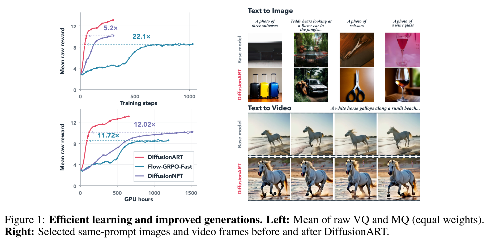

*原论文 Figure 1，第 1 页，直接从 PDF 截取，保留原图与图注。*

- **左侧**：红线是 ART。达到基线后期的同一奖励水平，所需训练步数和 GPU 小时更少。下图约 12 倍的效率提升，特指 HunyuanVideo、视觉质量与运动质量等权重的设置，不是所有模型都快 12 倍。
- **右侧**：相同提示下，展示基础模型与 ART 的图像、视频帧对比。这些是作者挑选的案例，整体表现要结合后面的评估表看。

### 1.2 把生成模型想成“不断修改草稿的画师”

模型不是一下画完，而是从噪声出发，反复预测“下一步怎么改”，逐步得到成品。

这里的几个词只需要这样理解：

- **latent**：图像或视频在模型内部的压缩表示，不是直接可看的 RGB 图片。
- **state / 中间状态**：生成到一半时的 latent。
- **velocity / 速度**：模型预测的 latent 修改方向与幅度，不是画面中物体移动的速度。
- **trajectory / 轨迹**：从起始噪声到最终成品的整条生成过程。

困难在于：**奖励模型通常只给最后的成品打分，不告诉你中间哪一步该怎么改。**

ART 的做法是：

```text
同一个任务，生成多个不同候选
    ↓
给最终成品打分
    ↓
对比候选的最终 latent 与分数，汇总一个共同的改进方向
    ↓
回到这些候选实际走过的中间状态，修正模型的速度预测
    ↓
分两组更新；第二次同时纠偏，并用 mask 拦住过大的向外偏移
```

**高分和低分候选都参与比较，也都可以提供训练状态。不是只留下高分图做监督微调，更不是给每一个生成步骤单独打分。**

### 1.3 它与 Flow-GRPO、DiffusionNFT 有什么不同？

| 方法 | 怎么使用最终反馈 | 本文指出的问题或改进 |
| --- | --- | --- |
| Flow-GRPO | 用最终奖励给轨迹里的采样动作加权，通过概率比更新 | 最终奖励不能精确说明每个动作的贡献，学习效率受限 |
| DiffusionNFT | 给最终成品重新加噪，再训练模型预测速度 | 重新加噪构造的目标与实际生成过程可能不一致，更新里混入并非改善奖励的力量 |
| DiffusionART | 先汇总奖励与终态 latent 的共同方向，再训练真实轨迹上的速度预测 | 不用 NFT 的重新加噪目标，也不用 GRPO 的动作概率比；再加两次更新和 mask 控制偏移 |

ART 的核心不是“另换一个评分器”，而是**改变从最终评分到模型更新的传递方式**。论文主要针对 rectified flow；不能把它的具体速度处理不加改动地套到所有扩散参数化上。

## 2. 方法模块：每一步究竟处理什么

以下源码来自官方公开仓库的固定版本 [`a676204fb48fd4711c8903a8e63573c22998bb96`](https://github.com/vanzll/DiffusionART/tree/a676204fb48fd4711c8903a8e63573c22998bb96)。标为“原始代码”的片段保留原表达式，仅去掉展示所不需要的外层缩进；片段不等于可独立运行的脚本。

公开代码是整理后的实现。其文档也说明，当前公开配置不等于已经复现论文数值。因此下文区分：**论文机制、公开实现、用户给定的教学配置**。

### 2.1 模块一：生成候选，保存真实经过的状态

**输入**：同一个 prompt；条件生成任务还可能有源图等条件；每个候选使用不同的起始噪声。

**操作**：不计算训练梯度，完整生成候选；在指定时刻保存中间 latent 和当时模型给出的速度。

**输出**：最终 latent，以及供后续训练使用的中间状态、旧速度、噪声水平。

原始代码节选：[training/rollout.py，`collect_rollout`](https://github.com/vanzll/DiffusionART/blob/a676204fb48fd4711c8903a8e63573c22998bb96/src/visual_rl/training/rollout.py#L38-L180)。下面是保存轨迹的关键部分：

```python
if len(local_rows):
    rows_at_step = local_rows + start
    source_rows = local_rows.to(state.device)
    states[rows_at_step, slots_at_step] = state[source_rows].float().cpu()
    velocities[rows_at_step, slots_at_step] = velocity[source_rows].float().cpu()
    following[rows_at_step, slots_at_step] = next_state[source_rows].float().cpu()
    means[rows_at_step, slots_at_step] = result.mean[source_rows].float().cpu()
```

记住两个区别：

1. **只保存、训练 4 个时刻，不代表只生成 4 步。** 若设置完整生成 30 步，30 步仍然全部执行。
2. 这些状态是生成过程中真实经过的状态，**不是把最终图片重新加噪造出来的训练状态**。

ODE 采样在模型、初始噪声和其他设置固定时是确定性的；不同候选靠不同初始噪声得到，并不矛盾。

### 2.2 模块二：只给成品打分，再聚合成共同方向

**先打分**：把最终 latent 解码成图片或视频，交给奖励模型。奖励模型只需返回分数，不需要提供梯度。

图像路径的原始代码节选：[training/image.py，`decode_and_score_images`](https://github.com/vanzll/DiffusionART/blob/a676204fb48fd4711c8903a8e63573c22998bb96/src/visual_rl/training/image.py#L83-L132)：

```python
native = adapter.decode(endpoints[start:stop].to(device))
if native.ndim != 4 or native.shape[1] != 3 or not torch.isfinite(native).all():
    raise ValueError("image VAE must return finite BCHW RGB")
pixels = (native.float() / 2 + 0.5).clamp(0, 1)
results.append(score_image_batch(
    scorer, pixels, prompts[start:stop], microbatch=score_microbatch,
    metadata=None if metadata is None else metadata[start:stop],
    evaluation=evaluation,
))
```

**再找方向**：比较同一 prompt 下的候选，汇总“分数越高，终态 latent 倾向往哪边变化”。这就是代码里的协方差方向。

直观上是**靠近高于组内平均分的候选，远离低于平均分的候选**，但不是选中一张最高分图后照着它学，也不等于准确识别了“高分由哪个语义因素造成”。

原始代码节选：[algorithms/covariance.py，L81–94](https://github.com/vanzll/DiffusionART/blob/a676204fb48fd4711c8903a8e63573c22998bb96/src/visual_rl/algorithms/covariance.py#L81-L94)：

```python
numerator = x.new_zeros(group_count, x.shape[1]).index_add_(0, groups, centered[:, None] * x)
denominator = (counts - int(reduction == "unbiased")).clamp_min(1)
covariance = numerator / denominator[:, None]
covariance = torch.where((counts > 1)[:, None], covariance, 0.0)
```

其中 `x` 是展开后的终态 latent，`centered` 是减去本组平均分的奖励，`groups` 表示候选属于哪一个 prompt。**必须先收齐同一任务的候选来算方向，再拆训练小组。**

随后把方向的整体大小标准化，防止某个评分器数值大就天然产生更强的更新。原始代码中的历史归一化路径为：

```python
signal = covariance / torch.where(mad > 0, mad, 1.0)[:, None]
signal_rms = signal.square().mean(1).sqrt()
```

```python
if direction_mode == "historical":
    directions = signal / signal_rms.clamp_min(eps)[:, None]
```

两段分别见 [L92–94](https://github.com/vanzll/DiffusionART/blob/a676204fb48fd4711c8903a8e63573c22998bb96/src/visual_rl/algorithms/covariance.py#L92-L94) 和 [L102–103](https://github.com/vanzll/DiffusionART/blob/a676204fb48fd4711c8903a8e63573c22998bb96/src/visual_rl/algorithms/covariance.py#L102-L103)。`mad` 是组内奖励的平均绝对偏差，`signal_rms` 衡量整条方向的大小。

论文直接标准化协方差；公开代码的历史路径还包含上述中间缩放，协方差默认分母也与论文不同。**在非零信号、没有触及数值下限时，这些正比例缩放会被最后的方向标准化消除；极弱信号时不能声称逐位等价。**

用户代码里的三个返回值可以这样记：

| 返回值 | 含义 |
| --- | --- |
| `d` / `direction` | 标准化后的共同方向，形状与终态 latent 对应 |
| `magnitude` | 对方向再乘的幅度；论文主方法采用单位化指导，公开函数默认此幅度为 1，不是自动再乘一次奖励大小 |
| `active` | 是否有可用的非零指导信号；例如所有候选同分时，没有相对优劣可学习 |

多个奖励同时使用时，公开实现要求**先把奖励按指定权重合成一个分数，再计算共同方向**，不是各自标准化一个方向后随意相加。

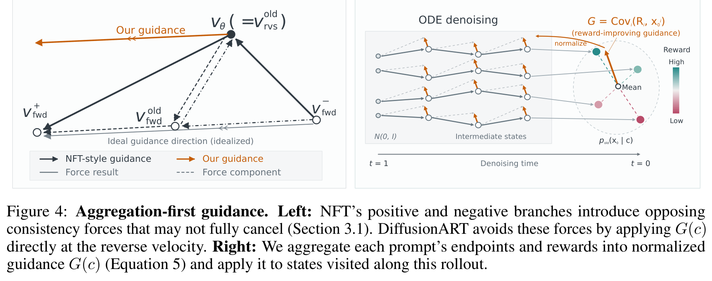

*Figure 4，第 6 页。右图从不同终点汇总方向，再把同一个方向分配给同一 prompt 的中间状态。这里共享的是指导方向，不是把所有轨迹的速度都设成同一个数。*

### 2.3 模块三：把共同方向变成“新的速度答案”

**每个训练状态都有自己的旧速度。ART 在这个旧速度上加一个统一的方向修正，得到这个状态的新目标。**

训练时重新把保存的中间状态送进当前模型，要求新预测接近这个目标。

公开代码节选：[algorithms/art.py，L90–97](https://github.com/vanzll/DiffusionART/blob/a676204fb48fd4711c8903a8e63573c22998bb96/src/visual_rl/algorithms/art.py#L90-L97)：

```python
else:
    target = (old - displacement).detach()
    residual = target - v
    desired_step = residual.detach()
unmasked = weight * residual.square().flatten(1).mean(1)
movement = v - old
energy = movement.square().flatten(1).mean(1)
alignment = (movement * desired_step).flatten(1).mean(1)
```

代码里的 `displacement` 是指导方向乘幅度；`v` 是当前模型预测。默认 `weight` 使用 `sigma`，即当前噪声水平，**不是整数步骤编号**。噪声越大的训练状态权重越高。

只需要读懂三件事：

- `target`：希望模型预测的速度。
- `residual`：当前预测离目标还差多少。
- `detach()`：目标固定，只训练当前预测这一侧；不沿奖励模型或整条生成轨迹反传。

**为什么论文写“加方向”，代码却是 `old - displacement`？**

论文把速度定义为去噪方向；公开采样代码使用的速度约定相反，时间步从高噪声走向低噪声时增量为负。因此对应实现使用减号。不要脱离采样器约定手动改成加号。[采样实现](https://github.com/vanzll/DiffusionART/blob/a676204fb48fd4711c8903a8e63573c22998bb96/src/visual_rl/sampling.py)

### 2.4 模块四：同一批生成结果，分两组各更新一次

**不是把一模一样的训练样本重复训练两遍，而是拆成两个互不重叠的小批次。两次共用本轮生成时冻结的旧预测与目标。**

以用户给的 4 条轨迹为例：

```text
生成时的模型：M0

轨迹 A、B → 在 M0 上训练 → 得到 M1
轨迹 C、D → 在 M1 上训练 → 得到 M2

A、B、C、D 的目标，全部仍由 M0 的旧速度与本轮共同方向构造。
```

为什么第二次能纠偏？因为模型参数是共享的：训练 A、B 后，模型在 C、D 上的预测通常也会变化。第二次不再从“旧速度”出发，而是从“已经变化的当前速度”出发，继续追赶**同一个固定目标**。第一次改得越多，第二次剩下该改的部分就会相应变化；过头时会往回拉。

图像训练器中的原始拆分代码：[backends/sd3.py，L940–943](https://github.com/vanzll/DiffusionART/blob/a676204fb48fd4711c8903a8e63573c22998bb96/src/visual_rl/backends/sd3.py#L940-L943)：

```python
order = torch.randperm(p * k, generator=generator, device=device).cpu().tolist()
windows = prompt_disjoint_windows(
    groups, len(cache.selected), updates=c.algorithm.options.get("updates_per_rollout", 2), order=order
)
```

`p` 是 prompt 数，`k` 是每个 prompt 的候选数。先随机打乱，再由 `prompt_disjoint_windows` 按 prompt 均分到两个更新窗口；每条轨迹携带其全部选中时刻，不能把一条轨迹随意当成多个独立候选。[拆分实现](https://github.com/vanzll/DiffusionART/blob/a676204fb48fd4711c8903a8e63573c22998bb96/src/visual_rl/training/objectives.py#L30-L60)

梯度累积的重点不是“调用多少次 backward”，而是**累积完一个窗口才调用一次 optimizer.step**。[training/update.py](https://github.com/vanzll/DiffusionART/blob/a676204fb48fd4711c8903a8e63573c22998bb96/src/visual_rl/training/update.py#L58-L258) 实现了这一点，并保留原始窗口分母：被 mask 掉的样本贡献零，但不因此缩小平均时的分母。

### 2.5 模块五：mask 只拦“已经偏太远，还想继续往外走”

第二次更新有纠偏能力，但仍可能改得过猛。ART 再加一个开关：

1. 当前预测相对本轮旧预测，是否已经偏移过大？
2. 当前拟合目标所指的更新方向，是否还会让这个偏移继续扩大？

**两个条件同时满足，才屏蔽该训练项；如果正在往回修正，就允许继续。**

公开代码节选：[algorithms/art.py，L134–136](https://github.com/vanzll/DiffusionART/blob/a676204fb48fd4711c8903a8e63573c22998bb96/src/visual_rl/algorithms/art.py#L134-L136)：

```python
masked = (active & corrective_mask_enabled & (energy >= threshold) & (alignment > 0)).detach()
keep = (anchor | (active & ~masked)).detach()
policy = torch.where(keep, unmasked, torch.zeros_like(unmasked))
```

- `energy`：按采样器参考尺度换算的偏移量，不只是未经处理的速度差。
- `alignment > 0`：继续拟合目标会向外走。
- `anchor`：公开实现允许某些没有指导信号的样本仅用于保持旧预测；是否启用取决于具体配置。

论文用一个参考高斯转移构造偏移代理，固定参考噪声参数 0.8、阈值 `1e-5`。**这只是计算 mask 的尺度，实际生成仍然用 ODE，并没有为了 mask 给每步重新加随机噪声。**

第一次更新前，当前预测与本轮旧预测一致，偏移为零；这个 mask 主要在第二次更新时发挥作用。mask 本身不参与求导，也不是额外加一个 KL 损失。

### 2.6 模块六：评分器只会比较“哪张更好”，也能训练

不必让评分器给出可信的绝对分数。对同一 prompt 的候选两两比较：胜者标 1，败者标 0，平局两边都标 0.5；然后使用同一套协方差与训练流程。

公开代码节选：[algorithms/covariance.py，L162–166](https://github.com/vanzll/DiffusionART/blob/a676204fb48fd4711c8903a8e63573c22998bb96/src/visual_rl/algorithms/covariance.py#L162-L166)：

```python
left, right = pair.unbind(1)
label = torch.where(
    scores[left] > scores[right], 1.0, torch.where(scores[left] < scores[right], 0.0, 0.5)
)
labels[left], labels[right] = label, 1.0 - label
```

这段公开辅助函数是**比较已有分数来构造胜负标签**；不应把它误写成已经调用了某个原生双图偏好模型。论文 Algorithm 2 则允许直接查询 pairwise 评分器。

当一个 prompt 只有两个候选时，共同方向可以直观理解成：**从较差候选的 latent 指向较好候选的 latent**。候选更多时，先汇总同一 prompt 的全部配对，再标准化，不是每对各训各的。

## 3. 对照用户的“30 步、4 张、4 个时刻”流程

### 3.1 哪些是 ART，哪些是这次例子的配置？

| 用户代码中的内容 | 核验结论 |
| --- | --- |
| 成品奖励 + 终态 latent → 共同方向 | ART 核心机制 |
| 保存真实中间状态及旧速度，再重新预测训练 | ART 核心机制 |
| 冻结目标，分两组各更新一次 | ART 核心机制 |
| sigma 加权的均方误差，再应用纠偏 mask | 与公开实现默认路径相符；mask 还需要相邻噪声水平等采样器信息 |
| 完整生成 30 步，只训练其中 4 个时刻 | 用户给定配置；不是论文统一默认 |
| 每个任务生成 4 张 | 用户给定组大小；论文有其他组大小及消融 |
| `source` + `prompt`、Qwen 评分 | 用户给定的条件与评分接口；论文主实验是文生图、文生视频、图生视频，不能称其验证了这套 Qwen 图像编辑配置 |
| `loss / 8` | 在每组 2 条轨迹、每条 4 个时刻、各项等权平均的例子里成立；不是 ART 固定常数 |
| `if active` 才训练 | 适用于此处单任务、无零信号 anchor 的简化；公开视频配置还可能保留零信号样本做恢复约束 |

### 3.2 一轮训练的完整伪代码

**教学伪代码，保留用户配置，不是作者原始脚本。** `ART_loss` 表示上一节核验过的默认速度损失与 mask；参数名为便于阅读而简化。模型时间输入必须按其接口转换，不能直接把“第几步”当噪声水平。

```python
# 一个任务；完整生成 30 步，每条轨迹只保留 4 个训练时刻。
selected = 随机不重复抽取(range(30), 数量=4)
sigmas = 生成采样器的噪声水平表(生成步数=30)

with no_grad():
    trajectories = [
        rollout(source, prompt, seed=k,
                sigmas=sigmas, 保存时刻=selected)
        for k in range(4)
    ]
    rewards = [Qwen奖励(source, tr.image, prompt)
               for tr in trajectories]

    # 必须用同一任务全部 4 个候选，先算方向，再拆训练组。
    direction, magnitude, active = 计算协方差方向(
        [tr.final_latent for tr in trajectories], rewards
    )

if active:  # 此例不启用无指导信号样本的恢复 anchor
    for group in 随机分成两组(trajectories):
        optimizer.zero_grad()
        item_count = len(group) * len(selected)  # 此例为 8

        for tr in group:
            for index in selected:
                z = tr.states[index]
                old_v = tr.velocities[index]   # 两次更新都不改这个缓存
                sigma = sigmas[index]
                dt = sigmas[index + 1] - sigma

                v = model(z, 模型时间输入(sigma), source, prompt)
                loss = ART_loss(
                    current_velocity=v,
                    old_velocity=old_v,
                    sigma=sigma,
                    guidance_direction=direction,
                    guidance_magnitude=magnitude,
                    ode_velocity_coefficient=dt,
                )
                (loss / item_count).backward()

        optimizer.step()  # 共两次；不是每个时刻都更新
```

读这段代码时，只抓住四个数量：

- **4 次完整生成**，每次都走 30 步。
- **4 次成品评分**，不是每个中间状态都评分。
- **16 个状态用于训练前向与梯度累积**：4 条轨迹，每条 4 个时刻。
- **2 次参数更新**：每次汇总 8 个训练项。

生成阶段和训练阶段分开：先生成并固定本轮材料，再训练；两次更新之间不重新生成、不重新评分，也不刷新旧速度或共同方向。

**不能保证每个状态都得到精确最优方向。** 论文附录 B.3 明确指出：prompt 级共同方向不必等于每一个中间状态的理想方向。这正是需要状态级恢复与偏移限制的原因。

## 4. 实验结果与原始表格

下表数值均为论文报告，不是本笔记复跑结果。VQ = 视觉质量，MQ = 运动质量，TA = 文本对齐；三者都是奖励模型分数，**不是准确率或人类胜率**。GenEval 评估对象、数量、属性、关系等提示遵循情况；OCR 评估画面文字；PickScore 等评估偏好或图文匹配。

### 4.1 实验设置：不要把不同任务的数字混在一起

| 任务 | 基础模型 | 微调方式 | 生成设置 | 主要奖励 |
| --- | --- | --- | --- | --- |
| 文生图 | SD3.5-M | LoRA，rank 32、alpha 64；学习率 `3e-4` | 512×512，10 步 | GenEval / OCR / PickScore；以及四奖励联合 |
| 文生图扩展 | FLUX.1-dev，12B | LoRA；沿用图像训练设置 | 512×512，6 步；内置 guidance 3.5 | GenEval |
| 文生视频 | CFG-distilled HunyuanVideo-13B | 全参数，学习率 `1e-5` | 每轮 32 prompts，每个 8 视频；53 帧，480×480，8 FPS，16 步 | 主实验 TA:VQ:MQ = 7:2:1；另测 VQ:MQ = 1:1 |
| 图生视频 | LightX2V 发布的 CFG/step-distilled Wan2.1-I2V-14B | 全参数，学习率 `1e-5` | 每轮 32 prompts，每个 8 视频；53 帧，400×640，8 FPS，4 步；FLUX 参考图 | VQ:MQ = 1:1 |

来源：论文 §5.1–5.3。视频使用 VideoReward，训练与评估评分时按 4 FPS 读取；这不同于生成视频的 8 FPS。

### 4.2 文生图：SD3.5-M 曲线与 FLUX 评估表

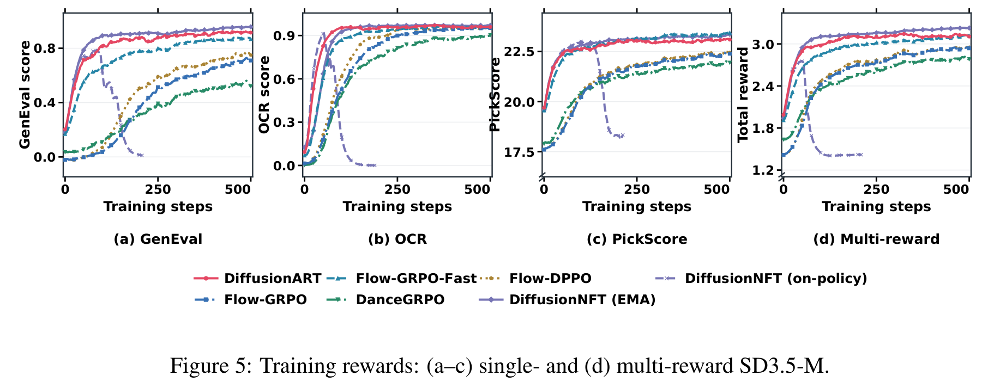

*Figure 5，第 8 页。*

在 SD3.5-M 上，ART 无需按任务调 EMA，效率与**已按任务调好超参**的 NFT（EMA）相近，并避免纯 on-policy NFT 的严重崩塌。不能把这项结果概括成“ART 在所有图像任务都远快于 NFT”。

达到 Flow-GRPO 第 500 步的同一奖励水平时，ART 在 GenEval、OCR、PickScore 上分别使用 **10.0、5.2、9.6 倍更少的训练步数**。这是训练步数比较，不是 GPU 小时比较。

**原论文 Table 2：FLUX.1-dev，step 500 的 GenEval 评估分数。**

| 方法 | Eval reward ↑ |
| --- | ---: |
| Flow-GRPO-Fast | 0.8374 |
| Flow-DPPO | 0.9183 |
| DiffusionNFT（EMA） | 0.8490 |
| **DiffusionART** | **0.9684** |

FLUX 对照保留了 NFT 在 SD3.5-M GenEval 上的 EMA 与 beta 设置，未针对 FLUX 重调。因此这里支持的是 ART 的迁移稳定性优势，不能当作“穷尽 NFT 调参后仍必然达到同样差距”。

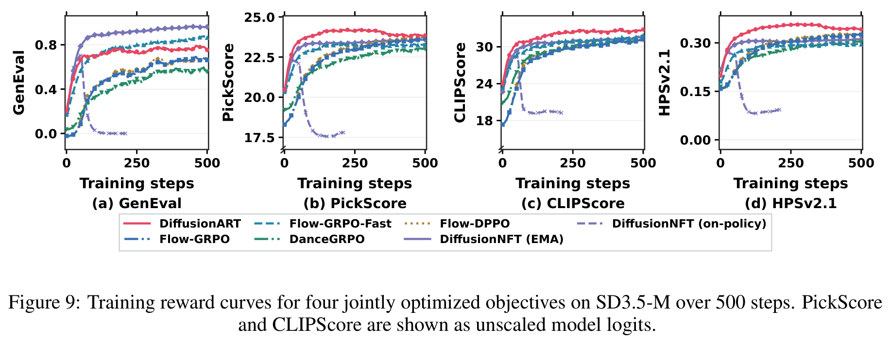

*Figure 9，第 15 页。联合优化 GenEval、PickScore、CLIPScore、HPSv2.1；PickScore 和 CLIPScore 展示的是未缩放 logits，不应拿不同奖励的纵轴直接比较高低。*

### 4.3 文生视频：主实验完整评估表

**原论文 Table 3：HunyuanVideo-13B；训练权重 TA:VQ:MQ = 7:2:1。**

| 方法 | VQ ↑ | MQ ↑ | TA ↑ |
| --- | ---: | ---: | ---: |
| Pretrained | 5.195 | 1.943 | 1.118 |
| Flow-GRPO-Fast | 3.149 | 1.874 | 1.667 |
| DanceGRPO | 3.922 | 1.206 | 1.685 |
| DiffusionNFT（EMA） | 6.827 | 2.683 | 2.096 |
| DiffusionNFT（on-policy） | 5.543 | 1.839 | -4.480 |
| **DiffusionART** | **8.970** | **4.224** | **2.111** |

相对表中最强基线 NFT（EMA），ART 的 VQ 与 MQ 分别提高 **31.4%**、**57.4%**，TA 接近且略高。注意部分基线的 VQ、MQ 低于预训练模型，不能只挑提升项讲。

达到训练 VQ 5.5：ART 用 24 步、63.4 GPU 小时；NFT（EMA）用 273 步、1,401.4 GPU 小时。对应 **11.4 倍步数优势、22.1 倍 GPU 小时优势**；这个 22.1 倍与 teaser 中另一设置的 12.02 倍不是同一个比较。

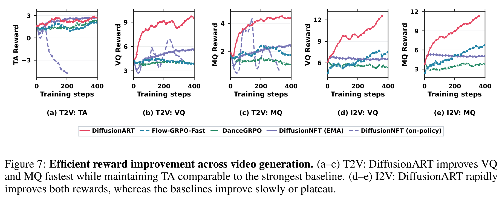

*Figure 7，第 9 页。前三列为文生视频，后两列为图生视频。*

### 4.4 文生视频：视觉与运动等权重，teaser 的效率结果

此处仅优化 VQ:MQ = 1:1，**不含 TA 奖励**。来源：附录 A.5、Figures 1 / 10。

| 比较口径 | DiffusionART | DiffusionNFT（EMA） | Flow-GRPO-Fast |
| --- | ---: | ---: | ---: |
| 最后 50 个训练步的平均原始奖励 | 13.018 | 10.105 | 8.510 |
| ART 相对该基线的平均训练奖励提升 | — | 28.8% | 53.0% |
| ART 达到该基线后期平均奖励所用 GPU 小时的节省倍数 | — | 12.02× | 11.72× |
| 达到训练 VQ 6 的训练步数 | 20 | 50 | 427 |
| 达到训练 VQ 6 的 GPU 小时 | 44.2 | 250.2 | 502.5 |
| 达到训练 MQ 3 的训练步数 | 19 | 33 | 117 |
| 达到训练 MQ 3 的 GPU 小时 | 42.9 | 165.6 | 149.4 |

这里“平均原始奖励”指视觉与运动两项原始分数的等权平均，**不是 Table 3 的独立评估分数**。DanceGRPO 达到 VQ 6 用了 821 步、1,805.5 GPU 小时。

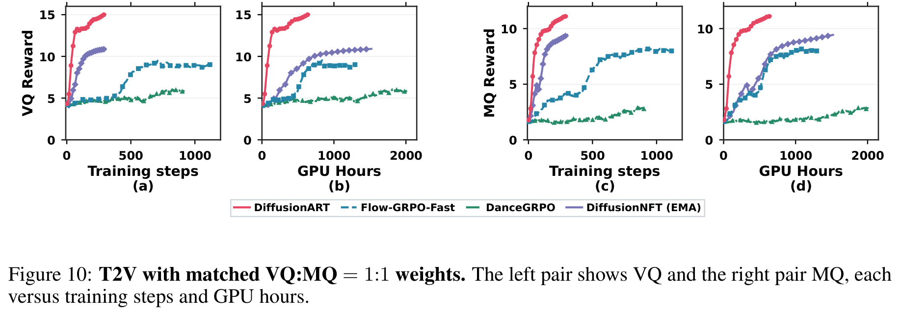

*Figure 10，第 15 页。*

### 4.5 图生视频：完整评估表

**原论文 Table 4：Wan2.1-I2V-14B；VQ:MQ = 1:1。**

| 方法 | VQ ↑ | MQ ↑ |
| --- | ---: | ---: |
| Flow-GRPO-Fast | 5.771 | 4.710 |
| DanceGRPO | 5.123 | 3.266 |
| DiffusionNFT（EMA） | 5.516 | 4.161 |
| **DiffusionART** | **11.196** | **10.476** |

达到训练 MQ 6 时，ART 用 45.8 GPU 小时，Flow-GRPO-Fast 用 220.3 GPU 小时，约 **4.8 倍**效率优势。

### 4.6 与可微奖励优化 ReFL 的补充比较

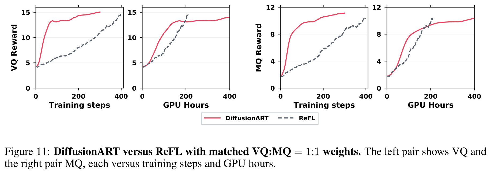

*Figure 11，第 15 页；相同 VQ:MQ = 1:1 权重。*

ART 不需要奖励梯度；ReFL 通过冻结的奖励模型与 VAE，把梯度传回最后一步去噪，之前的步骤截断。

**不能只看步数：** ReFL 每个 prompt 只生成 1 个视频，ART 为 8 个。ART 用更少更新达到较高奖励，但 ReFL 每次更新样本更少且需要奖励反传；GPU 小时曲线中的差距并不等于更新次数差距。论文未给这项比较的独立数值表，保留原曲线而不猜读精确数值。

## 5. 消融实验：每个设计到底有什么用

### 5.1 总表：先看结论，再看原图

此表是依据原文整理的消融索引，不是论文中另有一张同名表。定量数字只采用正文、附录明确报告的值。

| 要验证的问题 | 改动 | 论文观察 | 对应位置 |
| --- | --- | --- | --- |
| NFT 为什么要正负联合训练？ | 只用正分支 / 只用负分支 / 两者一起 | 单独分支崩塌；联合训练明显更稳定，但只能部分抵消额外的一致性作用 | §3.1，Fig. 2 |
| NFT 的 EMA 稳定作用只是因为生成模型更新慢？ | 保留 EMA 生成数据，但移除旧策略锚点 | 仍然崩塌，说明仅用滞后的生成数据不够 | §3.2，Fig. 3(b) |
| NFT 不用 EMA，只做两次更新能否稳定？ | 每轮一次改成两次不重叠更新，beta = 1 | 观察窗口内不崩塌，但达到 OCR 0.9 从 21 步变为 320 步，慢 15.2 倍 | §3.2，Fig. 3(a) |
| NFT 两次更新为何变慢？ | 分析奖励指导与恢复项 | 恢复项输出空间 RMS 小 9.4 倍，聚合后的参数梯度范数却大 4.9 倍；作者认为指导信号相互抵消可能造成低效 | §3.2，Fig. 3(c) |
| ART 的第二次更新是否必要？ | ART 一次更新 vs 两次更新 | 一次更新学得快但逐渐退化；两次更新保持长期稳定 | §5.1，Fig. 6(b) |
| 两次更新本身就够了吗？ | ART 两次 vs NFT 两次，后者 beta 调为 0.1 | NFT 曾短暂崩至近零后恢复；ART 更稳，说明指导方式也重要 | §5.1，Fig. 6(b) |
| 视频上的 mask 有什么用？ | 只去掉 mask，保留方向归一化、时间权重、两次更新 | 无 mask 在约 200 步附近下降后恢复；有 mask 更平稳 | §5.2，Fig. 8 |
| 图像任务也必须用 mask 吗？ | SD3.5-M 与 FLUX 去掉 mask | 仍有效，有时略快；FLUX 无 mask 在第 180 步达到训练 GenEval 0.971 | 附录 A.6，Fig. 12 |
| mask 是否真的控制了偏移？ | 对比梯度和速度偏移诊断 | 前 300 步中，第一次更新的最大梯度范数：有 mask 1.96，无 mask 3.33；无 mask 偏移尖峰更多 | 附录 A.7，Fig. 13 |
| 每个 prompt 的候选必须很多吗？ | Pairwise 的 K = 2 / 4 / 8 | 该设置下 K = 2 的最终 VQ 不低于 K = 8，GPU 小时约少 3.4 倍；并非 K 越大必然越好 | §5.2，Table 1 |
| 应全 prompt 汇总，还是每对单独算方向？ | 24 张组成 12 对，比较两种指导方式 | 第 400 步 held-out GenEval：全 prompt 汇总 0.91，每对单独处理 0.78 | 附录 C.3，Fig. 14 |

**需要保留的反例：mask 并非所有图像任务都提高速度；更多候选也不保证更高分。**

### 5.2 NFT 诊断：正负分支、EMA 与恢复

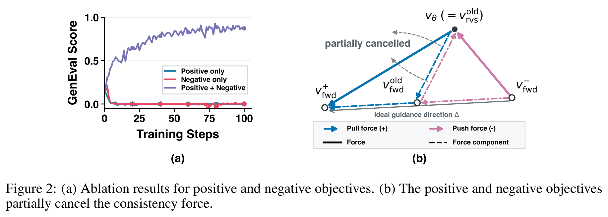

*Figure 2，第 4 页。单独的正或负分支很快失效；联合训练较稳。右图解释两者相反的一致性作用如何只被部分抵消。*

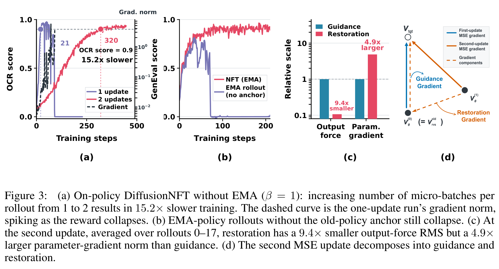

*Figure 3，第 5 页。要区分“有稳定作用”和“学得高效”：NFT 两次更新可以改善稳定性，但该实验里明显拖慢奖励提升。*

### 5.3 ART 的指导与两次更新

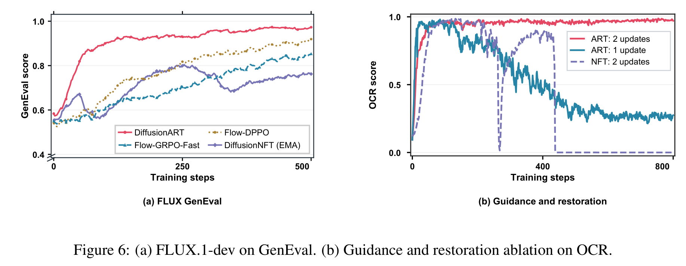

*Figure 6，第 8 页。右侧比较 ART 一次、ART 两次、NFT 两次更新。结论不是“所有算法多训一次都变好”，而是 ART 的共同指导与第二次恢复相配合。*

### 5.4 mask：视频中更重要，图像中不一定更快

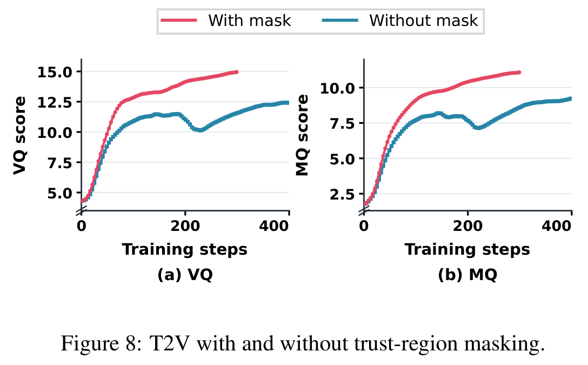

*Figure 8，第 10 页，HunyuanVideo、VQ:MQ = 1:1。*

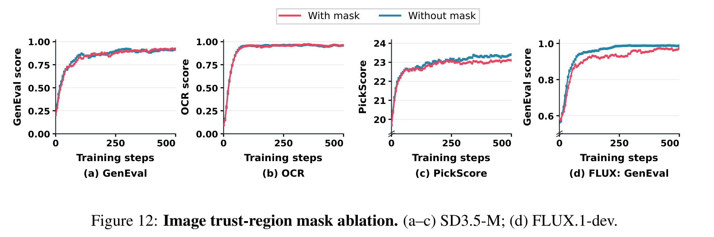

*Figure 12，第 16 页。图像任务去掉 mask 仍可学习，部分曲线更快。*

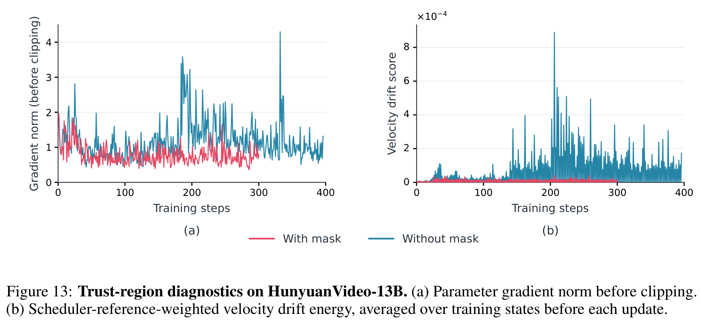

*Figure 13，第 16 页。mask 虽主要在第二次更新起作用，但它也影响后续轮次模型所处的位置，因此后续第一次更新的梯度尖峰同样可能减少。*

### 5.5 原论文 Table 1：标量与 Pairwise、组大小消融

**设置：只优化 VQ，step 400 评估。不是 VQ:MQ = 1:1 的训练结果。**

| 方法 | GPU Hours ↓ | VQ ↑ |
| --- | ---: | ---: |
| Scalar，K = 8 | 891.1 | **13.637** |
| Pairwise，K = 2 | **260.8** | 12.235 |
| Pairwise，K = 4 | 465.6 | 10.883 |
| Pairwise，K = 8 | 883.3 | 12.092 |

正确解读：**两两偏好反馈能有效训练，且这个实验里每个 prompt 只有一对候选就很省算力。** 但 scalar K = 8 的最终 VQ 更高，不能说 pairwise 全面超过标量奖励。

### 5.6 全 prompt 汇总，优于每对单独指导

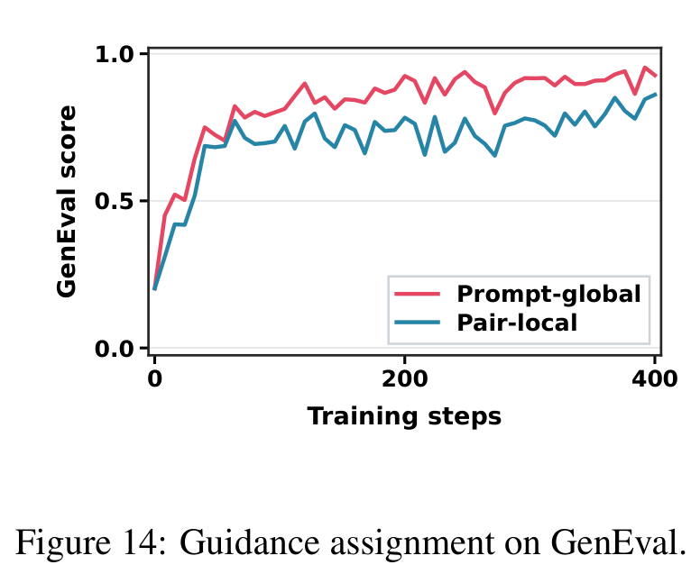

*Figure 14，第 20 页，GenEval，每个 prompt 24 张图、12 对。*

| 指导方式 | 第 400 步 held-out GenEval ↑ |
| --- | ---: |
| Prompt-global：先汇总 12 对，再标准化一个共同方向 | **0.91** |
| Pair-local：每对各自标准化，只指导本对轨迹 | 0.78 |

这也是标题里 **Aggregation-First（先聚合）** 的直观含义：先把同一任务的证据汇总，减少每一小对候选各自方向的噪声，再分配到生成过程。

---

**最后记住：ART 学的不是“某张好图的标准答案”，而是“根据一组候选的优劣，当前生成过程应该往哪里调整”；第二次更新负责结合已经发生的变化纠偏，mask 防止继续偏得过远。**

### 来源与代码许可

- 论文与全部图表：[arXiv:2610.12572v1](https://arxiv.org/pdf/2610.12572v1)。正文与附录共 23 页；本文四张原始数据表对应 Tables 1–4，其他表是注明来源的整理。
- 公开实现版本：[a676204fb48fd4711c8903a8e63573c22998bb96](https://github.com/vanzll/DiffusionART/tree/a676204fb48fd4711c8903a8e63573c22998bb96)。[算法实现说明](https://github.com/vanzll/DiffusionART/blob/a676204fb48fd4711c8903a8e63573c22998bb96/docs/algorithm-provenance.md)、[图像配方说明](https://github.com/vanzll/DiffusionART/blob/a676204fb48fd4711c8903a8e63573c22998bb96/docs/paper-image.md)、[视频配方说明](https://github.com/vanzll/DiffusionART/blob/a676204fb48fd4711c8903a8e63573c22998bb96/docs/paper-video.md)。未运行模型训练，不把源码阅读当作论文结果复现。
- 原始代码片段：Copyright 2026 DiffusionART contributors，Apache-2.0；[许可副本](./assets/diffusionart/CODE-LICENSE.txt)。项目包含第三方派生工作，完整归属见上游 [THIRD_PARTY_NOTICES.md](https://github.com/vanzll/DiffusionART/blob/a676204fb48fd4711c8903a8e63573c22998bb96/THIRD_PARTY_NOTICES.md)。本笔记的教学伪代码另有明确标记；论文原图的归属不由代码许可替代。
