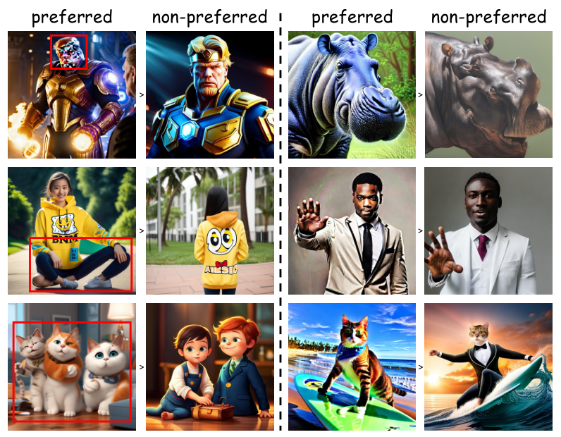
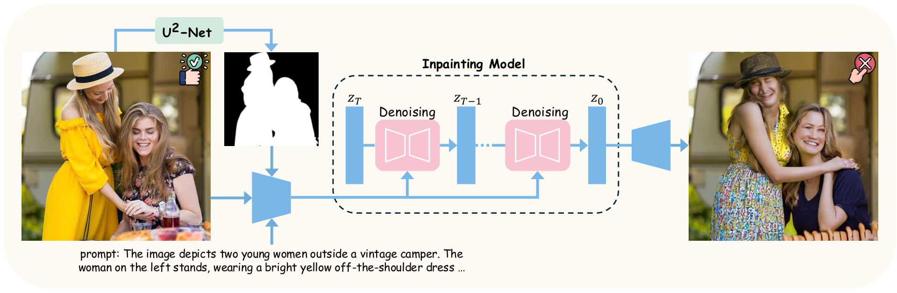
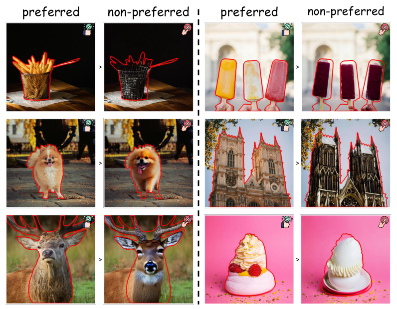
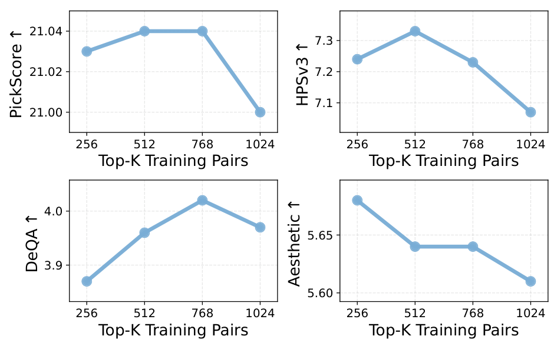

# RealAlign：利用真实数据进行扩散模型对齐

**论文：** When Preference Labels Fall Short: Aligning Diffusion Models from Real Data  
**论文链接：** https://arxiv.org/abs/2605.19839  
**研究方向：** Text-to-Image、Real Data Alignment、Diffusion-DPO

## 1. 研究背景与动机

传统 T2I 偏好优化通常采用同一个 Prompt 生成多张图片，再通过人工标注或 Reward Model 选择 Winner 和 Loser。然而，这种方法存在一个问题：Winner 只是相对 Loser 更好，并不意味着它本身符合真实世界的视觉质量要求。

例如，同一个 Prompt 生成两张人物图片，一张有六根手指，另一张有七根手指。即使选择前者作为 Winner，模型仍然没有学习到真正正确的人体结构。

另一方面，真实摄影数据具有较高的视觉真实性，可以提供更可靠的优化目标。但是，真实图片与预训练 T2I 模型的生成分布存在 Domain Gap，直接进行真实图像与生成图像的偏好优化可能存在困难。

因此，论文提出 RealAlign，通过两个阶段逐步完成生成模型与真实数据的对齐：

1. Distribution Alignment：首先缩小生成分布与真实图像分布之间的差异。
2. Pairwise Preference Learning：再利用真实图像与退化图像构建 Preference Pairs，学习细粒度视觉质量偏好。

## 2. 核心方法

### 2.1 整体框架

RealAlign 分为两个训练阶段：

**Stage 1：Distribution Alignment**

使用真实图片作为正向数据，当前生成模型生成的图片作为对照数据，通过 Diffusion-DRO 进行分布级对齐。

目标：让模型生成分布逐渐接近真实图像分布。

**Stage 2：Pairwise Preference Learning**

利用真实图片构建 Winner，通过局部 Inpainting 生成对应的退化图片作为 Loser，使用 Diffusion-DPO 进行偏好优化。

目标：让模型学习真实图片相对于退化图片的视觉质量优势。

两个阶段的关系是：先学习真实图像分布，再学习细粒度视觉质量偏好。

## 3. 核心数据构建：Real Preference Pairs

这是论文最值得借鉴的部分。

### 3.1 Winner 数据来源

论文使用 HPDv3 中的真实摄影图像作为基础数据。

选择真实摄影数据的原因：
- 具有较好的图像质量。
- 能够提供真实世界的视觉分布。
- 不需要依赖其他 T2I 模型生成 Winner。
- 可以作为局部图像退化的原始参考。

### 3.2 第一级筛选：Colorfulness

作者使用 Colorfulness 作为图像质量筛选指标。

保留色彩丰富度高于数据集平均值的图片：

$$
D_{\mathrm{real}}=
\{x_i\mid C(x_i)>\overline C\}
$$

其中，$C(x_i)$ 表示图像色彩丰富度，$\overline C$ 表示数据集平均值。

这一筛选主要用于排除色彩过于单调的图片，并不直接评价图像的解剖结构或整体美学质量。

### 3.3 第二级筛选：显著区域定位

作者使用 U²-Net 提取图像中的显著区域：

$$
M=\operatorname{U^2Net}(x_{\mathrm{real}})
$$

其中：
- 输入：真实图像。
- 输出：显著区域 Mask。

Mask 用于确定后续需要进行局部重绘的区域。

### 3.4 第三级筛选：Inpainting 生成 Loser

作者使用 Stable Diffusion 1.5 Inpainting，对显著区域进行局部重绘：

$$
x_{\mathrm{deg}}=
\operatorname{Inpaint}(x_{\mathrm{real}},M,c)
$$

其中：
- $x_{\mathrm{real}}$：原始真实图片。
- $M$：显著区域 Mask。
- $c$：文本条件。
- $x_{\mathrm{deg}}$：局部重绘后的退化图片。

这里不是重新生成整张图片，而是在保留原图其他区域的情况下，对指定区域进行重新生成。

因此，原始图片和退化图片在整体内容、构图和背景方面具有较高的一致性，而局部视觉质量可能存在差异。

最终构成：

$$
P_i=(x_i^w,x_i^l,c_i)
$$

其中：
- $x_i^w=x_{\mathrm{real}}$：原始真实图片，Winner。
- $x_i^l=x_{\mathrm{deg}}$：局部重绘图片，Loser。
- $c_i$：对应文本条件。

### 3.5 第四级筛选：PickScore 差异过滤

作者使用 PickScore 衡量原始真实图片和退化图片的文本图像偏好分数。

保留条件：

$$
S_{\mathrm{Pick}}(x_i^w,c_i)
-
S_{\mathrm{Pick}}(x_i^l,c_i)>0.02
$$

如果两张图片的 PickScore 差异过小，说明局部退化可能不够明显，因此丢弃该 Pair。

注意：PickScore 在这里主要用于筛选退化效果明显的样本，而不是负责生成所有偏好标签。

### 3.6 第五级筛选：Winner 排序

在通过前面筛选的 Pair 中，作者按照 Winner 的 PickScore 排序，选取最高分的 512 组作为最终偏好训练数据。

完整流程：

$$
\boxed{
\text{HPDv3}
\rightarrow
\text{Colorfulness}
\rightarrow
\text{U}^2\text{-Net}
\rightarrow
\text{Inpainting}
\rightarrow
\text{PickScore Filter}
\rightarrow
\text{Top-512}
}
$$

最终得到 512 组真实图片与局部退化图片构成的 Preference Pairs。

## 4. 两阶段训练方法

### 4.1 Stage 1：Distribution Alignment

这一阶段不使用前面构建的 512 组 Inpainting Pairs。

数据包括：

- 真实图像：来自真实摄影数据。
- 生成图像：由当前 T2I 模型生成。

使用 Diffusion-DRO 进行分布级优化，使模型生成分布逐渐靠近真实数据分布。

其核心思想是：不必一开始就构建精细的 Winner / Loser 关系，而是先利用真实数据与模型生成数据之间的分布差异，调整模型生成分布。

### 4.2 Stage 2：Pairwise Preference Learning

使用前面构建的 512 组 Preference Pairs：

$$
(x_{\mathrm{real}},x_{\mathrm{inpaint}})
$$

分别作为 Winner 和 Loser，采用标准 Diffusion-DPO 进行训练。

DPO 的核心目标是提高 Winner 相对于 Loser 的生成偏好概率：

$$
\mathcal L_{\mathrm{DPO}}
=
-\mathbb E
\left[
\log\sigma
\left(
\beta
\left(
\Delta_\theta-\Delta_{\mathrm{ref}}
\right)
\right)
\right]
$$

其中：

$$
\Delta_\theta=
\log\frac{p_\theta(x^w|c)}{p_\theta(x^l|c)}
$$

$$
\Delta_{\mathrm{ref}}=
\log\frac{p_{\mathrm{ref}}(x^w|c)}
{p_{\mathrm{ref}}(x^l|c)}
$$

这里：
- $p_\theta$：当前待优化模型。
- $p_{\mathrm{ref}}$：参考模型。
- $x^w$：真实图片。
- $x^l$：局部退化图片。
- $\beta$：偏好优化强度。

对于扩散模型，实际训练通过扩散去噪目标构造相应的偏好损失，而不是直接运行一个显式的图像概率计算器。

## 5. 实验结果

论文主要使用 Stable Diffusion 1.5 和 Stable Diffusion 3.5 Medium 进行验证。

论文报告的主要 HPSv3 结果：

| 方法 | Preference Pairs | SD1.5 HPSv3 | SD3.5 Medium HPSv3 |
|---|---:|---:|---:|
| Base | 0 | 5.98 | 10.03 |
| Diffusion-DPO | 851K | 6.80 | 10.79 |
| RealAlign | 512 | 7.33 | 12.77 |

主要结论：

1. 仅使用 512 组经过精心构建的真实数据偏好对，就取得了较好的优化效果。
2. 在论文报告的 HPSv3 实验中，RealAlign 超过了对应的 Diffusion-DPO 对照。
3. 说明真实图像经过适当处理，可以形成有效的偏好监督，不一定需要大规模人工 Winner / Loser 标注。

需要注意：512 组 Pair 的效果依赖于前面的真实图像筛选、局部退化生成和质量过滤，并不意味着任意 512 组真实图像都能获得相同效果。

## 6. 方法局限与研究思考

### 6.1 论文数据构建的局限

**第一，显著区域不等于结构异常区域。**

U²-Net 只负责识别显著区域，并不理解人体解剖结构。它可能选择脸部、衣服、背景或其他视觉显著区域。

**第二，Inpainting 不保证一定生成结构错误。**

局部重绘可能改变图像风格、纹理、光照，也可能生成另一张同样合理的图片。

**第三，PickScore 不是人体结构评价器。**

PickScore 更关注图文匹配与整体偏好，不能保证 Loser 确实存在人体结构异常。

因此，RealAlign 原始数据构建方式不能直接等同于人体结构异常 Preference Pair 构建。

### 6.2 对 SeFi-Image 人体结构优化的启发

可以将 RealAlign 的数据构建方法改造成 Anatomy-guided Preference Construction。

| 环节 | RealAlign | 人体结构优化改进 |
|---|---|---|
| Winner | HPDv3 真实摄影 | 高质量真实人体摄影 |
| 区域定位 | U²-Net | 人体解析、手部检测、人体姿态估计 |
| Loser | SD1.5 Inpainting | 针对人体部位进行局部结构退化 |
| 初步筛选 | PickScore | 文本一致性与图像质量筛选 |
| 异常验证 | 通用偏好差异 | 人体结构异常检测与人工复核 |
| Pair 选择 | Winner PickScore Top-512 | 人体结构正确性、图像质量、内容一致性联合筛选 |

建议重点构建以下异常类别：

- 数量异常：多余手指、缺失手指、多余肢体。
- 形态异常：手掌、脚部及肢体变形。
- 连接异常：肢体融合、身体部位连接错误。
- 姿态异常：关节位置错误、不合理弯曲。
- 多人交互异常：人物之间的肢体混淆和错误融合。

### 6.3 值得开展的实验

1. Real-to-Generated：真实人体图片作为 Winner，SeFi-Image 生成的异常图片作为 Loser。
2. Real-to-Inpainted：真实人体图片作为 Winner，局部结构退化图片作为 Loser。
3. Generated-to-Generated：SeFi-Image 生成的正常人体图片作为 Winner，异常人体图片作为 Loser。
4. 比较三种 Pair 的优化效果，判断真实数据监督和局部结构控制对人体结构生成的贡献。

## 7. 核心结论

RealAlign 的主要贡献不是提出新的 DPO 损失，而是提出了一套从真实图像构建高质量 Preference Pairs 的方法，并通过两阶段训练解决真实数据与生成数据之间的分布差异。

其核心数据构建逻辑是：

**真实图像筛选 → 显著区域定位 → 局部 Inpainting → PickScore 过滤 → 高质量 Pair 选择。**

对人体结构生成任务而言，最值得借鉴的是：通过真实图像构造内容高度对应的局部退化样本，让 Winner 和 Loser 之间的差异尽可能集中在希望优化的视觉属性上。
