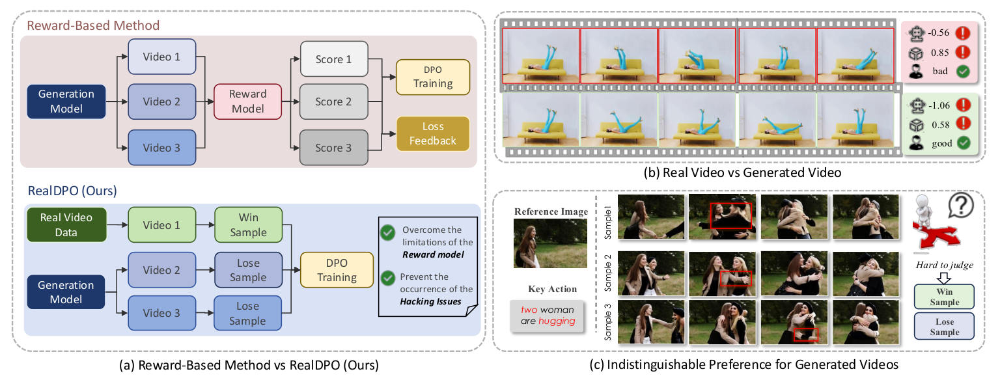
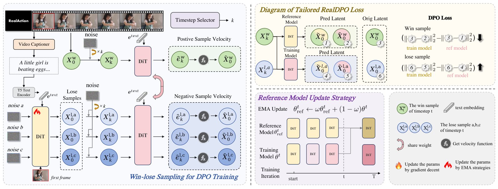
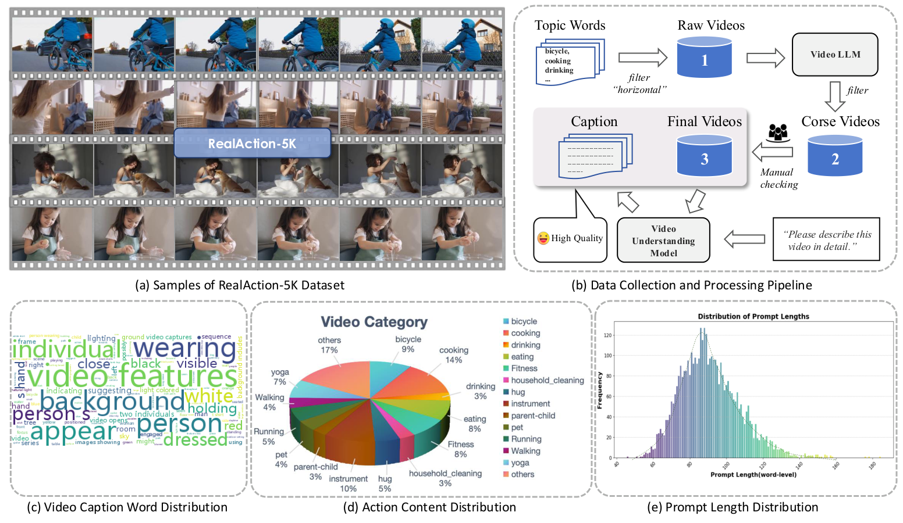

# RealDPO：用真实数据替代生成样本作为 Win

**论文：** RealDPO: Real or Not Real, that is the Preference  
**论文：** https://arxiv.org/pdf/2510.14955  
**代码：** https://github.com/Vchitect/RealDPO

## 1. 核心 Insight

传统 DiffusionDPO 从同一个 Prompt 的多个生成结果中选出 Win 和 Lose。

**问题是：如果模型生成的所有结果都很差，那么选出来的 Win 依然是有缺陷的。** 模型只是在学习“相对没那么差”的结果，而不是真正正确的结果。

**RealDPO 的思路：直接使用真实数据作为 Win，模型生成的数据作为 Lose。**

这样不需要额外的 Reward 模型来挑选正样本，也避免了优化固定 Reward 时的一类 Reward Hacking。



## 2. 核心方法

**一句话主流程：**

真实视频 → 生成对应 Caption → 模型根据相同 Caption 生成 3 个负样本 → 真实视频作为 Win、生成视频作为 Lose → 分别加噪并计算预测误差 → DPO 更新模型。



训练数据来自 RealAction-5K，约 5000 段真实人体动作视频。作者先筛选真实视频，再生成详细 Caption，用相同 Caption 离线生成负样本。



**训练时不需要每一步重新 Rollout**，直接使用保存好的正负样本 latent。

## 3. Loss 怎么理解？

```python
win_delta = win_error - ref_win_error
lose_delta = lose_error - ref_lose_error

margin = lose_delta - win_delta
loss = -F.logsigmoid(scale * margin)
```

其中：

- `win_delta`：当前模型相比参考模型，还原真实视频的误差变化。
- `lose_delta`：当前模型相比参考模型，还原生成视频的误差变化。
- `margin`：模型对真实视频相对于生成视频的偏好改善程度。

**Margin 越大，Loss 越小。**

例如：

| | 参考模型误差 | 当前模型误差 |
|---|---:|---:|
| Win | 10 | 6 |
| Lose | 10 | 12 |

真实视频误差下降 4，生成视频误差上升 2，因此 Margin = 6。

### 梯度到底在做什么？

**Win：** 让模型更准确地还原真实视频。

**Lose：** 给出与拟合生成负样本相反的训练信号。

两种梯度组合后更新模型。相对于 SFT，RealDPO 增加了负样本梯度，并用参考模型控制相对偏好。

需要注意：优化的是整体相对偏好，不保证每一步 Win 误差都下降、Lose 误差都上升。

## 4. 对我当前 5B T2I 实验的启发

目前的主要问题是**人体结构、手部、复杂姿态和多人交互错误**，而 RealGen、HPSv3++ 等 Reward 又容易引起 Reward Hacking。

RealDPO 提供了一条不同路线：

**不再完全依赖 Reward 判断生成图像是否正确，而是用真实、人体结构正确的图像作为 Win，5B 生成的错误图像作为 Lose，直接进行偏好优化。**

但有一个关键风险：

**真实 Win 和生成 Lose 不只在人体结构上存在差异，还可能有背景、姿态、光照等差异。** RealDPO 的梯度作用于整个图像，不会自动只纠正错误的手或肢体。

因此，最值得验证的是：

**RealDPO 能否比直接使用真实图像做 SFT，更有效地改善 5B 的人体结构？**

最小实验只需三个对照：

| 方法 | 目的 |
|---|---|
| 5B Base | 原始基线 |
| 真实人像 SFT | 验证真实数据本身的价值 |
| RealDPO | 验证负样本偏好优化是否带来额外收益 |

三组使用相同的困难 Prompt 进行评测，重点比较人体结构正确率、多人交互、真实感和多样性。

**最终结论：RealDPO 最值得借鉴的不是新的 Loss，而是改变偏好数据的构造方式——直接把真实数据作为可靠的 Win。**
