# DanceOPD：在学生自己走到的状态上，向一个老师学习去噪方向

- 论文：Wei Zhou et al., [DanceOPD: On-Policy Generative Field Distillation，arXiv:2606.27377v3](https://arxiv.org/abs/2606.27377v3)；下文页码均为这份 **42 页 PDF** 的页码。
- 官方源码：[worldbench/DanceOPD](https://github.com/worldbench/DanceOPD/tree/f856e877ef3e09b688414b4a8592023c6c1c6f14)，固定 commit：`f856e877ef3e09b688414b4a8592023c6c1c6f14`。
- 核验范围：论文方法、主结果、实验附录及官方训练代码；**没有运行训练或独立复现指标**。代码节讲实际 `danceopd` 分支，不把 README 示意代码当训练实现，也不把公开 smoke run 当论文复现。

## 1. 先通俗理解：把几个老师的本领，练进同一个学生

希望最终只部署一个模型：既能根据文字画图，又能修改已有图片；修改时，既能只改局部属性，又能进行换背景、换风格等全局变化。难点是这些要求会冲突：学会“大改”，可能破坏“不该改的地方”；加入编辑训练，也可能损伤原来的文生图能力。

DanceOPD 不要求每次都把所有老师的答案混在一起。它做的是：

> **每次选一个老师，在学生自己的生成过程中，挑一个接近成图的时刻，学习老师的去噪方向。**

```text
选定任务/数据桶及对应老师
→ 学生从随机噪声出发，无梯度地生成一段轨迹
→ 选一个偏低噪声的中间状态 z_t
→ 老师和学生接收相同的 z_t、t 和条件
→ 老师无梯度给出速度 target，学生有梯度重算速度 pred
→ 速度 MSE，只更新学生
```

这里的“方向”是整块 latent 的**速度张量**，包含方向和大小，不是一个分类标签，也不是最终成品图片。老师**不把学生预测的速度当输入**；它看的是学生已经走到的状态。学生 rollout 本身不保留反传图，不需要把 loss 反传穿过整条生成过程。

### 原始 teaser：效果与代价要一起看

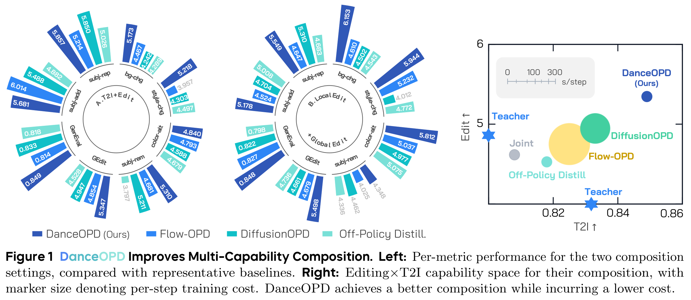

*Wei Zhou et al., DanceOPD v3，Figure 1，[PDF 第 1 页](https://arxiv.org/pdf/2606.27377v3#page=1)，原 PDF 裁剪截图，保留原图例与说明。*

- **左侧两组环形柱图**：A 是 T2I＋Edit，B 是 Local＋Global Edit。GEdit 是编辑六类评分的平均，GenEval 是文生图综合分，均越高越好；比较 DanceOPD、Flow-OPD、DiffusionOPD、Off-Policy Distillation。不同指标量纲不同，不把柱长直接当统一收益。
- **右侧散点图**：横轴 T2I、纵轴 Edit，越靠右上综合表现越好；另画教师、Joint Training 等参照。气泡大小表示每个训练 step 的耗时，**不是推理延迟**。教师星号是能力参照，不能把它们在另一轴的示意位置当完整评测结果。
- 图想说明的是“较好的能力折中＋较少的训练开销”，不是“每个子项都第一”。完整数值和不利项见第 3 节；teaser 中一处 GenEval 标注与 Table 2 的差异见 4.5 节。

### 谁是老师，谁是学生？三种设置不能混用

| 设置 | 冻结教师/能力来源 | 学生及初始化边界 |
|---|---|---|
| 论文主实验：Z-Image，T2I＋Edit | Z-Image T2I；在完整 OmniEdit 上训练的 joint Edit 教师 | 一个 Z-Image 学生；两桶 1:1。§4.4 描述所用最终学生为 edit-initialized，但 Table 2 未给出精确初始化 checkpoint；官方主表模板也保留未指定路径，不能自行补成某个公开权重 |
| 论文主实验：Z-Image，Local＋Global | OmniEdit 属性子集训练的 Local 教师；风格子集训练的 Global 教师 | 一个 Z-Image 学生；两桶 1:1。主表精确初始化不补猜；诊断实验明确从 attribute/local-edit SFT LoRA 初始化，不能自动推广到所有主表行 |
| 论文三桶诊断 | Local、Global、T2I 三个场 | Local Edit 初始化；三桶 1:1:1，用于路由、loss、query 等消融；不是主表两个实验的同义写法 |
| 论文真实感吸收：SD3.5-M | 全参数训练的 realism 教师 | SD3.5-M 学生；官方 `paper/sd35_realism_absorption.yaml` 设 `init: base`；该教师未发布，不等于公开 FlowGRPO 专家 |
| 仓库 public SD3.5-M smoke | 公开 FlowGRPO OCR / GenEval LoRA 教师 | **先用 OCR expert warm-start**，再训练新 LoRA；4 步 rollout、rank 8、2 次训练更新，仅供跑通代码 |
| 仓库 public Z-Image smoke | 可下载的 Z-Image-Turbo / adapter 替代资产 | 是可运行替代品，不是论文 Z-Image 编辑教师或学生的精确权重 |

定位：论文 §8.5–8.6（[第 29–30 页](https://arxiv.org/pdf/2606.27377v3#page=29)）、§4.4（[第 18 页](https://arxiv.org/pdf/2606.27377v3#page=18)），以及官方 [paper 配置说明][paper-readme]、[public SD35 配置][public-sd35]、[public Z-Image 配置][public-zimage]。论文编辑教师 LoRA 和学生 checkpoint 未随本版本发布。

**公开 SD35 的 OCR warm-start，不是我们另一个项目采用的 base 初始化。** 更不能把它与论文 realism 教师、主表 Z-Image 权重串成同一套实验。

## 2. 按一次真实更新理解方法与源码

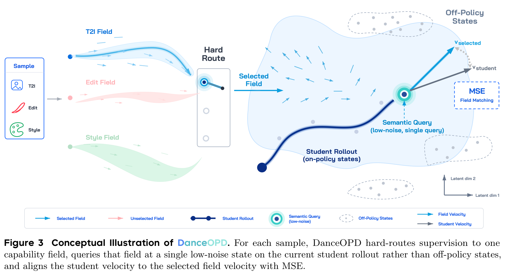

*Wei Zhou et al., DanceOPD v3，Figure 3，[PDF 第 7 页](https://arxiv.org/pdf/2606.27377v3#page=7)，原 PDF 截图。*

左边 `Hard Route` 选中一个教师场；右边圆点是学生当前走到的状态，两根箭头分别是教师和学生在**这个点**预测的速度，MSE 缩小两者差距。虚线圈中的 off-policy states 不在本次学生轨迹上。

下面主要用较清楚的 **SD3.5 Diffusers 后端**讲共用算法；它是 T2I-only。论文主实验使用 Z-Image，编辑条件另在 2.4 节对照其真实实现。所有代码链接均锁定上述 commit；代码片段是函数内部摘录或明确标注的删减版，不是可独立运行的脚本。

### 2.1 先准备模型：老师固定，学生只训练 LoRA

**输入**是基模、学生初始化权重、各教师 checkpoint/LoRA。**输出**是冻结教师与带可训练 LoRA 的学生。这样教师目标不会跟着学生更新而漂移。

[SD35 `prepare()` L73–86][sd35-prepare]，原代码摘录：

```python
student.requires_grad_(False)
target_modules = self.cfg.student.lora_target_modules or [
    "to_q", "to_k", "to_v", "to_out.0",
    "add_q_proj", "add_k_proj", "add_v_proj", "to_add_out",
]
lora_rank = int(self.cfg.student.lora_rank)
lora_alpha = int(self.cfg.student.lora_alpha or lora_rank)
lora_cfg = LoraConfig(
    r=lora_rank,
    lora_alpha=lora_alpha,
    init_lora_weights="gaussian",
    target_modules=target_modules,
)
student.add_adapter(lora_cfg)
```

先冻结学生已有参数，再加入新的可训练 adapter；后面的 AdamW 只接收 `requires_grad=True` 的参数。若指定 OCR warm-start，源码 L59–71 会先加载并合并它，再加上述新 LoRA。文本编码器和 VAE 也不训练。

教师由 [teacher.py L124–149][teacher-compose] 构造，下面是**两个函数内关键语句的删减并列摘录**（注释为讲解补充）：

```python
# merge_lora() 内：
teacher = PeftModel.from_pretrained(module, resolved, is_trainable=False)
teacher = teacher.merge_and_unload()
log(f"{label} PEFT LoRA merged")
return teacher

# compose_teacher() 内：
load_full_checkpoint(module, teacher_cfg.get("base_ckpt"), label=label, log=log)
module = merge_lora(module, teacher_cfg.get("lora_dir"), label=label, log=log)
return module.to(device).eval().requires_grad_(False)
```

PEFT LoRA 可以先合入教师，再 `.eval().requires_grad_(False)`。Z-Image 的 raw-LoRA 分支则显式注入、加载 LoRA 后冻结，不能泛称所有教师 adapter 都已经 merge。无论哪种装载形式，蒸馏时只更新学生。

### 2.2 选老师和数据桶：一次 optimizer update 默认只有一个 route

这里不是用一个分类器读 prompt 后“智能挑老师”，而是先抽预定义 route，再从对应数据桶取样。T2I 桶查 T2I 教师；编辑桶查相应编辑教师。

[`WeightedRouter.sample/accumulation_routes` L39–45][routing]，原代码摘录：

```python
def sample(self) -> Route:
    return random.choices(self.routes, weights=[r.weight for r in self.routes], k=1)[0]

def accumulation_routes(self, groups) -> list[Route]:
    """Resolve G=M capability groups without breaking data/teacher binding."""
    if not groups:
        return [self.sample()]
```

默认不设 `accumulation_groups`，只返回一个 route。引擎 [engine.py L122–147][engine] 将这一 route **共享给本次更新的所有梯度累积 microbatch**；多卡时由主进程抽取并广播给其他进程。以下为该区间的**删减摘录**，省略日志及源图缺失检查，保留 route 广播：

```python
groups = self.cfg.routing.get("accumulation_groups")
routes = router.accumulation_routes(groups) if self.accelerator.is_main_process else None
if int(getattr(self.accelerator, "num_processes", 1)) > 1:
    from accelerate.utils import broadcast_object_list

    payload = [routes]
    broadcast_object_list(payload, from_process=0)
    routes = payload[0]
for route in routes:
    for _ in range(grad_accum):
        sample = dataset.sample(route.dataset)
        loss = backend.compute_loss(sample=sample, route=route)
        backend.backward(loss / (grad_accum * len(routes)))
backend.optimizer_step()
```

`grad_accum=4` 表示同一能力桶取四次样本、平均梯度后再更新，**不是同时混合四个教师**。论文的 $G$ 指一次更新累积的能力桶数，默认 $G=1$，与这里的 microbatch 累积数不同。

为什么这样做？每个样本只接受与本任务对应的明确目标，多种能力通过不同更新在同一学生中积累；不先把几位老师的冲突方向平均成一个样本目标。源码保留跨桶 accumulation 接口用于相应基线/诊断，不能当默认行为。

### 2.3 学生走到哪里再问老师？Beta 抽的是轨迹位置，不是物理时间

轨迹按**高噪声 → 低噪声**排序。默认从后段更常抽一个查询位置，论文称它为 semantic-side single query。

[`sample_query_indices` L49–61][timestep]，原代码摘录：

```python
if bias == "high_t":
    alpha, beta = 2.0, 5.0
elif bias == "mid_t":
    alpha, beta = 5.0, 5.0
else:
    alpha, beta = 5.0, 2.0

chosen: set[int] = set()
attempts = 0
while len(chosen) < k and attempts < 50 * k:
    u = random.betavariate(alpha, beta)
    chosen.add(min(max(int(u * n_states), 0), n_states - 1))
    attempts += 1
```

- `u ~ Beta(5,2)` 偏向较大的 `u`，经 `int(u * n_states)` 变成较靠后的**索引**。
- 后段索引对应较小的物理噪声时间 $t$；不是直接把 `u` 填进模型当 $t$。
- 高/中噪声消融对应 Beta(2,5) / Beta(5,5)，见论文 Table 3（[第 23 页](https://arxiv.org/pdf/2606.27377v3#page=23)）。偏低噪声不代表每次都抽最后一步，也不代表所有样本都已接近完美成图。

接下来学生从随机噪声生成状态。[SD35 `_rollout` L186–238][sd35-rollout] 整体带 `@torch.no_grad()`。以下为**保留 query-prefix ODE 路径的删减摘录**：省略 SDE、完整轨迹存储分支，并将 ODE 更新移出被删分支的缩进。

```python
self.scheduler.set_timesteps(steps, device=self.device)
sigmas = self.scheduler.sigmas.to(self.device)
timesteps = self.scheduler.timesteps.to(self.device)
latents = torch.randn(self._latent_shape(), device=self.device, dtype=self.torch_dtype)
trajectory: list[FlowState] = []
for i in range(steps):
    t = timesteps[i]
    if selected is not None:
        if i in selected:
            trajectory.append(FlowState(latents=latents.detach().clone(), timestep=t.detach().clone()))
        if i == stop_index:
            break
    v = self._cfg_velocity(
        model, latents, t, prompt_embeds, pooled, scale=cfg_scale,
        uncond_embeds=uncond_embeds, uncond_pooled=uncond_pooled,
    )
    dt = sigmas[i + 1] - sigmas[i]
    latents = latents + dt * v
    latents = latents.to(self.torch_dtype)
```

`latents` 是中间状态，`v` 是学生在该状态的速度，`dt` 是相邻 scheduler sigma 的差，反向去噪时为负。`latents + dt * v` 才是下一状态；**速度本身不是下一状态**。保存时 detach/clone，rollout 不保留梯度。

#### “前 11 次更新得到 z11，然后预测第 12 次的速度”怎样对应代码？

这是**教学编号**：初始噪声叫 `z0`，沿原定时间网格完成 11 次 Euler 更新得到 `z11`。抽到索引 11 时，老师和学生在 `z11` 上预测本来供第 12 次 Euler 更新使用的速度；这不是物理 $t=11$，也不是第 11 次 optimizer 更新。

当前 commit 默认 `training.rollout_mode=query_prefix`：在 [compute_loss L356–371][sd35-query] **提前抽取位置**，只走到这个查询状态就停。`set_timesteps(steps)` 仍构造原来的完整网格；例如 `rollout_steps=16`，不意味着把时间网格重新压成 11 或 12 步。索引 11 到达后尚未执行第 12 次 rollout 前向，后面会为训练单独重算它。

**论文与新版执行的区别：** 论文 Algorithm 1 与 §8.1/8.5 描述的是完整 16 步 rollout 后抽状态；当前代码的 prefix 模式避免生成不参与本次 loss 的后缀。`rollout_mode=full` 保留原执行方式。不要把论文完整 rollout 的耗时直接说成新版 prefix 的实测耗时，也不要把四步 public smoke 说成论文默认 16 步。

### 2.4 相同条件不只是 prompt：编辑还必须传入源图

T2I 的条件是文本；编辑的条件是**编辑指令＋源图**。DanceOPD 的这条 on-policy loss 路径不使用配对 target image；配对目标图在此仓库的 off-policy 编辑分支才被编码为加噪端点。学生生成的目标 latent 从随机噪声开始，源图作为干净条件保留，不是把源图本身当成整条学生 rollout。

[Z-Image `compute_loss` L521–527][zimage-conditions]，原代码摘录：

```python
def compute_loss(self, sample, route) -> torch.Tensor:
    edit_image = self._preprocess_image(sample.source_image) if sample.source_image else None
    prompt_embeds = self._encode_prompt(sample.prompt, edit_image=edit_image)
    image_latents = [self._encode_preprocessed_image(edit_image)] if edit_image is not None else None
    teacher = self.teachers[route.teacher]
    method = get_method(self.cfg.training.method)
    raw_student = self.accelerator.unwrap_model(self.student)
```

源图先做 RGB/crop-resize，再无梯度编码为 latent；文本使用适配编辑输入的 Omni prompt layout（[`_encode_prompt` L214–251][zimage-prompt]），不能把普通 T2I 的单段 prompt layout 硬套给多图输入。

[Z-Image `_conditioned_velocity` L280–293][zimage-velocity]，原代码摘录：

```python
condition_latents = [x.to(self.torch_dtype).permute(1, 0, 2, 3) for x in image_latents]
target_latents = latents.to(self.torch_dtype).permute(1, 0, 2, 3)
model_inputs = [condition_latents + [target_latents]]
image_noise_mask = [[0] * len(condition_latents) + [1]]
scaled_timestep = (1000.0 - timestep.reshape(1).to(self.device, dtype=self.torch_dtype)) / 1000.0
output = model(
    model_inputs,
    scaled_timestep,
    prompt_embeds,
    siglip_feats=[None],
    image_noise_mask=image_noise_mask,
    use_gradient_checkpointing=bool(self.cfg.training.get("use_gradient_checkpointing", True)),
)[0]
return -output.permute(1, 0, 2, 3)
```

- `condition_latents + [target_latents]`：干净源图 latent 在前，正在生成的 noisy target 在后。
- `image_noise_mask`：源图为 0，只有 target 为 1；返回值变换回后端所用的速度方向/维度约定。
- 学生 rollout 与随后师生查询都传同一份 `image_latents`；[L567–578][zimage-match] 能直接看到 teacher/student 接收相同 `z, t, prompt_embeds, image_latents`。

这是当前后端实际采用的编辑路径；源码注释指出部分 DiffSynth Turbo helper 虽接受 `image_latents` 却不使用，因此这里直接调用 DiT 的多图路径。**SD35 后端则在收到 source image 时明确报错**（[L321–323][sd35-match]），不能拿它当编辑已经实现的证据。

### 2.5 在这个状态上，老师给 target，学生重算 pred

[SD35 `compute_loss` L374–385][sd35-match]，原代码摘录：

```python
for state in states:
    z = state.latents.to(self.device, dtype=self.torch_dtype)
    t = state.timestep.to(self.device)
    with torch.no_grad():
        target = self._cfg_velocity(
            teacher, z, t, prompt_embeds, pooled, scale=teacher_cfg_scale,
            uncond_embeds=uncond_embeds, uncond_pooled=uncond_pooled,
        )
    pred = self._cfg_velocity(
        self.student, z, t, prompt_embeds, pooled, scale=student_cfg_scale,
        uncond_embeds=uncond_embeds, uncond_pooled=uncond_pooled,
    )
```

`z` 来自学生刚才的轨迹；`t` 来自同一个 scheduler 位置。老师与学生使用相同 prompt embedding（SD35 还包括 pooled embedding），得到相同 shape 的速度张量，通常为 `[B, C, H_latent, W_latent]`。公开 SD35 实现每次调用构造一个样本，`B=1`。

老师前向在 `no_grad` 中，学生前向在其外部。**不能复用 rollout 阶段无梯度算出的学生速度来直接训练**，要在固定的 `z` 上有梯度重算。教师也不是独立采样另一张图，再与学生成图做像素 MSE。

### 2.6 速度 MSE：只对这次学生预测反传

论文式 (6) 的目标可写为：

$$
\mathcal L
=\mathbb E_{m,(x,c),z_T,s}
\left[\left\|v_\theta(\bar z_t,t,c)-v_m(\bar z_t,t,c)\right\|_2^2\right],
\qquad \bar z_t=\operatorname{sg}(z_t^\theta),\quad t=t(s).
$$

$m$ 是所选教师/数据桶；$c$ 是文本或编辑条件；$z_T$ 是初始噪声；$s$ 是查询位置；$\operatorname{sg}$ 表示停止梯度。教师目标同样固定。公式对采样取期望，实际每次用抽到的样本估计它。

[`core/loss.py` L4–9][loss]，原代码摘录：

```python
import torch
import torch.nn.functional as F


def velocity_mse(student_velocity: torch.Tensor, teacher_velocity: torch.Tensor) -> torch.Tensor:
    return F.mse_loss(student_velocity.float(), teacher_velocity.detach().float())
```

`F.mse_loss` 默认对全部元素求 mean，得到一个标量；没有额外时间权重、没有余弦辅助项，也没有对教师方向做差值外推。例如两个速度向量分别为 `(1, 3)` 与 `(2, 1)` 时，教学示例 MSE 为 `(1 + 4) / 2 = 2.5`。这里比较的是**速度数值**，不是最终图质量奖励。

在 DanceOPD 分支，源码 `weight=1`，除以查询数 `len(states)`；默认 $K=1$，就是一次 velocity MSE。随后 [SD35 `backward/optimizer_step` L394–402][sd35-update]：

```python
def backward(self, loss: torch.Tensor) -> None:
    self.accelerator.backward(loss)

def optimizer_step(self) -> None:
    clip = float(self.cfg.training.gradient_clip or 0.0)
    if clip > 0:
        self.accelerator.clip_grad_norm_(self.trainable_params, clip)
    self.optimizer.step()
    self.optimizer.zero_grad(set_to_none=True)
```

梯度路径只有 `loss → 学生本次速度 → 学生 LoRA`。教师、查询状态、前面 11 次 rollout 更新都不在反传链上。引擎还会按 microbatch 数归一化 loss，累积完再执行这次参数更新。

论文附录将**同协方差的局部高斯转移 KL**化为时间加权速度 MSE（§7.1，第 20 页）；这不等于任意模型分布 KL 都等于无权 MSE，更不证明 MSE 对所有下游指标永远最优。本文默认使用普通 MSE，是这组消融里的实验选择。

### 2.7 CFG 吸收：把 guided teacher field 当 target

老师不一定只能是某个原始 checkpoint 的条件分支，也可以是按 CFG 组合后的速度：

$$
v_\alpha=v_\varnothing+\alpha(v_{\mathrm{cond}}-v_\varnothing).
$$

[SD35 `_cfg_velocity` L178–184][sd35-cfg]，原代码摘录：

```python
cond = self._model_velocity(transformer, latents, timestep, prompt_embeds, pooled)
if float(scale) == 1.0:
    return cond
if uncond_embeds is None or uncond_pooled is None:
    raise ValueError("CFG scale != 1 requires unconditional prompt embeddings")
uncond = self._model_velocity(transformer, latents, timestep, uncond_embeds, uncond_pooled)
return cfg_target(uncond, cond, float(scale))
```

最后调用 [`cfg_target` L23–25][cfg-target] 的真实表达式：`unconditional + float(scale) * (conditional - unconditional)`。

把 `teacher_cfg_scale=alpha`、`student_cfg_scale=1.0`，就是让学生一次条件前向去拟合老师 guided field；老师可能需要条件/无条件两次计算。**scale=1 仍是有文本条件的预测，不是无条件生成。** 当前 public 默认师生都为 1，不自动做非平凡的 guidance 吸收。

若推理又施加外部 CFG $\beta$，在无条件分支近似保持且条件分支已吸收 $\alpha$ 的前提下，有效 guidance 近似 $\alpha\beta$；这是论文 §7.7 的近似分析，不是任意训练后都精确成立。过大组合会伤害结果，见 Table 6。

这**不是我们 GFD 项目的 Delta 差值 cosine 辅助项**。普通 DanceOPD 默认没有那套外推、delta clipping 或附加 loss；CFG 只是在定义要模仿的教师速度目标。

## 3. 论文结果：能力是否组合起来，代价是什么？

### 3.1 先对齐实验口径

论文 Table 5（第 29 页）给 Z-Image 默认配置：DiT LoRA rank **128**、**16 步 Euler ODE**、单状态 $K=1$、活跃桶均匀路由、Beta(5,2)、普通速度 MSE、AdamW、学习率 **2e-4**、梯度累积 **4**，关闭额外外推。

默认评测采用 **28 步**；GEditBench-EN 用 CFG **7.0**，GenEval 用 CFG **3.5**（§8.6）。训练 rollout 网格是生成查询状态的工具，不是强制部署时也用 16 步的轨迹压缩目标。

- **GEditBench-EN ↑**：Subj-Add / Subj-Rep / Bg-Chg / Style-Chg / Color-Alt / Subj-Rem 分别是加主体、替换主体、换背景、换风格、改颜色、删除主体；Avg 为六项算术平均。
- **GenEval ↑**：单物体、双物体、计数、颜色、位置、颜色归属，以及 Overall。
- 下文的 DiffusionOPD / Flow-OPD 是 **DanceOPD 作者在其设置下的复现/适配**。附录 §8.2–8.3：前者为 16 步 ODE、dense $K=16$、同一步跨能力桶累积；后者为 SDE、group size 16、$K=16$、merge 初始化，且因无兼容 Z-Image 审美教师而**关闭 MAR**。不能把这里的排名直接等同于其他论文原配置的普遍排名，也不是已有 Flow-OPD 笔记中 `gkd + MAR` 分支的一对一对照。

### 3.2 Table 2：T2I＋Edit，Local＋Global 的主结果

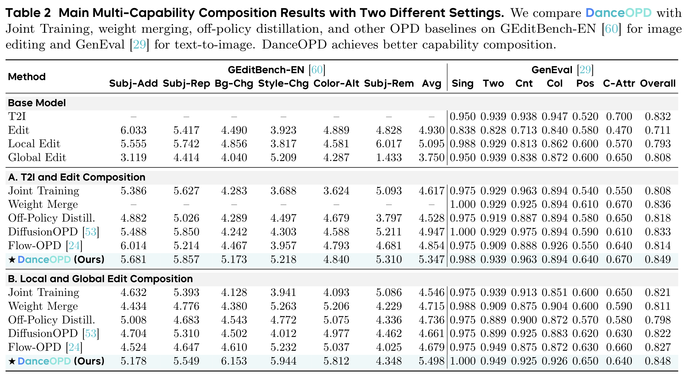

*Wei Zhou et al., DanceOPD v3，Table 2，[PDF 第 11 页](https://arxiv.org/pdf/2606.27377v3#page=11)，原表截图。用途：保留所有编辑、GenEval 子项及缺失值；以下转录综合分便于比较。*

| 方法 | A：T2I＋Edit，GEdit Avg ↑ | A：GenEval ↑ | B：Local＋Global，GEdit Avg ↑ | B：GenEval ↑ |
|---|---:|---:|---:|---:|
| Joint Training | 4.617 | 0.808 | 4.546 | 0.821 |
| Weight Merge | — | 0.836 | 4.715 | 0.811 |
| Off-Policy Distill. | 4.528 | 0.818 | 4.736 | 0.798 |
| DiffusionOPD | 4.947 | 0.833 | 4.661 | 0.822 |
| Flow-OPD | 4.854 | 0.814 | 4.679 | 0.827 |
| **DanceOPD** | **5.347** | **0.849** | **5.498** | **0.848** |

原始能力来源的综合分：

| 教师/来源 | GEdit Avg ↑ | GenEval ↑ |
|---|---:|---:|
| T2I | — | 0.832 |
| Edit | 4.930 | 0.711 |
| Local Edit | 5.095 | 0.793 |
| Global Edit | 3.750 | 0.808 |

A 中，DanceOPD 的 GEdit **5.347** 高于最强 OPD 对照 **4.947** 和 Edit 教师 **4.930**，GenEval **0.849** 也高于 T2I 来源 **0.832**。B 中，GEdit **5.498** 高于最佳组合基线 Off-Policy **4.736**，GenEval **0.848** 高于这些组合基线。

但**“综合更好”不是每项都赢**。把教师与学生的六项编辑分数并排：

| 来源/学生 | Subj-Add ↑ | Subj-Rep ↑ | Bg-Chg ↑ | Style-Chg ↑ | Color-Alt ↑ | Subj-Rem ↑ |
|---|---:|---:|---:|---:|---:|---:|
| Edit 教师 | 6.033 | 5.417 | 4.490 | 3.923 | 4.889 | 4.828 |
| DanceOPD A | 5.681 | 5.857 | 5.173 | 5.218 | 4.840 | 5.310 |
| Local 教师 | 5.555 | 5.742 | 4.856 | 3.817 | 4.581 | 6.017 |
| Global 教师 | 3.119 | 4.414 | 4.040 | 5.209 | 4.287 | 1.433 |
| DanceOPD B | 5.178 | 5.549 | 6.153 | 5.944 | 5.812 | 4.348 |

A 的主体添加、颜色修改低于 Edit 教师；B 的主体添加、主体替换、主体删除低于 Local 教师，主体删除也低于 Joint Training 的 **5.086**。GenEval 同样不是所有子项都最好，例如 A 的颜色分 **0.894** 低于 T2I 来源的 **0.947**。

### 3.3 真实感吸收：奖励只用来评测，不参与这份 MSE 更新

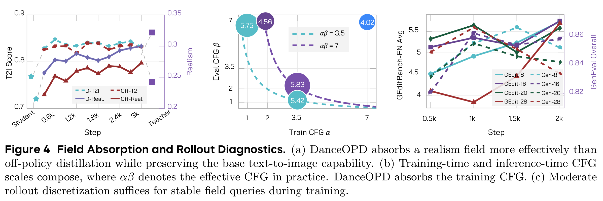

*Wei Zhou et al., DanceOPD v3，Figure 4，[PDF 第 11 页](https://arxiv.org/pdf/2606.27377v3#page=11)，原图截图。左图用于看真实感与 T2I 的并行变化；中图对应 Table 6；右图实线按左轴读 GEdit，虚线按右轴读 GenEval，不能混用两轴。*

Figure 4(a) 使用 SD3.5-M。realism 教师先全参数训练 **100,000 steps**，学习率 **1e-5**、batch size **16**；横轴到 **3k** 是后续蒸馏训练，不是教师只训练了 3k。

作者用**未公开的真实感 reward model**评测 **200 个训练外样本**，分辨率 **1024×1024**、28 步、CFG 3.5；reward model **仅用于评测**，不是 DanceOPD 的训练奖励。左图左轴是 T2I Score、右轴是真实感分，均越高越好；两条不同量纲的线不能直接比较高度。

| 论文报告的比较（§4.1C） | 结果 |
|---|---:|
| DanceOPD 真实感 reward 相对 Off-Policy | +9.9% |
| 弥合 student-to-teacher 真实感 reward 差距 | 85.3% |
| T2I score 相对学生 anchor | +7.6% |
| T2I score 与 Off-Policy 的相对差异 | 0.1% 以内 |

这些是作者报告的相对量，不是“85.3% 的图片看起来真实”。PDF 没有为 Figure 4(a) 给逐点精确数值表，因此这里不从曲线猜写三位小数，也不把它的 T2I Score 擅自改名为另一份 benchmark 成绩。

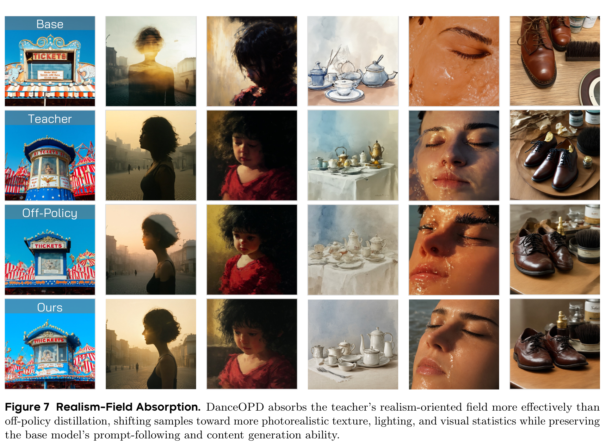

*Wei Zhou et al., DanceOPD v3，Figure 7，[PDF 第 15 页](https://arxiv.org/pdf/2606.27377v3#page=15)，原图截图。用途：对照 Base / Teacher / Off-Policy / Ours 的材质、光照和视觉统计变化。*

茶具、皮鞋和面部样例帮助理解“吸收真实感场”指什么，但属于定性展示，不是独立的人类偏好胜率统计；票亭中的字形等也不因此保证正确。

### 3.4 CFG 吸收：多叠一层 guidance 不一定更好

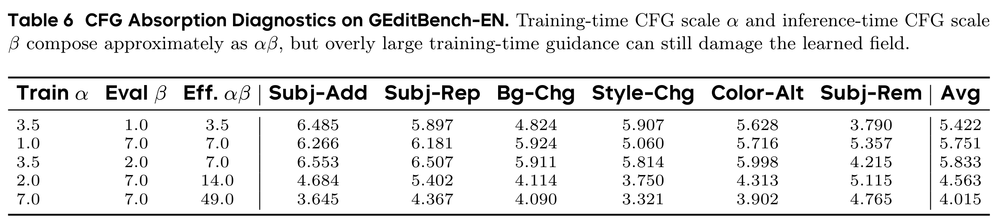

*Wei Zhou et al., DanceOPD v3，Table 6，[PDF 第 30 页](https://arxiv.org/pdf/2606.27377v3#page=30)，原表截图。用途：区分仅训练吸收、仅推理 CFG、二者组合及过度 guidance。所有分数越高越好。*

| Train α | Eval β | 近似 αβ | Subj-Add | Subj-Rep | Bg-Chg | Style-Chg | Color-Alt | Subj-Rem | Avg ↑ |
|---:|---:|---:|---:|---:|---:|---:|---:|---:|---:|
| 3.5 | 1.0 | 3.5 | 6.485 | 5.897 | 4.824 | 5.907 | 5.628 | 3.790 | 5.422 |
| 1.0 | 7.0 | 7.0 | 6.266 | 6.181 | 5.924 | 5.060 | 5.716 | 5.357 | 5.751 |
| 3.5 | 2.0 | 7.0 | 6.553 | 6.507 | 5.911 | 5.814 | 5.998 | 4.215 | **5.833** |
| 2.0 | 7.0 | 14.0 | 4.684 | 5.402 | 4.114 | 3.750 | 4.313 | 5.115 | 4.563 |
| 7.0 | 7.0 | 49.0 | 3.645 | 4.367 | 4.090 | 3.321 | 3.902 | 4.765 | 4.015 |

适度组合 **5.833** 高于 train-only **5.422**、eval-only **5.751**；但同样近似有效强度 7 的两行也不完全相同。最强组合的删除主体 **4.215** 仍低于 eval-only 的 **5.357**。过强组合降到 **4.015**，说明“吸收后仍套用原默认 CFG”会改变比较条件，不能当成无影响的评测细节。

### 3.5 Table 4：便宜在哪里？不是跳过所有生成

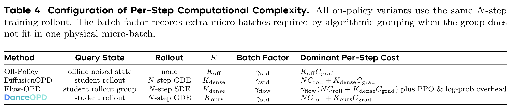

*Wei Zhou et al., DanceOPD v3，Table 4，[PDF 第 27 页](https://arxiv.org/pdf/2606.27377v3#page=27)，原表截图。用途：解释 Figure 1 气泡对应的训练成本，不是模型部署成本。*

$C_{\rm roll}$ 是一次无梯度学生 rollout 前向的成本，$C_{\rm grad}$ 是一次查询监督单元，包括教师/奖励查询及学生前向、反向。论文计时设置 $N=16$、物理 microbatch 为 8、FlowGRPO group 为 16：

| 论文比较方法 | 训练轨迹 | 查询数 K | grouping 的额外 microbatch 因子 | 主要成本 |
|---|---|---:|---:|---|
| Off-Policy | 无 rollout | 1 | 1 | $C_{\rm grad}$ |
| DiffusionOPD | 16 步 ODE | 16 | 1 | $16C_{\rm roll}+16C_{\rm grad}$ |
| Flow-OPD | 16 步 SDE，按组采样 | 16 | 2 | $2(16C_{\rm roll}+16C_{\rm grad})$，另有 PPO/log-prob 开销 |
| DanceOPD | 16 步 ODE | 1 | 1 | $16C_{\rm roll}+C_{\rm grad}$ |

核心省在**少查询、少做局部学生反传**，而不是把完整 solver 反传从 16 步改为 1 步——这些 rollout 本来就 stop-gradient。Off-Policy 仍更便宜，但查询状态分布不同。此表的因子 2 也不是前面的路由桶数 $G$，更不是普通梯度累积数。

新版 `query_prefix` 进一步省去无用后缀，但不在这张论文成本表里另补一个未经实测的加速比。

## 4. 消融：每个选择究竟由什么结果支持？

以下 Table 6–9 是**受控诊断**，不是 Table 2 主实验的额外重复运行。默认诊断 anchor 为三桶、Local Edit 初始化、hard-routed MSE、ODE、$K=1,G=1$、16 步、low-t；**5.751** 在多张表中重复是共用对照，不是多个独立证据。

### 4.1 路由、同一步混桶与 dense query 要分开看

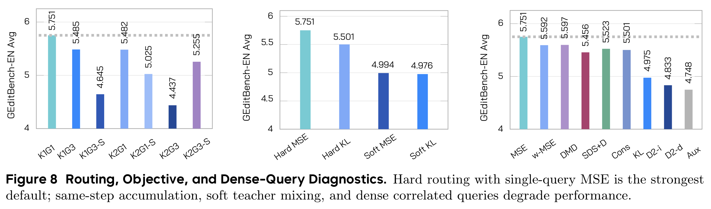

*Wei Zhou et al., DanceOPD v3，Figure 8，[PDF 第 16 页](https://arxiv.org/pdf/2606.27377v3#page=16)，原图截图。用途：先看总体变化；精确数值与每类得失见下表。*

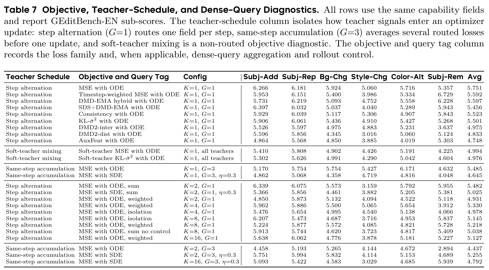

*Wei Zhou et al., DanceOPD v3，Table 7，[PDF 第 31 页](https://arxiv.org/pdf/2606.27377v3#page=31)，原表截图，保留全部行、配置和六类评分。用途：避免只报告最好的一行或把不同聚合方式混为一谈。*

**先看 hard vs soft（均 $K=1$）：**

| 教师目标构造 | MSE，Avg ↑ | KL 加权，Avg ↑ |
|---|---:|---:|
| Hard：样本只查对应教师 | **5.751** | **5.501** |
| Soft：同一状态混入所有教师 | 4.994 | 4.976 |

Hard/soft 改的是**一个样本的目标来自谁**；MSE/KL 改的是匹配误差的权重。两轴不要混为同一项改动。这里的 soft MSE 是多个教师误差的加权和，对学生的梯度等价于拟合平均速度场（附录式 39–40），不是学到一个动态 router。

**再看同一步累积几个桶、每条轨迹问几次：**

| 设置 | K | G | Avg ↑ | Subj-Add ↑ | Subj-Rem ↑ |
|---|---:|---:|---:|---:|---:|
| 单查询默认，ODE | 1 | 1 | **5.751** | 6.266 | 5.357 |
| 同步混桶，ODE | 1 | 3 | 5.485 | 5.170 | 4.632 |
| 同步混桶，SDE η=0.3 | 1 | 3 | 4.645 | 4.862 | 4.048 |
| 双查询 sum，ODE | 2 | 1 | 5.482 | 6.339 | 5.955 |
| 双查询 sum，SDE η=0.3 | 2 | 1 | 5.025 | 5.366 | 5.381 |
| 双查询＋同步混桶，ODE | 2 | 3 | 4.437 | 4.458 | 2.894 |
| 双查询＋同步混桶，SDE η=0.3 | 2 | 3 | 5.255 | 5.751 | 4.689 |
| 16 查询＋同步混桶，SDE η=0.3 | 16 | 3 | 4.792 | 5.093 | 5.939 |

- $G=3$ 同步混桶仍可让每个样本查正确教师，但一次 optimizer update 合并了多个任务梯度；这不同于 soft 在同一个样本里混教师。
- $K=1,G=3$ 的平均分下降，但 Style-Chg **5.427 > 5.060**、Color-Alt **6.171 > 5.716**：它改变了能力平衡，不是所有项一起变差。
- SDE 将压力设置 $K=2,G=3$ 从 **4.437** 拉回 **5.255**，但没恢复到 **5.751**；其他两个 SDE 对照反而退步，因此不是默认更好。

**固定 $G=1$，增加同一轨迹的加权查询数：**

| K | 1（默认） | 2 weighted | 4 weighted | 8 weighted | 16 weighted |
|---|---:|---:|---:|---:|---:|
| GEdit Avg ↑ | **5.751** | 4.931 | 5.330 | 5.218 | 5.127 |

Table 7 还报告 isolation / sum no control 等不同聚合，不能只按 K 把它们接成同一条曲线。**“dense 更差”是本文这些字段、初始化和聚合设置的观测，不是所有 OPD 的定理。** 共享噪声、条件和路径会造成相关监督，SDE 压力实验支持该诊断，但相关性本身并不自动证明增加查询必然有害。

### 4.2 Loss：普通速度 MSE 的综合分最好，不等于所有替代项毫无收益

同样是 Table 7 的 $K=1,G=1$ ODE 诊断：

| 目标 | GEdit Avg ↑ | 读法 |
|---|---:|---|
| 普通 velocity MSE | **5.751** | 默认 |
| Timestep-weighted MSE | 5.592 | 改变时间权重 |
| DMD-EMA hybrid | 5.597 | 被动 EMA 参照＋MSE anchor |
| SDS＋DMD-EMA | 5.456 | score-style surrogate 再加时间权重 |
| Consistency | 5.523 | 简化的一致性诊断＋教师 anchor |
| KL-$\bar\sigma^2$ | 5.501 | 局部转移方差加权 |
| DMD2-inter | 4.975 | fake critic 的中间状态训练变体 |
| DMD2-dist | 4.833 | fake critic 的学生分布训练变体 |
| AuxFeat | 4.748 | 加中间特征匹配 |

例如 weighted MSE 的主体删除 **6.729** 高于默认 **5.357**，但风格修改 **3.986** 低于 **5.060**，平均分才是默认较强的依据。附录 §7.6 特别说明这些是作者在 stop-gradient 查询状态上的诊断实现，DMD-EMA 并非训练独立 fake critic 的完整 DMD；不把本表解释为那些方法在各自原任务上的普遍排名。

### 4.3 查低噪声、从合适学生初始化，是否真的有帮助？

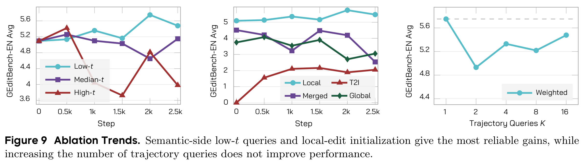

*Wei Zhou et al., DanceOPD v3，Figure 9，[PDF 第 16 页](https://arxiv.org/pdf/2606.27377v3#page=16)，原图截图。用途：看随训练的变化而不是只看终点；右图 K=16 与附录 Table 7 的不一致见 4.5 节。*

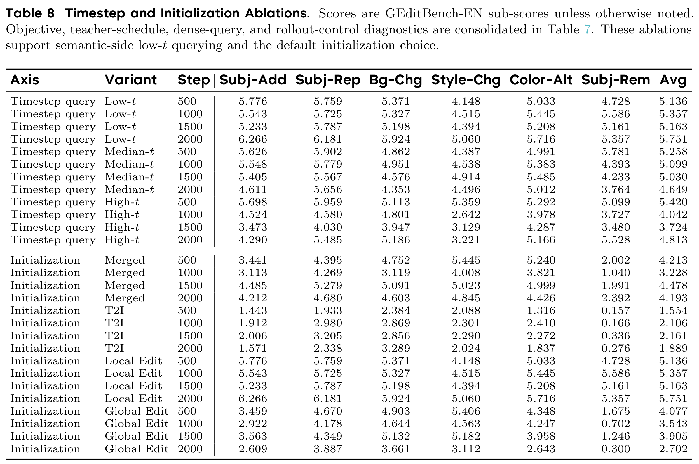

*Wei Zhou et al., DanceOPD v3，Table 8，[PDF 第 31 页](https://arxiv.org/pdf/2606.27377v3#page=31)，原表截图。用途：保留 500–2000 steps 的中间检查点和六类评分，下面转录平均分。*

| 查询位置 | 500 steps | 1000 | 1500 | 2000，Avg ↑ |
|---|---:|---:|---:|---:|
| Low-t，Beta(5,2) | 5.136 | 5.357 | 5.163 | **5.751** |
| Median-t，Beta(5,5) | 5.258 | 5.099 | 5.030 | 4.649 |
| High-t，Beta(2,5) | 5.420 | 4.042 | 3.724 | 4.813 |

2k 时低噪声明显较好，但 **500 step 时 High-t 最高**，而 Low-t 从 1k 到 1.5k 也会回落。这支持最终设置选择，不是“低噪声在每个训练时刻都最好”。高噪声在 2k 的主体删除 **5.528** 仍略高于 low-t **5.357**。

| 学生初始化 | 500 steps | 1000 | 1500 | 2000，Avg ↑ |
|---|---:|---:|---:|---:|
| Merged | 4.213 | 3.228 | 4.478 | 4.193 |
| T2I | 1.554 | 2.106 | 2.161 | 1.889 |
| **Local Edit** | 5.136 | 5.357 | 5.163 | **5.751** |
| Global Edit | 4.077 | 3.543 | 3.905 | 2.702 |

初始化会改变学生早期真正走到的状态，因此也改变教师被查询的位置。在这组编辑诊断里，已有较强局部编辑能力的起点更有效；**不能据此宣称所有蒸馏都必须从 Local Edit 或 OCR 初始化**，也不能把这个诊断起点填入未公开的主表精确权重。

### 4.4 rollout 步数：更长不自动更好

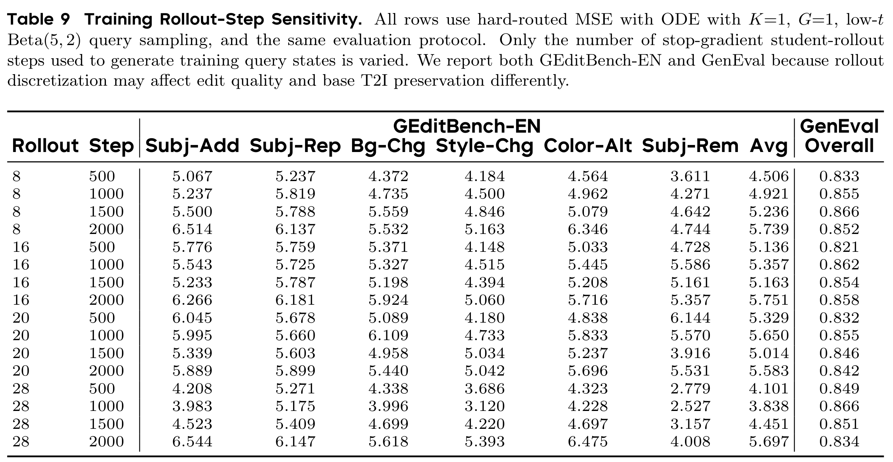

*Wei Zhou et al., DanceOPD v3，Table 9，[PDF 第 32 页](https://arxiv.org/pdf/2606.27377v3#page=32)，原表截图。用途：比较训练查询状态的网格精细程度；评测 sampler 保持固定。*

统一看训练到 **2000 steps** 的行：

| 训练 rollout 步数 N | GEdit Avg ↑ | GenEval Overall ↑ | Subj-Rem ↑ |
|---|---:|---:|---:|
| 8 | 5.739 | 0.852 | 4.744 |
| **16** | **5.751** | **0.858** | 5.357 |
| 20 | 5.583 | 0.842 | **5.531** |
| 28 | 5.697 | 0.834 | 4.008 |

16 步的综合折中最好，但与 8 步 GEdit 只差 **0.012**；20 步主体删除还更高。不应把很小的单次差距包装为有统计显著性保证的优势。

这些行都从同一个 Beta(5,2) 抽归一化索引。增大 N 是细化原轨迹网格，不是增加单次监督数 K，也不是修改评测采样预算。论文还指出：最末查询格的概率从 N=8 时约 **0.167** 降为 N=28 时约 **0.017**，低噪声概率质量被分散到更多相邻状态，不能理解为“走得越长越常监督最干净的点”。

### 4.5 原图与结果表并非处处一致

核对 v3 原 PDF 后，至少有两处不能强行统一：

| 位置 | 原图标注或读数 | 原表的精确值 |
|---|---|---|
| Figure 1，B 组 Flow-OPD 的 GenEval | 标注 **0.821** | Table 2：**0.827** |
| Figure 9(c)，weighted K=16 | 约 5.45（曲线近似读数） | Table 7：**5.127** |

笔记保留原截图，不重绘或篡改曲线；上述数值转录按 Table 2/7，**不声称图表完全一致，也不猜测差异原因**。这些差异会影响具体比较幅度。

**Figure 4(c) 的双轴不是数值矛盾：** 实线 GEdit 对应左轴，虚线 GenEval 对应右轴。2k 时 8/28 步的 GEdit 实线约为 5.74/5.70，与 Table 9 的 **5.739/5.697** 相符；同位置虚线分别对应 GenEval **0.852/0.834**，不能按左轴误读成 GEdit 约 5.1/4.5。

另一个不是矛盾的差别：Table 2 的 DanceOPD 为 **5.347 / 5.498**，诊断 anchor 为 **5.751**；论文 §10 已说明它们不是同一实验块，不能挑 5.751 充当主表最优成绩。

## 5. 读完后保留的边界

- **能直接比较速度的前提**：教师与学生共享兼容的 latent 空间、backbone 家族、scheduler 及速度参数化（论文 §6）。不是拿任意两个不兼容模型的张量直接做 MSE。
- **预定义路由**：当前按数据桶绑定教师，没有证明面对任意模糊任务都能自动选对老师。
- **零样本涌现主要是定性观察**：§4.4 / Figure 11（第 18–19 页）展示服装拆解、多镜头、视角/姿态转换等未显式训练任务。作者将能力组合与单查询关联的解释仍含假设；它不是严格受控的泛化定理或完整零样本成功率评测。
- **复现缺口**：论文编辑教师/学生权重、真实感教师及其 proprietary reward model 不随当前仓库完整发布；主表精确初始化及上述图表差异仍无法据现有材料消除。公开源码能核实算法与输入路径，不等于已经复现论文数值。

**一句话收束：先让学生自己走，再在它真实走到的一个偏低噪声状态上，向对应老师学习速度；多种能力通过不同更新进入同一个学生。**

## 来源与引用说明

图表均从指定 [arXiv:2606.27377v3 原 PDF](https://arxiv.org/pdf/2606.27377v3) 渲染裁剪，非 README 动图、非重绘；仅保留用于上述评论的 Figure 1、3、4、7、8、9 和 Table 2、4、6–9，不收录整篇 PDF。作者为 Wei Zhou 等，图表权利归原权利人；源码 Apache-2.0 不自动适用于论文、模型权重或上游依赖。

代码引用来自官方固定 commit，均在相邻段落标注原摘录或删减；没有用伪代码替代已经可核实的核心训练实现。来源路径统一带 `danceopd/` 前缀，不能省略成仓库根目录的 `core/`。以下为源码许可原文，便于随引用保留。

<details>
<summary>官方代码 Apache-2.0 许可原文</summary>

```text
                                 Apache License
                           Version 2.0, January 2004
                        https://www.apache.org/licenses/

   TERMS AND CONDITIONS FOR USE, REPRODUCTION, AND DISTRIBUTION

   1. Definitions.

      "License" shall mean the terms and conditions for use, reproduction,
      and distribution as defined by Sections 1 through 9 of this document.

      "Licensor" shall mean the copyright owner or entity authorized by
      the copyright owner that is granting the License.

      "Legal Entity" shall mean the union of the acting entity and all
      other entities that control, are controlled by, or are under common
      control with that entity. For the purposes of this definition,
      "control" means (i) the power, direct or indirect, to cause the
      direction or management of such entity, whether by contract or
      otherwise, or (ii) ownership of fifty percent (50%) or more of the
      outstanding shares, or (iii) beneficial ownership of such entity.

      "You" (or "Your") shall mean an individual or Legal Entity
      exercising permissions granted by this License.

      "Source" form shall mean the preferred form for making modifications,
      including but not limited to software source code, documentation
      source, and configuration files.

      "Object" form shall mean any form resulting from mechanical
      transformation or translation of a Source form, including but
      not limited to compiled object code, generated documentation,
      and conversions to other media types.

      "Work" shall mean the work of authorship, whether in Source or
      Object form, made available under the License, as indicated by a
      copyright notice that is included in or attached to the work
      (an example is provided in the Appendix below).

      "Derivative Works" shall mean any work, whether in Source or Object
      form, that is based on (or derived from) the Work and for which the
      editorial revisions, annotations, elaborations, or other modifications
      represent, as a whole, an original work of authorship. For the purposes
      of this License, Derivative Works shall not include works that remain
      separable from, or merely link (or bind by name) to the interfaces of,
      the Work and Derivative Works thereof.

      "Contribution" shall mean any work of authorship, including
      the original version of the Work and any modifications or additions
      to that Work or Derivative Works thereof, that is intentionally
      submitted to Licensor for inclusion in the Work by the copyright owner
      or by an individual or Legal Entity authorized to submit on behalf of
      the copyright owner. For the purposes of this definition, "submitted"
      means any form of electronic, verbal, or written communication sent
      to the Licensor or its representatives, including but not limited to
      communication on electronic mailing lists, source code control systems,
      and issue tracking systems that are managed by, or on behalf of, the
      Licensor for the purpose of discussing and improving the Work, but
      excluding communication that is conspicuously marked or otherwise
      designated in writing by the copyright owner as "Not a Contribution."

      "Contributor" shall mean Licensor and any individual or Legal Entity
      on behalf of whom a Contribution has been received by Licensor and
      subsequently incorporated within the Work.

   2. Grant of Copyright License. Subject to the terms and conditions of
      this License, each Contributor hereby grants to You a perpetual,
      worldwide, non-exclusive, no-charge, royalty-free, irrevocable
      copyright license to reproduce, prepare Derivative Works of,
      publicly display, publicly perform, sublicense, and distribute the
      Work and such Derivative Works in Source or Object form.

   3. Grant of Patent License. Subject to the terms and conditions of
      this License, each Contributor hereby grants to You a perpetual,
      worldwide, non-exclusive, no-charge, royalty-free, irrevocable
      (except as stated in this section) patent license to make, have made,
      use, offer to sell, sell, import, and otherwise transfer the Work,
      where such license applies only to those patent claims licensable
      by such Contributor that are necessarily infringed by their
      Contribution(s) alone or by combination of their Contribution(s)
      with the Work to which such Contribution(s) was submitted. If You
      institute patent litigation against any entity (including a
      cross-claim or counterclaim in a lawsuit) alleging that the Work
      or a Contribution incorporated within the Work constitutes direct
      or contributory patent infringement, then any patent licenses
      granted to You under this License for that Work shall terminate
      as of the date such litigation is filed.

   4. Redistribution. You may reproduce and distribute copies of the
      Work or Derivative Works thereof in any medium, with or without
      modifications, and in Source or Object form, provided that You
      meet the following conditions:

      (a) You must give any other recipients of the Work or
          Derivative Works a copy of this License; and

      (b) You must cause any modified files to carry prominent notices
          stating that You changed the files; and

      (c) You must retain, in the Source form of any Derivative Works
          that You distribute, all copyright, patent, trademark, and
          attribution notices from the Source form of the Work,
          excluding those notices that do not pertain to any part of
          the Derivative Works; and

      (d) If the Work includes a "NOTICE" text file as part of its
          distribution, then any Derivative Works that You distribute must
          include a readable copy of the attribution notices contained
          within such NOTICE file, excluding those notices that do not
          pertain to any part of the Derivative Works, in at least one
          of the following places: within a NOTICE text file distributed
          as part of the Derivative Works; within the Source form or
          documentation, if provided along with the Derivative Works; or,
          within a display generated by the Derivative Works, if and
          wherever such third-party notices normally appear. The contents
          of the NOTICE file are for informational purposes only and
          do not modify the License. You may add Your own attribution
          notices within Derivative Works that You distribute, alongside
          or as an addendum to the NOTICE text from the Work, provided
          that such additional attribution notices cannot be construed
          as modifying the License.

      You may add Your own copyright statement to Your modifications and
      may provide additional or different license terms and conditions
      for use, reproduction, or distribution of Your modifications, or
      for any such Derivative Works as a whole, provided Your use,
      reproduction, and distribution of the Work otherwise complies with
      the conditions stated in this License.

   5. Submission of Contributions. Unless You explicitly state otherwise,
      any Contribution intentionally submitted for inclusion in the Work
      by You to the Licensor shall be under the terms and conditions of
      this License, without any additional terms or conditions.
      Notwithstanding the above, nothing herein shall supersede or modify
      the terms of any separate license agreement you may have executed
      with Licensor regarding such Contributions.

   6. Trademarks. This License does not grant permission to use the trade
      names, trademarks, service marks, or product names of the Licensor,
      except as required for reasonable and customary use in describing the
      origin of the Work and reproducing the content of the NOTICE file.

   7. Disclaimer of Warranty. Unless required by applicable law or
      agreed to in writing, Licensor provides the Work (and each
      Contributor provides its Contributions) on an "AS IS" BASIS,
      WITHOUT WARRANTIES OR CONDITIONS OF ANY KIND, either express or
      implied, including, without limitation, any warranties or conditions
      of TITLE, NON-INFRINGEMENT, MERCHANTABILITY, or FITNESS FOR A
      PARTICULAR PURPOSE. You are solely responsible for determining the
      appropriateness of using or redistributing the Work and assume any
      risks associated with Your exercise of permissions under this License.

   8. Limitation of Liability. In no event and under no legal theory,
      whether in tort (including negligence), contract, or otherwise,
      unless required by applicable law (such as deliberate and grossly
      negligent acts) or agreed to in writing, shall any Contributor be
      liable to You for damages, including any direct, indirect, special,
      incidental, or consequential damages of any character arising as a
      result of this License or out of the use or inability to use the
      Work (including but not limited to damages for loss of goodwill,
      work stoppage, computer failure or malfunction, or any and all
      other commercial damages or losses), even if such Contributor
      has been advised of the possibility of such damages.

   9. Accepting Warranty or Additional Liability. While redistributing
      the Work or Derivative Works thereof, You may choose to offer,
      and charge a fee for, acceptance of support, warranty, indemnity,
      or other liability obligations and/or rights consistent with this
      License. However, in accepting such obligations, You may act only
      on Your own behalf and on Your sole responsibility, not on behalf
      of any other Contributor, and only if You agree to indemnify,
      defend, and hold each Contributor harmless for any liability
      incurred by, or claims asserted against, such Contributor by reason
      of your accepting any such warranty or additional liability.

   END OF TERMS AND CONDITIONS

   APPENDIX: How to apply the Apache License to your work.

      To apply the Apache License to your work, attach the following
      boilerplate notice, with the fields enclosed by brackets "[]"
      replaced with your own identifying information. (Don't include
      the brackets!)  The text should be enclosed in the appropriate
      comment syntax for the file format. We also recommend that a
      file or class name and description of purpose be included on the
      same "printed page" as the copyright notice for easier
      identification within third-party archives.

   Copyright 2026 DanceOPD Authors

   Licensed under the Apache License, Version 2.0 (the "License");
   you may not use this file except in compliance with the License.
   You may obtain a copy of the License at

       https://www.apache.org/licenses/LICENSE-2.0

   Unless required by applicable law or agreed to in writing, software
   distributed under the License is distributed on an "AS IS" BASIS,
   WITHOUT WARRANTIES OR CONDITIONS OF ANY KIND, either express or implied.
   See the License for the specific language governing permissions and
   limitations under the License.
```

</details>

[paper-readme]: https://github.com/worldbench/DanceOPD/blob/f856e877ef3e09b688414b4a8592023c6c1c6f14/configs/paper/README.md
[public-sd35]: https://github.com/worldbench/DanceOPD/blob/f856e877ef3e09b688414b4a8592023c6c1c6f14/configs/public/sd35.yaml
[public-zimage]: https://github.com/worldbench/DanceOPD/blob/f856e877ef3e09b688414b4a8592023c6c1c6f14/configs/public/zimage.yaml
[sd35-prepare]: https://github.com/worldbench/DanceOPD/blob/f856e877ef3e09b688414b4a8592023c6c1c6f14/danceopd/backends/sd35_diffusers.py#L59-L127
[teacher-compose]: https://github.com/worldbench/DanceOPD/blob/f856e877ef3e09b688414b4a8592023c6c1c6f14/danceopd/backends/teacher.py#L110-L149
[routing]: https://github.com/worldbench/DanceOPD/blob/f856e877ef3e09b688414b4a8592023c6c1c6f14/danceopd/core/routing.py#L39-L55
[engine]: https://github.com/worldbench/DanceOPD/blob/f856e877ef3e09b688414b4a8592023c6c1c6f14/danceopd/core/engine.py#L122-L147
[timestep]: https://github.com/worldbench/DanceOPD/blob/f856e877ef3e09b688414b4a8592023c6c1c6f14/danceopd/core/timestep.py#L28-L64
[sd35-rollout]: https://github.com/worldbench/DanceOPD/blob/f856e877ef3e09b688414b4a8592023c6c1c6f14/danceopd/backends/sd35_diffusers.py#L186-L238
[sd35-query]: https://github.com/worldbench/DanceOPD/blob/f856e877ef3e09b688414b4a8592023c6c1c6f14/danceopd/backends/sd35_diffusers.py#L356-L371
[zimage-conditions]: https://github.com/worldbench/DanceOPD/blob/f856e877ef3e09b688414b4a8592023c6c1c6f14/danceopd/backends/zimage_diffsynth.py#L521-L527
[zimage-prompt]: https://github.com/worldbench/DanceOPD/blob/f856e877ef3e09b688414b4a8592023c6c1c6f14/danceopd/backends/zimage_diffsynth.py#L214-L251
[zimage-velocity]: https://github.com/worldbench/DanceOPD/blob/f856e877ef3e09b688414b4a8592023c6c1c6f14/danceopd/backends/zimage_diffsynth.py#L269-L305
[zimage-match]: https://github.com/worldbench/DanceOPD/blob/f856e877ef3e09b688414b4a8592023c6c1c6f14/danceopd/backends/zimage_diffsynth.py#L567-L578
[sd35-match]: https://github.com/worldbench/DanceOPD/blob/f856e877ef3e09b688414b4a8592023c6c1c6f14/danceopd/backends/sd35_diffusers.py#L321-L392
[loss]: https://github.com/worldbench/DanceOPD/blob/f856e877ef3e09b688414b4a8592023c6c1c6f14/danceopd/core/loss.py#L4-L9
[sd35-update]: https://github.com/worldbench/DanceOPD/blob/f856e877ef3e09b688414b4a8592023c6c1c6f14/danceopd/backends/sd35_diffusers.py#L394-L402
[sd35-cfg]: https://github.com/worldbench/DanceOPD/blob/f856e877ef3e09b688414b4a8592023c6c1c6f14/danceopd/backends/sd35_diffusers.py#L174-L184
[cfg-target]: https://github.com/worldbench/DanceOPD/blob/f856e877ef3e09b688414b4a8592023c6c1c6f14/danceopd/core/timestep.py#L23-L25
