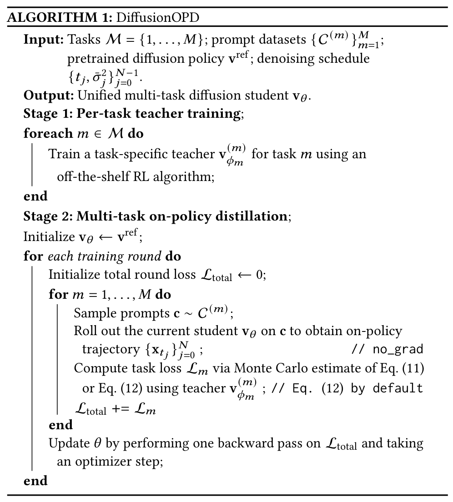
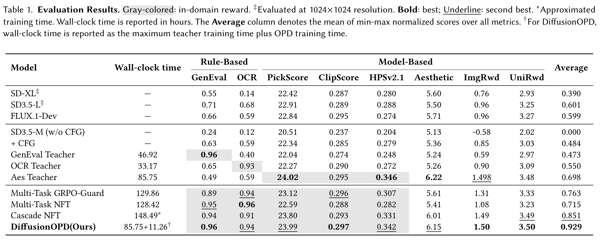
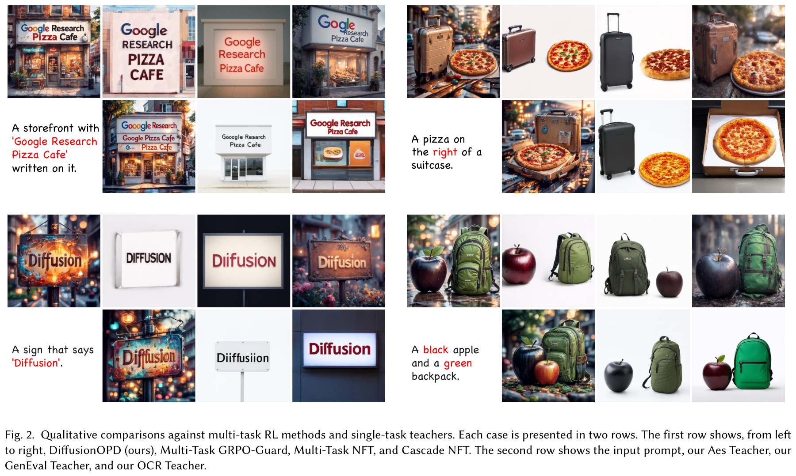
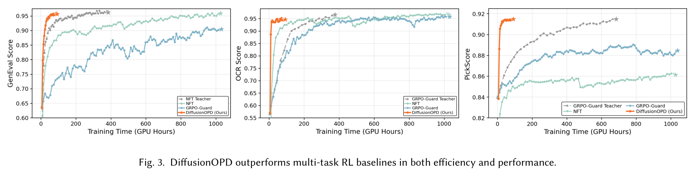
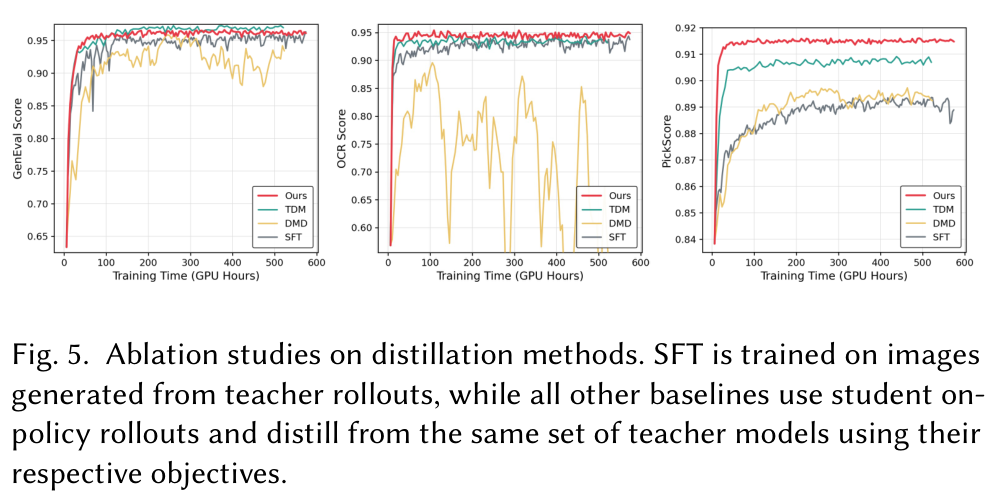
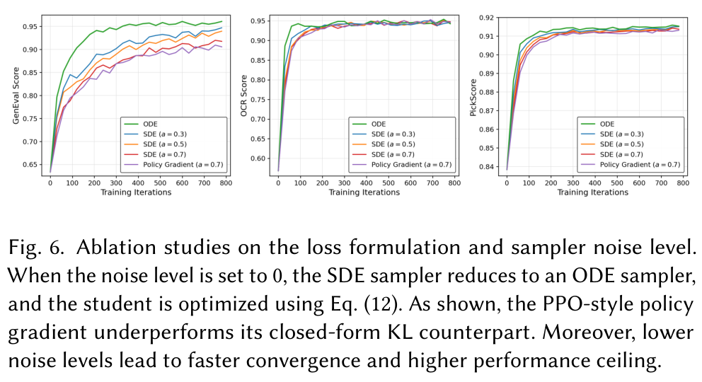

# DiffusionOPD：沿核心代码读懂多教师能力融合

- 论文：[DiffusionOPD: A Unified Perspective of On-Policy Distillation in Diffusion Models](https://arxiv.org/abs/2605.15055v2)，Quanhao Li 等；本文核对 **arXiv v2**（2026-09-11）。
- 官方源码：[ali-vilab/DiffusionOPD](https://github.com/ali-vilab/DiffusionOPD)，固定提交 [`0c85bf0193a6da24bb1f72152b612d353a154999`](https://github.com/ali-vilab/DiffusionOPD/tree/0c85bf0193a6da24bb1f72152b612d353a154999)。
- 阅读范围：`config/opd.py:mopd()` 与 `scripts/train_sd3_opd.py` 的**默认 ODE、多教师训练路径**。源码节选省略日志、评测等，不是独立可运行脚本；教学伪代码另行标明。
- 核验边界：读过原文和源码，没有执行训练或复现指标。下列算法、图和结果表均为原始 PDF 的局部截图，保留原图表编号、标签与说明，不重画实验结果。

## 一、先把整条训练链看清楚

**把多个能力装进一个模型里面：不同任务找对应教师，但最后更新的是同一个学生。**

```text
不同任务的数据桶
→ 按数据桶选择对应教师
→ 学生自己 rollout，保存中间状态
→ 教师在这些学生状态上预测下一步
→ 合并各任务的状态与教师目标
→ 学生在缓存状态上重新前向，计算 loss
→ 累积各任务的梯度，更新学生
```



*原论文 Algorithm 1，PDF 第 5 页。Stage 1 先训练各任务专家；Stage 2 才是本文逐段读的多教师蒸馏。`Roll out the current student` 对应学生收集状态，`using teacher` 对应教师标注，最外层更新对应跨任务累积。算法写成累计总 loss 后一次 backward；实际代码拆成多次微步 backward、累积后一次 optimizer update。*

**On-policy 在哪里？** 状态来自本轮学生自己生成的轨迹，不是老师预先生成的一批成品图。推理时只需要学生，不需要带着三个老师一起运行。

## 二、先认清：源码里谁是学生，谁是教师？

它们共用一个冻结的 SD3.5-Medium 底座，通过切换 LoRA 区分身份：

```text
同一冻结底座
├─ default            学生 LoRA：参与更新
├─ teacher_pickscore  美学教师 LoRA：不更新
├─ teacher_ocr        文字教师 LoRA：不更新
└─ teacher_geneval    构图教师 LoRA：不更新
```

所以 `set_adapter(...)` 表示**切换当前由谁做预测**，不是每次加载一个新的完整模型。优化器只持有选出的学生可训练参数。见[加载、冻结与优化器初始化](https://github.com/ali-vilab/DiffusionOPD/blob/0c85bf0193a6da24bb1f72152b612d353a154999/scripts/train_sd3_opd.py#L657-L712)。

教师权重需要预先准备，这个蒸馏脚本不负责训练教师。论文 §4.1.2 的设置是：OCR 和美学教师用 GRPO-Guard，GenEval 教师用 DiffusionNFT；美学教师优化 PickScore、CLIPScore、HPSv2.1 的等权组合。**代码里的 `pickscore` 数据桶名称和监测奖励，不代表论文美学教师只用 PickScore 训练。**

## 三、数据进来，怎么选择教师？

[`mopd()` 配置](https://github.com/ali-vilab/DiffusionOPD/blob/0c85bf0193a6da24bb1f72152b612d353a154999/config/opd.py#L75-L106)已经把数据集和教师绑定好：

| 数据桶 | 输入 | 对应教师 |
| --- | --- | --- |
| `dataset/pickscore` | 文本 prompt | 美学教师 |
| `dataset/ocr` | 文本 prompt | 文字教师 |
| `dataset/geneval` | prompt，另带评测 metadata | 构图教师 |

原代码节选，[875–881 行](https://github.com/ali-vilab/DiffusionOPD/blob/0c85bf0193a6da24bb1f72152b612d353a154999/scripts/train_sd3_opd.py#L875-L881)：

```python
teacher_idx = i % len(teachers)
slot_adapters = slot_adapter_names[teacher_idx]
slot_guidance_scales = slot_adapter_guidance_scales[teacher_idx]
train_samplers[teacher_idx].set_epoch(
    epoch * config.sample.num_batches_per_epoch + i
)
prompts, prompt_metadata = next(train_iters[teacher_idx])
```

`i=0、1、2` 时，依次从三个数据桶取一批 prompt，并选择对应教师。

**不是分析 prompt 后再让一个路由模型判断找谁，而是“数据桶—教师”预先绑定，轮流采样。** 蒸馏阶段不需要为这些 prompt 配标准答案图片。

## 四、学生怎么 rollout？

此时激活的是学生的 `default` LoRA。原代码节选，[895–921 行](https://github.com/ali-vilab/DiffusionOPD/blob/0c85bf0193a6da24bb1f72152b612d353a154999/scripts/train_sd3_opd.py#L895-L921)，省略混合精度上下文和参数字典构造：

```python
with torch.no_grad():
    images, latents, _ = pipeline_with_logprob(
        pipeline,
        **sample_kw,
    )

latents = torch.stack(latents, dim=1)
```

`sample_kw` 装的是文本 embedding、采样步数、guidance 等参数。默认 `num_steps=10`、`noise_level=0`。采样函数内部执行：

```text
随机初始噪声
→ 学生预测速度
→ scheduler 用这个速度更新 latent
→ 保存当前 latent
→ 重复，直到采样结束
```

返回的 `latents` 是 `[B, T+1, C, H, W]`：`B` 是 batch 大小，`T` 是采样步数，`C/H/W` 是 latent 的通道和空间尺寸。它保留了初始噪声以及每次更新后的状态。见[实际采样循环](https://github.com/ali-vilab/DiffusionOPD/blob/0c85bf0193a6da24bb1f72152b612d353a154999/flow_grpo/diffusers_patch/sd3_pipeline_with_logprob.py#L152-L194)。

**`no_grad()` 的意思是：这一段只负责收集学生会走到哪些状态，不保留整条采样链的反传图。** 后面需要重新计算学生预测。

最终 `images` 用于评测、监控和展示，不作为图片重建 loss 的标签。函数虽然叫 `pipeline_with_logprob`，这里并没有拿返回的 log-probability 做 PPO 更新。

## 五、教师怎么教？不是再生成一条教师轨迹

例如当前数据来自 OCR 桶，代码在 `no_grad()` 下切换到 `teacher_ocr`，遍历学生轨迹上的每一步，调用 `compute_teacher_step_mean()`。关键输入是：

```text
latents_at_j = latents[:, j]       学生走到的当前状态
时刻        = timesteps[:, j]     对应采样时刻
文本条件    = prompt_embeds       原来的 prompt
```

教师前向的核心如下。这是[`compute_teacher_step_mean` 的无 CFG 分支](https://github.com/ali-vilab/DiffusionOPD/blob/0c85bf0193a6da24bb1f72152b612d353a154999/scripts/train_sd3_opd.py#L244-L301)原码；默认 GenEval 教师使用该分支，其余教师的条件引导细节先略去：

```python
noise_pred = transformer(
    hidden_states=latents_at_j,
    timestep=timestep_at_j,
    encoder_hidden_states=cond_embeds,
    pooled_projections=cond_pooled,
    return_dict=False,
)[0]
```

变量叫 `noise_pred`，但在这个 flow 模型里，它表示**速度预测**。随后 scheduler 将速度换算成下一步 latent。默认零噪声 Euler 路径可以写为：

$$
\mu_T = z_j + \Delta t_j\,v_T(z_j,t_j,c).
$$

这里 $z_j$ 是学生当前状态，$c$ 是文本条件，$\Delta t_j$ 是这一采样步的步长；代码里的去噪步长为负。`teacher_prev_mean` 是整个下一步 latent 张量，**不是把图像取平均得到的一个标量**。

这些目标存入 `teacher_prev_sample_means`。标注完成后切回学生：

```python
unwrap_model(transformer, accelerator).set_adapter("default")
```

**教师没有从自己的噪声生成另一条轨迹；它只在学生走过的状态上回答“如果是我，下一步会怎么走”。** 目标也不是学生已经采出的 `next_latents`，而是教师根据当前状态重新计算的一步预测。见[教师查询与切回学生](https://github.com/ali-vilab/DiffusionOPD/blob/0c85bf0193a6da24bb1f72152b612d353a154999/scripts/train_sd3_opd.py#L933-L967)。

## 六、到底用 latent 算 loss，还是用速度算 loss？

**这份默认 ODE 代码直接比较的是：师生各自预测的下一步 latent。**

| 代码变量 | 含义 | 角色 |
| --- | --- | --- |
| `latents[:, j]` | 当前状态 $z_j$ | 师生共同输入 |
| `noise_pred` | 速度预测 $v$，可能已经做 CFG | 模型输出 |
| `prev_sample_mean` | 学生预测的下一步 latent $\mu_S$ | loss 的预测值 |
| `teacher_prev_mean` | 教师预测的下一步 latent $\mu_T$ | loss 的固定目标 |

latent 不是速度差。它们可以具有相同的张量形状，但表示的对象不同。

### 6.1 合并数据，再带梯度重算学生预测

各任务都完成采样和标注后，代码把状态、时间、文本条件和教师目标合并、打乱，重新组成 minibatch。随后学生在这些**缓存状态**上重新前向。

| 阶段 | 做什么 | 是否求梯度 |
| --- | --- | --- |
| 学生 rollout | 生成轨迹、收集状态 | 否 |
| 教师标注 | 给这些状态提供下一步目标 | 否 |
| 学生训练前向 | 在缓存状态上重新预测下一步 | **是** |

为什么重新算？因为 rollout 时没有保留计算图，不能直接拿当时的输出反传。梯度只穿过学生当前这次预测，不穿过整条采样轨迹，也不更新教师。

### 6.2 核心 loss 与更新代码

下面是[1153–1204 行](https://github.com/ali-vilab/DiffusionOPD/blob/0c85bf0193a6da24bb1f72152b612d353a154999/scripts/train_sd3_opd.py#L1153-L1204)的删减版：只保留默认 ODE 分支，省略混合精度、梯度裁剪和监控。代码保持原有变量名，长行略作重排。

```python
with accelerator.accumulate(transformer):
    prev_sample_mean, std_dev_t = compute_student_step(
        transformer, pipeline, sample, j, embeds, pooled_embeds, config
    )
    teacher_prev_mean = sample["teacher_prev_sample_means"][:, j].detach()
    delta = prev_sample_mean.float().unsqueeze(1) - teacher_prev_mean.float()

    # 仅展示 noise_level == 0 的 ODE 分支
    per_step_kl = 0.5 * (delta ** 2)
    per_step_kl_per_teacher_scalar = per_step_kl.mean(
        dim=tuple(range(2, per_step_kl.ndim))
    )
    per_step_kl_scalar = per_step_kl_per_teacher_scalar.sum(dim=1)
    distill_loss = per_step_kl_scalar.mean()
    loss = distill_loss

    accelerator.backward(loss)
    optimizer.step()
    optimizer.zero_grad()
```

- `compute_student_step`：在缓存的同一状态上，重新计算学生的下一步预测，保留梯度。
- `detach()`：教师目标视为常量。
- `unsqueeze(1)`：给学生预测补一个教师维度，便于对齐目标张量。
- `mean(...)`：先对 latent 的通道和空间维度平均，再聚合教师维与 batch。
- 当前配置每条记录只有一个对应教师，教师维为 1；`sum(dim=1)` **不是把三个专家对同一张图的意见相加**。
- `loss = distill_loss`：奖励只用于监控，不混入奖励 loss 或 PPO 项。

变量虽然叫 `per_step_kl`，这里实际执行的是平方误差；论文 Eq. (12) 将 ODE 版本定义为转移匹配的替代目标，不能将其说成两个零方差分布之间的有限 KL。

### 6.3 为什么又说它等价于速度匹配？

先用一个教学数字：某个 latent 维度上，学生预测下一步为 `0.6`、教师建议 `0.8`，该维 loss 为 $\tfrac12(0.6-0.8)^2=0.02$。

默认 Euler ODE 下，师生使用相同起点和步长：

$$
\mu_S=z_j+\Delta t_j v_S,\qquad
\mu_T=z_j+\Delta t_j v_T.
$$

因此单个时间步的 loss 为：

$$
\mathcal L_j
=\frac12\operatorname{mean}\!\left[(\mu_S-\mu_T)^2\right]
=\frac{\Delta t_j^2}{2}\operatorname{mean}\!\left[(v_S-v_T)^2\right].
$$

教学等价简写，**不是逐字源码**：

```python
mu_student = z_j + dt * v_student
mu_teacher = z_j + dt * v_teacher
loss = 0.5 * ((mu_student - mu_teacher) ** 2).mean()
```

**实现顺序是“预测速度 → 换算下一步 latent → 比较下一步 latent”。数学上才等价于带步长平方权重的速度 MSE，不是源码直接对裸速度做 MSE。**

这里的速度指各自实际送入求解器的预测，可能已经做 CFG；例如默认学生 guidance scale 为 4.5，而 GenEval 教师为 1.0，不能误写成所有师生的 guidance 都相同。这一等价式也不能无条件推广到其他求解器。

## 七、默认配置的一轮训练，具体算多少次？

[`mopd()` 默认设置](https://github.com/ali-vilab/DiffusionOPD/blob/0c85bf0193a6da24bb1f72152b612d353a154999/config/opd.py#L39-L66)下，每张卡一轮为：

```text
3 个任务，每个任务取 1 批，每批 3 个 prompt
→ 共 9 条学生轨迹，每条 rollout 10 步
→ 对应教师给每条轨迹的 10 个状态标注
→ 合并打乱，组成 3 个训练 minibatch
→ 每条轨迹使用前 9 步计算 loss
→ 3 个 minibatch × 9 个时间步 = 27 次微步 backward
→ 累积后实际更新学生一次
→ 下一轮用更新后的学生重新采样
```

为什么训练 9 步？`num_train_timesteps = int(10 * 0.99) = 9`，代码选的是**前 9 步**，不是随机抽 9 步。Accelerator 的累积次数设为 `3 * 9 = 27`，见[513–526 行](https://github.com/ali-vilab/DiffusionOPD/blob/0c85bf0193a6da24bb1f72152b612d353a154999/scripts/train_sd3_opd.py#L513-L526)。

虽然循环里每次都调用 `optimizer.step()`，但它被 Accelerate 包装，达到累积边界才真正更新参数。以上计数针对未覆写的默认配置及正常更新，不包括混合精度溢出导致的跳步。

## 八、论文结果：直接看原表和原图

### 8.1 主结果：能力确实合进同一个学生了吗？



*原论文 Table 1，PDF 第 6 页；包含全部模型行、表头、数值与表注。本文核对的 v2 全文只有这一张编号结果表，其余对比主要以图呈现。*

**先看比较条件：** 主实验底座为 SD3.5-Medium，分辨率 512×512，LoRA $r=32,\alpha=64$，评测使用 40 步一阶 ODE 采样器。表中 `‡` 标记的 SD-XL、SD3.5-L 在 1024×1024 评测，不能当作同分辨率的纯算法消融。GenEval/OCR 使用 FlowGRPO 数据划分，偏好侧在 Pick-a-Pic 训练、DrawBench 评测。

读这张表只抓四件事：

1. **相对底座的多能力提升。** SD3.5-M + CFG 的 GenEval/OCR/PickScore 为 `0.63 / 0.59 / 22.34`，DiffusionOPD 为 `0.96 / 0.94 / 23.99`。这里 OCR 是论文报告的 score，不把 `0.94` 改写成“94%文字准确率”。这些指标均是越高越好。
2. **整体更均衡，不是每一项都第一。** `Average=0.929`，高于 Multi-Task GRPO-Guard 的 `0.763`、Multi-Task NFT 的 `0.715` 和 Cascade NFT 的 `0.851`。但 Multi-Task NFT 的 OCR 为 `0.96`，高于 DiffusionOPD 的 `0.94`；美学教师的若干偏好指标也仍更高。
3. **Average 不是准确率。** 表注定义它为各指标经过 min-max 归一化后的平均，不能读成“92.9%准确率”，也不是原始分数直接平均。表中的三个 Teacher 行是单任务 RL 专家，不是单教师 OPD 的实验结果。
4. **训练时间不能只算蒸馏阶段。** DiffusionOPD 报告 `85.75 + 11.26 = 97.01` wall-clock hours：最长教师训练时间加 OPD 时间。这个口径对应教师阶段可并行、取最长时间；不是只需 `11.26` 小时完成所有训练，也不等于把所有教师成本相加后的总 GPU 工时。

### 8.2 定性结果：文字、构图与画质一起看



*原论文 Figure 2，PDF 第 7 页。每个案例的上排从左到右是 DiffusionOPD、Multi-Task GRPO-Guard、Multi-Task NFT、Cascade NFT；下排是 prompt、美学教师、GenEval 教师、OCR 教师。*

阅读时同时看招牌文字、颜色/空间关系和视觉呈现。图中展示的是作者选取的案例，用来帮助理解能力组合，不替代主表的总体评测。

### 8.3 训练效率：看曲线，但别混用时间单位



*原论文 Figure 3，PDF 第 7 页。三组曲线分别对应 GenEval、OCR、PickScore，横轴为 Training Time (GPU Hours)。*

图中 OPD 曲线较快达到较高分数，支持“先练专家，再融合”的训练效率结论。但这里是 **GPU 工时**，Table 1 是 **wall-clock 小时**；不要直接混称，也不要用蒸馏阶段的曲线抹去教师预训练成本。图中 PickScore 的数值尺度与 Table 1 不同，不交叉抄数值。

### 8.4 与其他蒸馏方法相比，关键是不是只有“在线采样”？



*原论文 Figure 5，PDF 第 8 页。各方法使用同一组专门教师并轮换任务；SFT 学习教师 rollout 生成的图片，DMD、TDM 和 DiffusionOPD 都使用学生 on-policy rollout，但采用不同目标。横轴为 GPU 工时。*

所以不能把差异仅归因为“是否在线生成”。这组实验同时说明，**在学生状态上如何构造教师监督和优化目标也很重要**。

### 8.5 为什么我们先读默认 ODE？



*原论文 Figure 6，PDF 第 8 页。图例包括 ODE、SDE（噪声系数 0.3、0.5、0.7）和 Policy Gradient（0.7）；横轴为 Training Iterations，而不是时间。*

- 比较 loss 形式时，论文在相同噪声系数 `0.7` 下比较闭式目标和 PPO-style policy gradient，闭式目标在该实验中表现更好。
- 比较采样方式时，降低噪声总体带来更快收敛，零噪声 ODE 是默认选择。不要将这组训练消融解读成“推理加速”或所有设置下都更优。

## 九、读代码时保留的边界

- **不是现成可运行的完整复现配方。** 默认配置中的教师路径是 `YOUR_AES_TEACHER_PATH` 等占位符，需要自行准备对应权重；学生默认新建 LoRA，不是默认先合并教师权重。
- **不是整条采样链反传。** 本轮先收集轨迹和教师目标，再训练；轮内复用缓存状态，不是在每个微步 backward 后立即重新 rollout。
- **SDE 不要直接套用上面的 ODE 等价式。** 论文 [Eq. (14)](https://arxiv.org/html/2605.15055v2#S3.E14) 使用完整一步转移方差。所核验版本的默认 Flow-SDE 实现，loss 分母使用 `std_dev_t**2`，而真正采样的噪声尺度还乘有 `sqrt(-dt)`，因此时间权重不同，不能把实现 loss 逐项等同论文 KL。见[采样噪声定义](https://github.com/ali-vilab/DiffusionOPD/blob/0c85bf0193a6da24bb1f72152b612d353a154999/flow_grpo/diffusers_patch/sd3_sde_with_logprob.py#L47-L65)与[loss 分支](https://github.com/ali-vilab/DiffusionOPD/blob/0c85bf0193a6da24bb1f72152b612d353a154999/scripts/train_sd3_opd.py#L1176-L1188)。本文主线限定为默认 `noise_level=0` 的 ODE 路径。

**收束：不同数据桶提供不同任务，教师提供对应的一步预测目标，所有任务最终更新同一个学生 LoRA。loss 直接比较预测的下一步 latent；“本质上匹配速度”是有条件的数学等价解释。**

## 图表与代码来源

- 论文及图表：Quanhao Li、Junqiu Yu、Kaixun Jiang、Yujie Wei、Zhen Xing、Pandeng Li、Ruihang Chu、Shiwei Zhang、Yu Liu、Zuxuan Wu，*DiffusionOPD: A Unified Perspective of On-Policy Distillation in Diffusion Models*，[arXiv:2605.15055v2](https://arxiv.org/abs/2605.15055v2)，[原始 PDF](https://arxiv.org/pdf/2605.15055v2)，许可为 [CC BY 4.0](https://creativecommons.org/licenses/by/4.0/)。本文仅做区域裁剪与分辨率转换，并新增中文解读；没有修改图表内的实验数据，不表示原作者认可本笔记。
- 代码节选来自官方仓库上述固定提交，采用 [Apache-2.0](https://github.com/ali-vilab/DiffusionOPD/blob/0c85bf0193a6da24bb1f72152b612d353a154999/LICENSE)。节选的删减、换行调整与教学注释已在文中标明；[随笔记附带许可证全文](https://github.com/wangyePHD/LearningNotes/blob/main/docs/domains/rl-aigc/opd/assets/diffusionopd/CODE-LICENSE.txt)。图表许可与代码许可分别适用。
