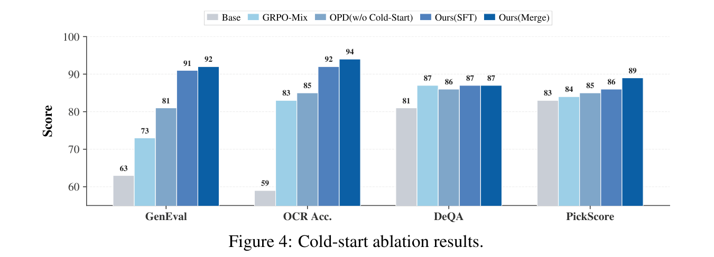
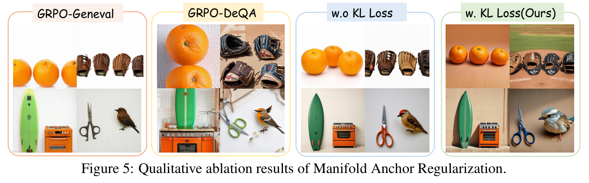
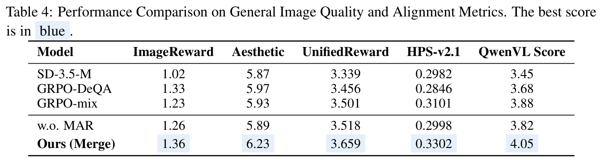
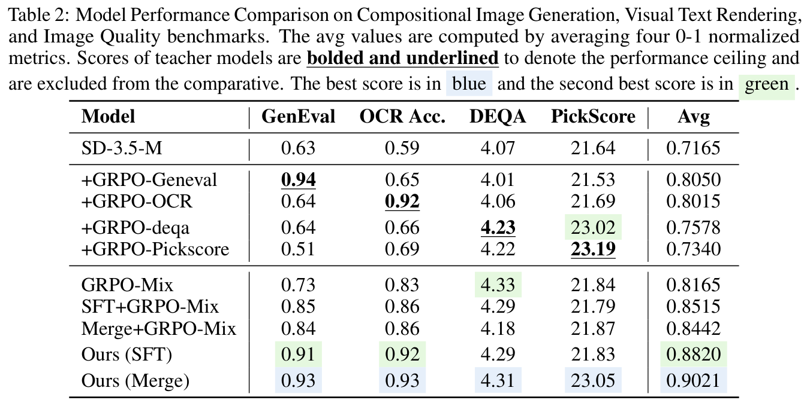
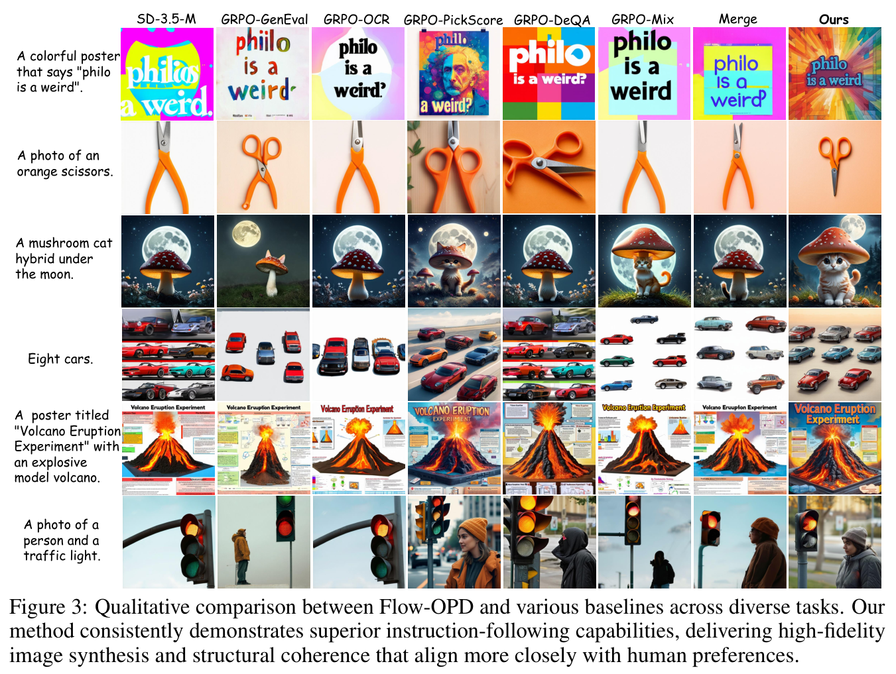

# Flow-OPD：沿 GKD 核心代码理解任务蒸馏与参考约束

- 论文：[Flow-OPD: On-Policy Distillation for Flow Matching Models，arXiv:2605.08063v5](https://arxiv.org/abs/2605.08063v5)，Zhen Fang et al.。
- 官方源码：[CostaliyA/Flow-OPD](https://github.com/CostaliyA/Flow-OPD)，固定提交 `434ab16911fc580f51e22107151915846222eb6a`；核心入口为 [`scripts/train_sd3_opd_mix.py`](https://github.com/CostaliyA/Flow-OPD/blob/434ab16911fc580f51e22107151915846222eb6a/scripts/train_sd3_opd_mix.py)。
- **阅读范围：只讲 `gkd` 模式，即任务蒸馏＋参考约束。** 不展开专家的 GRPO 训练、PPO 更新和分布式工程。源码片段均标注摘录或教学重排，不是独立运行脚本。
- **核验边界：** 已核对论文、源码和原图表，没有运行训练或独立复现指标；论文结果不等于本文展示的代码配置的实测结果。

## 1. 先把论文串起来：不是多奖励一起训，而是让专家分别教

希望一个模型同时具备构图、文字渲染和画面质量。直接混合多个最终图像奖励，可能顾此失彼；Flow-OPD 改为让各项专家在学生自己走过的中间状态上提供监督。

```text
准备同源的 SD3.5-Medium 任务专家
→ 用 SFT 或模型合并初始化学生
→ 学生自己生成，保存途中状态
→ 在同一状态上查询任务教师和全局参考模型
→ 匹配两份目标，只更新学生 LoRA
```

**On-policy** 指监督状态来自当前学生自己的轨迹，而不是固定的教师成品图数据集。教师不需要重新生成一条完整轨迹；推理时也只部署学生。

### 冷启动只决定起点，不替代后续蒸馏

论文研究 SFT 和 Model Merging 两种冷启动。这里只保留它在流程中的作用：**先初始化学生，再进行下文的在线蒸馏。** 训练循环不会自动替你完成这些准备工作。



*来源：Zhen Fang et al., Flow-OPD v5，Figure 4，[PDF 第 9 页](https://arxiv.org/pdf/2605.08063v5#page=9)，原 PDF 截图。*

图中不冷启动的 OPD，其 GenEval / OCR 分数为 81 / 85；经 SFT 或 Merge 冷启动、再进行 OPD 后，对应结果为 91 / 92、92 / 94。这支持冷启动在该实验中的作用，不表示“合并完权重就已经完成 Flow-OPD”。

代码通过 `train.lora_path` 读取已有学生 LoRA；默认值为 `None`，不能把示例运行自动等同于论文完整的冷启动方案。

## 2. 核心训练代码：从一批 OCR prompt 开始

本节选择 `config.train.reward_mode = "gkd"`，沿用多教师示例其余相关设置。教师权重路径需要实际配置；这不是一份开箱即用的复现命令。

| 对象 | 作用 | 是否更新 |
|---|---|---|
| `transformer` | 学生，重新计算当前一步预测 | 更新学生 LoRA |
| `current_ref_transformer` | 当前任务教师，例如 OCR 专家 | 不更新 |
| `mar_transformer` 或冻结基模 | 各任务共用的参考目标 | 不更新 |

任务教师分别加载到 `ref_transformers` 字典中，不是靠学生模型切换任务 adapter 来充当所有教师。

### 2.1 数据桶决定任务教师

[路由代码](https://github.com/CostaliyA/Flow-OPD/blob/434ab16911fc580f51e22107151915846222eb6a/scripts/train_sd3_opd_mix.py#L1119-L1130)与[教师选择](https://github.com/CostaliyA/Flow-OPD/blob/434ab16911fc580f51e22107151915846222eb6a/scripts/train_sd3_opd_mix.py#L1484-L1492)的关键语句，按逻辑并排摘录：

```python
current_ds_idx = get_current_dataset_idx(epoch)
current_ds_name = dataset_names[current_ds_idx]
current_train_dataloader = train_dataloaders[current_ds_name]
current_ref_transformer = ref_transformers.get(current_ds_name)
```

当前用 OCR 数据，就调用 OCR 教师；用 GenEval 数据，就调用构图教师。**不是先对每个 prompt 做语义分类，再智能挑选教师。**

[`mix_opd_8gpu()`](https://github.com/CostaliyA/Flow-OPD/blob/434ab16911fc580f51e22107151915846222eb6a/config/grpo.py#L128-L157) 的示例按 OCR 1 轮、GenEval 3 轮循环，PickScore 项被注释。这里的 `epoch` 是一次采样—更新外循环，不保证完整遍历数据集。

### 2.2 学生先采样，保存真实走过的状态

[原调用的删减重排版](https://github.com/CostaliyA/Flow-OPD/blob/434ab16911fc580f51e22107151915846222eb6a/scripts/train_sd3_opd_mix.py#L1220-L1241)，省略外层 `autocast` 与可选的 `generator` 参数：

```python
with torch.no_grad():
    images, latents, log_probs = pipeline_with_logprob(
        pipeline,
        prompt_embeds=prompt_embeds,
        pooled_prompt_embeds=pooled_prompt_embeds,
        negative_prompt_embeds=sample_neg_prompt_embeds,
        negative_pooled_prompt_embeds=sample_neg_pooled_prompt_embeds,
        num_inference_steps=config.sample.num_steps,
        guidance_scale=config.sample.guidance_scale,
        noise_level=config.sample.noise_level,
        height=config.resolution,
        width=config.resolution,
        output_type="pt",
    )

latents = torch.stack(latents, dim=1)
```

示例采样 10 步，轨迹形状为 `[B, 11, C, H, W]`：初始状态加 10 次转移。`noise_level=0.7`，每一步使用带随机噪声的 SDE 转移。

[缓存的轨迹字段](https://github.com/CostaliyA/Flow-OPD/blob/434ab16911fc580f51e22107151915846222eb6a/scripts/train_sd3_opd_mix.py#L1288-L1302)如下；文本条件、时间步等字段不在这里重复列出：

```python
sample_dict = {
    "latents": latents[:, :-1],
    "next_latents": latents[:, 1:],
}
```

- `sample["latents"][:, j]`：学生第 `j` 步的当前状态。
- `sample["next_latents"][:, j]`：当时实际采出的下一状态，包含随机噪声。
- **整个 rollout 不保留反传图。** 后面在缓存状态上重新前向，不是把 loss 穿过整条生成链。

### 2.3 同一个状态，分别计算学生和任务教师的速度预测

默认开启 CFG。`embeds`、`pooled_embeds` 已按“负条件在前、正条件在后”拼接；模型输入也复制为两份。

为避免把师生完全相同的前向写两遍，下面将[原文件的重复逻辑](https://github.com/CostaliyA/Flow-OPD/blob/434ab16911fc580f51e22107151915846222eb6a/scripts/train_sd3_opd_mix.py#L1500-L1593)抽成一个**教学函数**；`predict_velocity` 不是作者原文件中的函数名。

```python
def predict_velocity(model, sample, j, embeds, pooled_embeds, scale):
    pred = model(
        hidden_states=torch.cat([sample["latents"][:, j]] * 2),
        timestep=torch.cat([sample["timesteps"][:, j]] * 2),
        encoder_hidden_states=embeds,
        pooled_projections=pooled_embeds,
        return_dict=False,
    )[0]
    uncond, cond = pred.chunk(2)
    return uncond + scale * (cond - uncond)
```

```python
# 学生：需要梯度
noise_pred = predict_velocity(
    transformer, sample, j, embeds, pooled_embeds, config.sample.guidance_scale
)

# 任务教师：只提供目标
with torch.no_grad():
    ref_noise_pred = predict_velocity(
        current_ref_transformer, sample, j,
        embeds, pooled_embeds, config.sample.guidance_scale
    )
```

两者读取**同一个学生状态、同一个时间、同一个 prompt**。`noise_pred` 虽然沿用噪声预测的名字，在这里实际是 flow 速度预测；经过 CFG 后形状回到 `[B, C, H, W]`。

教师回答的是：“你已经走到这个状态了，如果是我，下一步会怎么走？”

### 2.4 从速度算出下一步预测 latent，再加随机噪声

上一段模型输出的是**速度**，还不是下一步 latent。采样时，采样器接着根据当前 latent、预测速度和当前时间步，算出下一步预测值，再加上本步随机噪声：

```text
当前 latent ＋ 模型预测的速度
        ↓ 按当前时间步的 SDE 规则计算
下一步预测 latent（加噪前）       ← prev_sample_mean
        ↓ 加本步随机噪声
实际采出的下一步 latent          ← 保存到 next_latents
```

**`prev_sample_mean` 就是“下一步预测 latent（加噪前）”，不是对一堆结果求平均。** 作者用 `mean` 命名，是因为它是这一步随机转移分布的均值参数；代码直接算出它，不需要先采样很多次，也没有在这里对 batch 求平均。下文统一称它为**下一步预测值（加噪前）**。

它仍是 `[B, C, H, W]` 的完整 latent 张量，不是一个平均分数；也不是模型另一个输出头，而是采样器根据速度算出的结果。

训练时，在缓存的当前状态上重新计算这个预测值。[原调用摘录](https://github.com/CostaliyA/Flow-OPD/blob/434ab16911fc580f51e22107151915846222eb6a/scripts/train_sd3_opd_mix.py#L1544-L1551)，补充一行注释，并将未使用的第一个返回值记为 `_`：

```python
# prev_sample_mean：学生的下一步预测 latent，还没加本步随机噪声
_, log_prob, prev_sample_mean, std_dev_t = _sde_step(
    pipeline.scheduler,
    noise_pred.float(),
    sample["timesteps"][:, j],
    sample["latents"][:, j].float(),
    prev_sample=sample["next_latents"][:, j].float(),
    noise_level=config.sample.noise_level,
)
```

任务教师也把自己的速度预测作同样转换，得到 `prev_sample_mean_ref_lora`，即教师的下一步预测值（加噪前）。教师的前向与转换均在 `no_grad` 中完成。**这份脚本在训练阶段查询教师，不是在 rollout 阶段先缓存好所有教师标签。**

上面的流程图描述采样时完整的一步。真正生成新的一步时，[源码加噪声的语句](https://github.com/CostaliyA/Flow-OPD/blob/434ab16911fc580f51e22107151915846222eb6a/flow_grpo/diffusers_patch/sd3_sde_with_logprob.py#L49-L68)是：

```python
prev_sample = prev_sample_mean + std_dev_t * torch.sqrt(-1 * dt) * variance_noise
```

训练调用已经传入保存的 `prev_sample`，不会再执行这次随机采样。并且，“加噪前”不等于“按 ODE 更新”：这里的预测值仍按 SDE 规则计算，不能直接拿 ODE 的 `当前状态 + dt × 速度` 替代。

**所以 GKD 比较的就是师生各自算出的下一步预测 latent（加噪前），不比较两个独立采样的随机落点。**

#### 为什么还保存 `next_latents`？

```text
采样时：A → B，B 就是保存的 next_latents。
训练时：从同一个 A 重算，学生下一步预测为 C，教师下一步预测为 D；C、D 都未加本步随机噪声。
GKD 比较 C 和 D，不是拿 B 当教师标签。
```

`next_latents` 被用于在当前模型的一步分布下，重算那次已采样转移的 `log_prob`；它不决定前面的加噪前预测值，也不是 GKD 的监督目标。若单独重构只做预测匹配的训练器，可以移除这条不必要的概率计算依赖；不能据此说现有脚本已经没有这些计算。

### 2.5 核心：两份预测差距，合成一个总 loss

除了任务教师，还要在**同一个状态、时间和文本条件**上计算第二份参考预测：

- 配置了 `train.mar_lora`：使用额外的审美教师。
- 未配置：临时禁用学生 LoRA，使用冻结基模。

[参考前向](https://github.com/CostaliyA/Flow-OPD/blob/434ab16911fc580f51e22107151915846222eb6a/scripts/train_sd3_opd_mix.py#L1597-L1663)同样不反传。变量名 `prev_sample_mean_ref_base` 不代表它永远来自基模；配置了 MAR 后，它装的是审美参考教师的下一步预测 latent（加噪前）。

给源码变量取更直观的教学别名；三者都是**下一步预测值（加噪前）**，并没有增加新的计算：

```python
student_next_pred = prev_sample_mean
task_next_pred = prev_sample_mean_ref_lora
ref_next_pred = prev_sample_mean_ref_base
```

下面是[原 GKD 损失](https://github.com/CostaliyA/Flow-OPD/blob/434ab16911fc580f51e22107151915846222eb6a/scripts/train_sd3_opd_mix.py#L1729-L1752)的**等价拆写**，假设任务教师已加载、参考约束已启用：

```python
task_error = ((student_next_pred - task_next_pred) ** 2).mean(
    dim=(1, 2, 3), keepdim=True
)
gkd_loss = (task_error / (2 * std_dev_t ** 2)).mean()

anchor_error = ((student_next_pred - ref_next_pred) ** 2).mean(
    dim=(1, 2, 3), keepdim=True
)
kl_loss = (anchor_error / (2 * std_dev_t ** 2)).mean()

loss = gkd_loss + config.train.beta * kl_loss
```

**两项都在比较下一步预测 latent，只是参考对象不同。**

- `gkd_loss`：向当前任务教师学习；这是与 DiffusionOPD 最相似的核心蒸馏项。
- `kl_loss`：向审美教师或基模靠拢。本文称它为**参考约束损失**，不是额外的探索奖励。
- `beta`：控制第二项的权重。两个目标可能存在分歧，不要求两项同时变成零。

**这里的 `.mean()` 才是真正在求平均：平均的是预测误差，不是在生成下一步预测值。** 对 `[B, C, H, W]` 的平方误差，先在通道、空间维度平均，再做噪声加权和 batch 平均。`prev_sample_mean` 中的 `mean` 是变量命名，与这里的误差平均要分开。所谓密集监督，是每一步整块 latent 的预测提供监督，最终 loss 仍是标量。

**实现边界：** 源码分母为 `2 * std_dev_t**2`，实际 SDE 步方差还包含 `(-dt)`，且源码用维度平均。因此这里准确描述的是加噪前下一步预测的归一化平方误差，不能逐项冒称论文完整高维转移 KL。

### 2.6 反传只更新学生

学生前向、loss 和更新都放在 `accelerator.accumulate(transformer)` 内。[实际更新代码](https://github.com/CostaliyA/Flow-OPD/blob/434ab16911fc580f51e22107151915846222eb6a/scripts/train_sd3_opd_mix.py#L1803-L1809)：

```python
accelerator.backward(loss)
if accelerator.sync_gradients:
    accelerator.clip_grad_norm_(
        transformer.parameters(), config.train.max_grad_norm
    )
optimizer.step()
optimizer.zero_grad()
```

梯度只沿着“总 loss → 学生下一步预测 latent（加噪前）→ 学生速度预测 → 学生 LoRA”传播。教师目标、采样轨迹、VAE 和文本编码器不更新；梯度累积下也不是每次调用 `step()` 都实际更新参数。

示例的 `timestep_fraction=0.99` 对 10 步取整后，训练的是前 **9** 步，而不是随机挑 9 步。

## 3. 为什么加参考约束？看 MAR 的原始消融

OCR 教师擅长把字写对，但它的整体画质不一定最好。只学任务教师，可能连不希望继承的生成行为也一起学过来。第二个参考目标希望在吸收任务能力时，约束学生不要偏离较好的生成行为太远。

**关键不是多了一个新任务数据桶，而是在 OCR、GenEval 等各类任务数据上，始终加入同一份参考约束。** 论文的 MAR 使用审美教师；代码 `mar_lora` 留空时则是基模参考，不能混为一谈。



*来源：Zhen Fang et al., Flow-OPD v5，Figure 5，[PDF 第 9 页](https://arxiv.org/pdf/2605.08063v5#page=9)，原 PDF 截图。*

图中的 **“w.o KL Loss / w. KL Loss”是在比较有无 MAR**。作者展示背景、物体外观和视觉质量的变化；它不是 `kl_only` 与 `gkd` 两种模式的对比。



*来源：Zhen Fang et al., Flow-OPD v5，Table 4，[PDF 第 10 页](https://arxiv.org/pdf/2605.08063v5#page=10)，原表截图。*

`w.o. MAR → Ours (Merge)`：Aesthetic 从 **5.89 → 6.23**，QwenVL Score 从 **3.82 → 4.05**。这是该设置下的质量/对齐评分收益，不是真人偏好胜率，也不保证从此不会出现画质退化。

## 4. 主结果：多项能力的折中，不是每项都超过最强教师



*来源：Zhen Fang et al., Flow-OPD v5，Table 2，[PDF 第 8 页](https://arxiv.org/pdf/2605.08063v5#page=8)，原表截图。*

按这张表读取：

- `Ours (Merge)` 的 GenEval / OCR score 为 **0.93 / 0.93**，GRPO-Mix 为 **0.73 / 0.83**。
- Avg 为 **0.9021 vs 0.8165**，它是四项归一化指标的平均，不是准确率或人类胜率。
- 不能说每项都超过教师：GenEval 教师为 0.94，PickScore 教师为 23.19；Ours 对应为 0.93、23.05。

Figure 4 的 `Ours (Merge)` 柱值为 92 / 94，按 0–1 表示为 0.92 / 0.94，与 Table 2 的 0.93 / 0.93 不一致。这里指冷启动后继续 OPD 的结果，不是仅做权重合并的初始模型；分别按原图原表引用，不猜测差异原因，也不手工改成一致。



*来源：Zhen Fang et al., Flow-OPD v5，Figure 3，[PDF 第 8 页](https://arxiv.org/pdf/2605.08063v5#page=8)，原 PDF 截图。*

对照单项专家、GRPO-Mix、Merge 和 Ours，理解论文追求的是文字、数量、属性与画面质量的综合折中。精选样例不能证明所有 prompt 都更好，也不能据海报小字直接统计 OCR 正确率。

**这些是论文主方法的结果，不是本文替 `gkd` 单独跑出的成绩，更不是 `gkd` 胜过 `kl_only` 的证据。**

## 5. 学完后保留的几个边界

### 不是三个损失，也没有两模式优劣的直接实验证据

`kl_only` 是另一种模式名，不是第三个 loss。参考约束开启时，分支关系的教学简写是：

```python
if reward_mode == "gkd":
    loss = gkd_loss + beta * kl_loss
elif reward_mode == "kl_only":
    loss = policy_loss + beta * kl_loss
```

二者互斥，不是三项一起相加。本文只解释第一条；[仓库 `mix_opd_8gpu()` 示例](https://github.com/CostaliyA/Flow-OPD/blob/434ab16911fc580f51e22107151915846222eb6a/config/grpo.py#L107-L110)默认选第二条，“默认”不表示最优，也不能据此认定论文所有实验的运行配置。

核对 v5 正文、附录、图 1–11 和表 1–5，**未找到这两条代码分支的一对一实验对比**。论文的理论论述、MAR 消融、Flow-OPD 与任务奖励 GRPO-Mix 的比较，都不能替代这种对照。

### 参考约束不等于必须用 SDE 探索

与已学的 [DiffusionOPD](./diffusionopd.md) 相比，GKD 的核心仍是学生状态上的师生预测匹配；但采样器、从速度到下一步预测值的转换和时间权重并不完全相同。

这里按官方 SDE 版 GKD 讲解。原则上可以为 ODE 设计“任务匹配＋参考匹配”的平方误差目标，但这是改写目标和实现：**当前两项损失都带噪声分母，不能直接把 `noise_level` 设零，也不是删掉参考约束就自动支持 ODE。**

### 通用脚本不等于已经精简好的纯 GKD 训练器

- `gkd_loss` 不使用最终图像奖励，但完整脚本仍计算任务奖励、任务优势，并据非零优势筛选样本；不能把整份脚本称为 reward-free，也不能承诺删除这些计算仍保持原行为。
- 本版本任务教师的加载也受 `beta > 0` 控制，教师查询还受 `step_wise` 和 `kl_scale != 0` 控制。不能把 `beta=0` 当作无副作用的“只关 MAR”操作；`kl_scale` 本身并不乘进 `gkd_loss`。
- 示例 `beta=0.04`、`mar_lora=""`；论文附录的 MAR 系数为 0.02，并使用审美参考教师。代码示例不等于论文完整实验配置。

## 来源与图表说明

图表均沿用本仓库已有的五张原 PDF 截图，仅调整为笔记相邻资源路径，未改图内数值或重绘表格；每张紧邻对应的学习解读。原论文由 Zhen Fang 等作者署名，来源统一为 [arXiv:2605.08063v5](https://arxiv.org/abs/2605.08063v5)。

论文版本页采用 [arXiv 非独占分发许可](https://arxiv.org/licenses/nonexclusive-distrib/1.0/license.html)，**不是 CC-BY，也不据此声称取得第三方通用转载授权**。图表权利归原权利人；此处保留来源及学术评论语境，进一步复用需另行确认授权或适用的法定引用例外。

代码片段依据上述固定提交作摘录或教学改写。仓库源码采用 MIT，Copyright (c) 2025 Jie Liu；[原始代码许可](./assets/flow-opd/CODE-LICENSE.txt)随笔记保留。代码许可不替代论文图表、模型权重及上游依赖各自的许可。

**一句话收束：沿 GKD 路线看，Flow-OPD 就是在学生自己走到的状态上，向任务教师学习，再用一份跨任务持续生效的参考约束控制偏离。**
