# Poly-OPD：不同老师通过图片教同一个学生，能力按模式切换

- 论文：Siming Fu 等，[Poly-OPD: Heterogeneous Multi-Teacher On-Policy Distillation for Capability-Selectable Flow Models](https://arxiv.org/abs/2608.04349v1)，**arXiv:2608.04349v1，2026-08-05，9 页**。下文页码、公式和图表编号均以这份 [v1 PDF](https://arxiv.org/pdf/2608.04349v1) 为准。
- **没有找到可核实的官方实现。** 已检查论文 PDF、摘要页与 HTML 的代码/项目链接，并做仓库名定向核查；没有定位到作者认可的 Poly-OPD 仓库。arXiv 的 HTML 反馈、LaTeXML 链接不是论文代码。下文所有 Python 风格片段均为**依据论文的教学伪代码，非作者源码**，不借用 Any-OPD 实现冒充。
- 本文核验方法、原图表与实验口径；没有运行训练或独立复现分数。

## 1. 先通俗理解：一条样本找一个老师，不同模型通过图片交流

想把两位老师的长处放进一个较小的模型：FLUX.1-dev 更擅长画得好看，Z-Image 更擅长照着文字安排物体、数量、颜色和位置。困难不只是“老师有两个”：它们的 VAE、latent 和噪声时间表不同，不能拿老师的内部张量直接当学生答案；两种能力的更新方向还可能互相冲突。

Poly-OPD 的做法可以记成三句话：

1. **一条样本只找一个对应老师。** 先抽偏好模式或构图模式，再从对应 prompt 池取文本；不是读完每条 prompt 后动态智能路由，也不是把两个老师的速度平均。
2. **不同 latent，先通过图片交流。** 学生先画完，老师用自己的 VAE 读这张图，加新噪声再生成一个修正版；学生从自己缓存的中途状态重画后半程，朝老师修正版的 DINOv2 特征靠近。
3. **共享 Attention 学两位老师，FFN 各学一位。** 底座冻结，两种模式共用 Attention LoRA，但各有独立 FFN LoRA；推理时选择模式，不再调用老师。

### 原始 teaser：左边看老师各擅长什么，右边看学生学到了什么

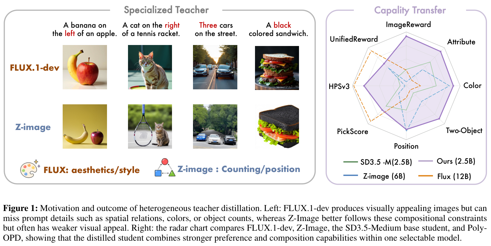

*Siming Fu et al., Poly-OPD v1，Figure 1，[PDF 第 1 页](https://arxiv.org/pdf/2608.04349v1#page=1)，原 PDF 渲染裁剪，保留原图与图注。*

- **左侧**用相同 prompt 比较 FLUX.1-dev 与 Z-Image：香蕉与苹果的位置、猫与球拍的位置、三辆车、黑色三明治。作者用这些样例说明“视觉吸引力”与“听懂构图要求”并不总在同一位老师上最强。它们是选取的例子，不是总体胜率。
- **右侧**把偏好指标和构图子项放在同一张雷达图中，紫色为 Poly-OPD。它表示**一个可切换模式的模型**所承载的能力：偏好评测用 preference adapter，构图评测用 composition adapter，不能读成同一个固定 adapter 同时取得全部成绩。不同轴也不能直接比较绝对数值大小。
- 紫色不是处处包住所有老师。完整数值见第 3 部分；例如 HPSv3 仍低于 FLUX，DPG-Bench 综合分仍低于 Z-Image。

| 角色 | 模型 | 本文中的工作 |
|---|---|---|
| 学生 | SD3.5-Medium，2.5B | 一个冻结底座，训练共享/专属 LoRA |
| 偏好老师 | FLUX.1-dev，12B，冻结 | preference 模式；prompt 来自 Pick-a-Pic |
| 构图老师 | Z-Image，6B，冻结 | composition 模式；prompt 来自 Flow-GRPO 的 GenEval-style split |

完整训练顺序是：

```text
Stage 1：先练 500 步
选模式/老师 → 老师独立出完整图 → 学生 VAE 编码 → 加噪 → flow-matching loss

Stage 2：再练 800 步
选模式/老师 → 从对应池抽 prompt
→ 学生无梯度走完 20 步，保存轨迹、解码成图
→ 对应老师编码这张图，加新噪声，走剩余 r 步得到修正版
→ 按噪声幅度找到学生缓存位置 j
→ 学生有梯度重跑 j 之后的多步轨迹，解码成图
→ DINOv2 CLS 特征比较 ＋ warm-start 正则项
→ 只更新共享 Attention LoRA ＋ 当前模式 FFN LoRA
```

与已学方法的联系：**像素桥、老师修图、学生后缀重跑，与 Any-OPD 的核心流程相近**；这里增加的重点是多教师下的共享/隔离边界，以及构图模式内按师生差距分配数据。它不是仅把“多一个老师”换成全新 OPD 范式。与 DanceOPD 的关键区别则是：**这里真的对学生后缀多步反传，不是在一个固定状态上只重算一次速度做 MSE。**

## 2. 按一次训练前后，逐模块理解方法

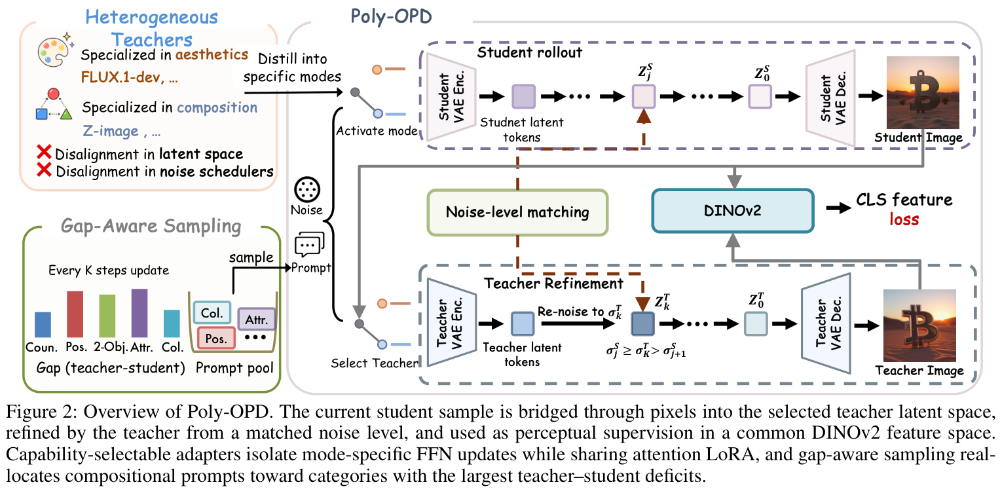

*Poly-OPD v1，Figure 2，[PDF 第 3 页](https://arxiv.org/pdf/2608.04349v1#page=3)，原 PDF 截图。*

从图中**上方 Student Image**沿灰色线走：学生成图送入**下方 Teacher VAE**，不是把学生 latent 直接塞给老师。老师修好的图与学生重跑得到的图进入中间 DINOv2；棕色虚线表示按噪声幅度匹配位置，不是两条轨迹共用 latent。左下角采样器只调构图 prompt 类别。

下文统一沿用正文的索引约定：$\sigma_0=1$ 是纯噪声，索引越大越干净，$\sigma_N=0$ 是终点。图中终图附近的 $Z_0$ 标签采用了不同写法，**不要据此把正文的第 0 个缓存状态当成干净图**。`S` 为当前模式学生，`T` 为选中老师，`c` 为同一条文本；各模型自行编码文本，不要求共享 text embedding。

### 2.1 先选模式，再取数据：老师与 FFN 必须配套

论文 §3.1、§3.2 式 (5)，第 3–4 页：模式来自固定先验 $\pi$，$\pi(\mathrm{pref})=\lambda$，$\pi(\mathrm{comp})=1-\lambda$。**这个 $\lambda$ 没有在当前 PDF 中给出数值**，不能默认两边各一半，也不是用 gap 算出来的老师权重。

**依据论文的教学伪代码，非作者源码：**

```python
mode = sample_mode(pi)                    # 固定先验；pi 的数值未披露
T = teachers[mode]                        # pref→FLUX；comp→Z-Image
S.activate(shared_attn, ffn[mode])         # 全程保持本次选中的模式
if mode == "comp":
    category = sample_category(p_gap)     # 只在构图模式内调类别比例
    c = sample_prompt(comp_pool[category])
else:
    c = sample_prompt(preference_pool)    # 固定数据分布
```

这里的 `shared_attn`、`ffn[mode]` 都是**跨多层的参数组**，不是全网只有几个矩阵。后文所有 `S.velocity`、rollout 和 warm-start loss 都使用本次同一模式。

### 2.2 Stage 1：先让学生学会模仿教师成品图

老师先按文本画出完整图，学生用**自己的 VAE**将它转成自己的训练数据，再做标准 flow matching。此时老师只是数据生成器，还没有查看学生当前生成的图，所以这一阶段是 off-policy warm start。

论文 §3.2 式 (1)，[第 3 页](https://arxiv.org/pdf/2608.04349v1#page=3)：

$$
z_{\mathrm{clean}}^{S,e}=E_S(x_e^\star),\qquad
z_\sigma^S=(1-\sigma)z_{\mathrm{clean}}^{S,e}+\sigma\epsilon,
$$

$$
\mathcal L_{\mathrm{WS}}^e
=\mathbb E\left[\left\|v_\theta(z_\sigma^S,\sigma,c)
-(\epsilon-z_{\mathrm{clean}}^{S,e})\right\|_2^2\right].
$$

$x_e^\star$ 是选中老师的完整成图，$E_S$ 是学生 VAE 编码器，$\epsilon$ 是新高斯噪声，$\sigma$ 取自学生噪声表。目标 $\epsilon-z_{\mathrm{clean}}^{S,e}$ 是从干净图指向噪声的速度；生成时按递减的 $\sigma$ 积分，方向与该参数化相容。

**依据论文的教学伪代码，非作者源码：**

```python
def warm_start_loss(S, T, c):
    with no_grad():
        x_teacher = T.generate(c)           # 独立完整出图，不看学生结果
        z_clean = S.vae.encode(x_teacher)   # 注意：学生 VAE
        sigma = sample_student_sigma()      # 噪声档采样细节未披露
        eps = randn_like(z_clean)
        z_noisy = (1 - sigma) * z_clean + sigma * eps
        target_v = eps - z_clean
    pred_v = S.velocity(z_noisy, sigma, c)   # 当前模式，有梯度
    return squared_l2(pred_v - target_v)

# 先选 mode/T/c，再执行；重复 500 次更新
optimizer.zero_grad(set_to_none=True)
loss = warm_start_loss(S, T, c)
loss.backward()
optimizer.step()                            # 仅更新本次活跃 LoRA
```

`generate`、`squared_l2` 等是教学操作名，不代表已知的官方函数或 loss reduction 实现。**500 步**来自 §4.1，而非 Any-OPD 的 400 步；教师完整采样步数、这里噪声档如何分配，当前版本未给出可复现配置。

### 2.3 Stage 2 前半程：学生先画，老师通过像素桥修图

现在目标不再只是模仿独立教师图。学生先按自己的当前参数生成，再把**自己实际产生的问题**交给老师处理。

论文 §3.2 式 (2)–(3)，第 3–4 页：

$$
x_S=G_S(z_{N_S}^S),\qquad \bar z_{\mathrm{clean}}^e=E_e(x_S),
\qquad k_e=N_e-r.
$$

这里 $G_S$ 是学生解码器，$E_e$ 是当前老师编码器。重新加噪这一步，按论文的 flow 插值约定展开为：

$$
\bar z_{k_e}^e=(1-\sigma_{k_e}^e)\bar z_{\mathrm{clean}}^e
+\sigma_{k_e}^e\epsilon_e,\qquad
x_{\mathrm{ref}}^e=G_e\!\left(\operatorname{Euler}_{T_e}
(\bar z_{k_e}^e,k_e\!\to\!N_e,c)\right).
$$

$\epsilon_e$ 是**新抽的老师空间噪声**，不是学生缓存的 $z_j$，也不要求与学生初始噪声相同。两边 latent 的维度和语义可以不同；共享的是图像与 prompt。

**依据论文的教学伪代码，非作者源码：**

```python
r = randint_inclusive(15, 20)              # §4.1，20 步教师网格
k = N_teacher - r                         # N_teacher = 20
sigma_T = teacher_sigmas[k]
with no_grad():
    z = sample_student_noise()
    cache = []
    for i in range(N_student):            # N_student = 20
        cache.append(z.detach().clone())  # 更新之前保存
        dt = student_sigmas[i + 1] - student_sigmas[i]
        z = z + dt * S.velocity(z, student_sigmas[i], c)
    x_student = S.vae.decode(z)
    z_teacher = T.vae.encode(x_student)   # 注意：老师 VAE
    eps_T = randn_like(z_teacher)         # 独立的新噪声
    z_teacher = (1 - sigma_T) * z_teacher + sigma_T * eps_T
    z_teacher = teacher_euler(T, z_teacher, k, N_teacher, c)
    x_ref = T.vae.decode(z_teacher).detach()
```

`teacher_euler` 按老师自己的 schedule 和速度参数化走 $r$ 步；不能把学生的 scheduler 直接套过去。VAE 的预处理、latent 缩放等模型细节被教学操作封装，不能据此把伪代码当可运行训练脚本。

**“精修”不等于只修最后一点细节。** 默认在 20 步网格上抽 $r=15\ldots20$，老师从较高噪声开始，可以大幅重排构图；这是较强介入。$r$ 同时控制目标保留多少学生内容、教师计算量，以及后续学生需要反传多长的后缀。

- $r=N_e=20$ 时，$k_e=0$、$\sigma_{k_e}^e=1$，学生图在加噪式中的系数变成 0：目标退化为**不依赖学生图、但仍由同一 prompt 引导的教师采样**。原文称其为 “unconditional teacher sample”，不能照译成“无文本条件”。学生侧仍从自身轨迹起点重跑，退化的是目标对学生图的依赖，不表示整个 Stage 2 loss 自动变成 Stage 1。
- $r=1$ 时，老师只在较低噪声处作较小修改，**不是严格恒等于原学生图**；仍有 VAE 转换、新噪声和一次教师更新。
- 因此，不能把所有 $r$ 都称为同样强的 on-policy 修正。

### 2.4 按噪声幅度接回学生轨迹：多步反传，只比较感知特征

老师的“第 5 步”和学生的“第 5 步”不一定有同样多噪声。要比较接近的生成阶段，匹配的是 $\sigma$，不是步号。

论文 §3.2 式 (4)，[第 4 页](https://arxiv.org/pdf/2608.04349v1#page=4)：找到满足下式的学生区间，再从对应缓存状态重跑。

$$
\sigma_j^S\geq\sigma_{k_e}^e>\sigma_{j+1}^S,\qquad
\widetilde x_S=G_S\!\left(\operatorname{Euler}_S
(\operatorname{sg}[z_j^S],j\!\to\!N_S,c;\theta)\right),
$$

$$
\mathcal L_{\mathrm{OPD}}^e
=1-\cos\!\left(f(\widetilde x_S),\operatorname{sg}[f(x_{\mathrm{ref}}^e)]\right).
$$

`sg` 是停止梯度，$f$ 是冻结 DINOv2 的 CLS 特征。这里确实是 **1 − cosine**，不是特征 L2，更不是异构 latent/velocity MSE 或两张完整图的像素 MSE。

**依据论文的教学伪代码，非作者源码：**

```python
j = next(i for i in range(N_student)
         if student_sigmas[i] >= sigma_T > student_sigmas[i + 1])
z = cache[j].detach()                     # 不反传到原 rollout 前缀
optimizer.zero_grad(set_to_none=True)
for i in range(j, N_student):             # 这 N_student-j 步都保留梯度
    dt = student_sigmas[i + 1] - student_sigmas[i]
    z = z + dt * S.velocity(z, student_sigmas[i], c)
x_hat = S.vae.decode(z)                   # 冻结参数，但不能 no_grad
with no_grad():
    target_feature = dino_cls(x_ref)
pred_feature = dino_cls(x_hat)            # 输入梯度必须保留
loss_opd = (1 - cosine(pred_feature, target_feature)).mean()
loss_ws = warm_start_loss(S, T, c)        # 同模式的式 (1) 正则项
loss = loss_opd + lambda_WS * loss_ws     # lambda_WS 数值未披露
loss.backward()
optimizer.step()
```

总目标来自式 (5)：$\mathcal L^{(2)}=\mathbb E_{e\sim\pi}[\mathcal L_{\mathrm{OPD}}^e+\lambda_{\mathrm{WS}}\mathcal L_{\mathrm{WS}}^e]$。伪代码用同一 `c` 计算两项来展示依赖；两项实际是否共用 batch、教师完整图是否缓存，论文没有说明。**不能漏掉这个仍保留的 warm-start 正则项，也不能把精修图简单当成唯一的 Stage 2 SFT 数据。**

梯度路径要分清：

```text
OPD loss → 学生图的 DINOv2 特征 → 冻结的学生 VAE 解码器
         → 第 j 到 N_S−1 步的学生速度网络 → 活跃 LoRA

无梯度：原始完整 rollout、缓存起点、教师精修分支、教师目标特征
冻结但保留输入梯度：学生图分支上的 DINOv2 与 VAE decoder
```

“冻结”只是参数不更新，不等于这个模块的输入也不能求导。把 `dino_cls(x_hat)` 或 `S.vae.decode(z)` 放进 `no_grad`，就切断了这条学习路径。与 DanceOPD 的单状态速度监督相比，这里反传开销随后缀长度增加；不能称为“只重算一次学生前向”。

### 2.5 Capability-Selectable Adapters：公共部分一起学，冲突部分分开学

**每一步只更新公共 Attention LoRA，以及当前选中模式的 FFN 适配器；底座和未选中的适配器不接收梯度。**

下面是参数组织的**教学结构图，非论文原图**。结构在多层中重复，并不是把全网压成三个 LoRA 矩阵：

```text
                   冻结的 SD3.5-Medium 底座
                              │
每个相关 block： Attention 基础权重 ＋ shared_attn（两种模式共用）
                              │
                  FFN 基础权重 ＋ 当前选中的一组
                              ├─ pref：ffn_pref
                              └─ comp：ffn_comp
```

论文 §3.3 式 (7) 的共享/专属边界是：Attention 增量不带模式下标，FFN 增量带 $e$ 下标。LoRA 本身每处仍由低秩 $A,B$ 因子组成；`shared_attn/ffn_pref/ffn_comp` 是参数组名字，**不是 LoRA 的三个矩阵 A/B/C**。

**依据论文的教学伪代码，非作者源码：**

```python
freeze(base, teachers, vaes, dino)          # 所有基础参数保持固定
shared_attn = add_attention_lora(base)
ffn_pref = add_ffn_lora(base, mode="pref")
ffn_comp = add_ffn_lora(base, mode="comp")

# 每次更新前：丢弃旧梯度，并只让选中 FFN 进入前向
optimizer.zero_grad(set_to_none=True)
active_ffn = ffn_pref if mode == "pref" else ffn_comp
S.activate(shared_attn, active_ffn)
loss = mode_loss(S, teachers[mode], c)     # Stage 1 或 Stage 2 目标
loss.backward()                          # inactive FFN 的 grad 为 None
optimizer.step()                         # 只更新有梯度的活跃参数
```

两次更新放在一起，就很直观：

| 本次模式 | 使用老师 | `shared_attn` | `ffn_pref` | `ffn_comp` | 底座 |
|---|---|---|---|---|---|
| 第一次：偏好 | FLUX.1-dev | 更新 | 更新 | 不更新 | 不更新 |
| 第二次：构图 | Z-Image | 更新 | 不更新 | 更新 | 不更新 |

因此，公共 Attention 会依次接收两位老师的梯度；两个 FFN 则各接收对应模式的梯度。推理只选择对应 FFN，不需要老师，也不是把两个 FFN 输出自动融合。**共享参数仍会受到两种任务影响，隔离 FFN 并不构成“绝对不会相互干扰”的数学保证。**

#### 为什么共享 Attention、隔离 FFN？来自本文的梯度诊断

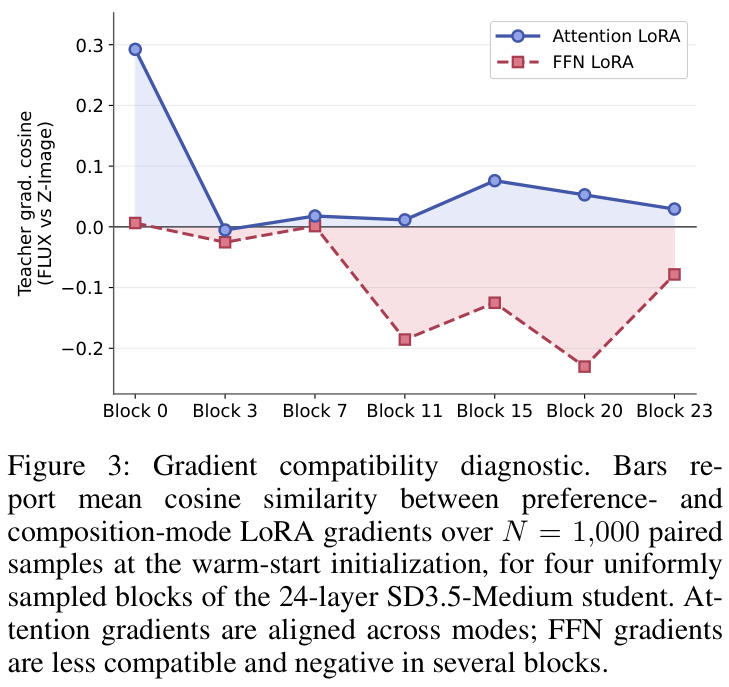

*Poly-OPD v1，Figure 3，[PDF 第 4 页](https://arxiv.org/pdf/2608.04349v1#page=4)，原 PDF 截图。*

§3.3 式 (6)：作者在 warm-start 初始化处，用相同形式的式 (1) 分别求 preference/comp 梯度；配对样本共用 $(\sigma,\epsilon)$，不同的是 prompt 来源与老师，再按模块计算两份梯度的 cosine。图注报告 **1,000 对样本**。

- 余弦大于 0：两个梯度较同向；小于 0：更新方向有冲突。
- 蓝色 Attention 整体较相容，部分位置接近零；红色 FFN 在多个 block 明显为负。这支持作者在这组模型/任务上采取“共享 Attention、专属 FFN”。
- 这不是所有 DiT 的定理，也不是训练时每一步动态重算共享边界。原图注写“四个 block / bars”，实际画出 **7 个 block 的折线点**；保留原图，不据图注推算未给出的精确诊断配置。

### 2.6 Gap-aware 采样：多练“老师还有东西可教”的构图类别

不是“绝对越难就越多练”。如果一个类别老师也很差，学生已经追平它，继续大量分配训练未必还有教师优势可学。Poly-OPD 看的量是**老师分数减学生分数的正部分**。

论文 §3.4 式 (8)，[第 5 页](https://arxiv.org/pdf/2608.04349v1#page=5)：

$$
g_a\leftarrow\beta g_a+(1-\beta)\max(s_a^T-s_a^S,0),\qquad
p(a)=\frac{\exp(g_a/\tau)}{\sum_{a'}\exp(g_{a'}/\tau)}.
$$

$a$ 是构图类别，$s_a^T,s_a^S$ 是相同 probe 上的教师/学生分数，$g_a$ 是平滑后的剩余差距。默认 **$\beta=0.8$、$\tau=0.1$**：EMA 减轻小样本波动，温度控制采样有多偏向最大差距。

**依据论文的教学伪代码，非作者源码：**

```python
categories = ["two-object", "counting", "colors", "position", "color attribution"]
# 每类 32 条固定 probe；与训练池、最终评测集均分离
teacher_score = score_offline(Z_Image, probes)
# g 的初始化未披露；这里仅展示每 50 步的刷新逻辑
if refresh_due(every=50):
    with no_grad():
        student_score = score_composition_mode(S, probes)
    gap = maximum(teacher_score - student_score, 0)
    g = 0.8 * g + 0.2 * gap
    p_gap = softmax(g / 0.1)

if mode == "comp":
    a = sample_category(p_gap)
    c = sample_prompt(comp_pool[a])
```

教师分数离线算好；学生每 **50 steps** 测一次，每类 **32 条**。五类不包括 single-object，虽然 GenEval 最终会评估它。probe 的作用是调数据比例，不是把评测 reward 直接反传给生成器。

学生超过老师时，新的 gap 贡献为 0，不会产生负采样概率；历史 EMA 会逐渐衰减。**当各类剩余差距都消失时**，$g_a$ 逐渐趋近 0，softmax 回到近均匀；如果只有某一类追平，就把更多预算移给仍有差距的其他类，而非立刻全体均匀。该模块不学习老师路由比例 $\pi$，偏好模式仍按固定 prompt 分布取样。

## 3. 主实验与全部消融：哪些能力提升，哪些边界没有解决？

### 3.1 先固定评测口径

论文 §4.1，第 5 页：

| 项目 | 论文设置 |
|---|---|
| 训练阶段 | warm start 500 steps，随后 OPD 800 steps |
| OPD 轨迹 | 学生 20 步 Euler；老师 20 步网格，默认抽取剩余深度 $r\in[15,20]$ |
| 全部模型评测分辨率 | **512×512** |
| DrawBench | preference adapter；**论文使用的 999 条设置**，每条 1 张 |
| GenEval | composition adapter；553 prompts × 4 张 |
| DPG-Bench | composition adapter；1065 prompts × 4 张 |
| 采样协议 | 教师使用各自官方设置；base/Poly-OPD 使用 SD3.5-Medium 协议 |

论文报告的 DrawBench **999 条与标准 200 条协议不同**；999 条的来源/重复展开方式在当前 PDF 中没有解释，待核实。论文称完整 sampler、guidance、schedule 配置在 supplement，但这份 9 页 PDF 只有正文与参考文献，没有所述补充材料，不能自行补齐 CFG 等参数。

下面均为论文报告值，指标越高越好。教师的采样设置不同，因此它们是论文协议下的能力参照，不代表相同采样预算的严格效率对比，更不构成跨论文排行榜。

### 3.2 Table 1：偏好模式的 DrawBench 主结果

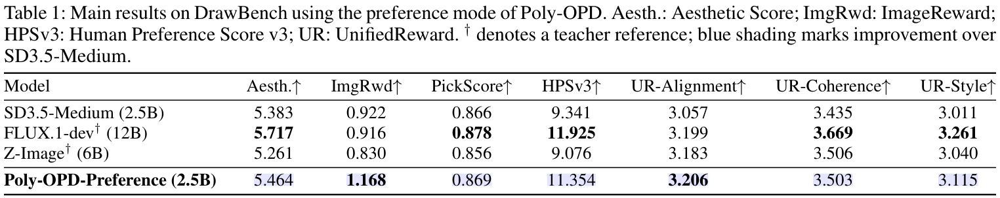

*Poly-OPD v1，Table 1，[PDF 第 5 页](https://arxiv.org/pdf/2608.04349v1#page=5)，原表截图，保留表头、教师标记与说明。*

| 模型 | Aesthetic | ImageReward | PickScore | HPSv3 | UR-Alignment | UR-Coherence | UR-Style |
|---|---:|---:|---:|---:|---:|---:|---:|
| SD3.5-Medium | 5.383 | 0.922 | 0.866 | 9.341 | 3.057 | 3.435 | 3.011 |
| FLUX.1-dev（老师） | 5.717 | 0.916 | 0.878 | 11.925 | 3.199 | 3.669 | 3.261 |
| Z-Image（老师） | 5.261 | 0.830 | 0.856 | 9.076 | 3.183 | 3.506 | 3.040 |
| **Poly-OPD-Preference** | **5.464** | **1.168** | **0.869** | **11.354** | **3.206** | **3.503** | **3.115** |

- HPSv3 **9.341 → 11.354**，ImageReward **0.922 → 1.168**；三个 UR 子项也高于 base。
- **纠正前述方向：v1 原表的 PickScore 是 0.866 → 0.869，不是 0.869 → 0.866。** 这是很小的数值增加，作者称其基本不变；没有误差条，不能包装为已证实的显著改善。
- 该表相对 base 的七项点估计均提高，但这不等于“所有实验设置、所有指标都提高”。相对 FLUX，Poly-OPD 只在 ImageReward 与 UR-Alignment 超过它，Aesthetic、PickScore、HPSv3、UR-Coherence、UR-Style 仍更低。

### 3.3 Table 2：构图模式的 GenEval 与 DPG-Bench 主结果

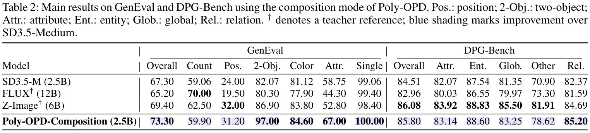

*Poly-OPD v1，Table 2，[PDF 第 5 页](https://arxiv.org/pdf/2608.04349v1#page=5)，原表截图。下方拆成两表，完整转录各子项。*

**GenEval：** Attr. 是颜色归属/属性绑定，不要与单独的 Color 混淆。

| 模型 | Overall | Counting | Position | Two-object | Color | Attr. | Single |
|---|---:|---:|---:|---:|---:|---:|---:|
| SD3.5-Medium | 67.30 | 59.06 | 24.00 | 82.07 | 81.12 | 58.75 | 99.06 |
| FLUX.1-dev（老师） | 65.20 | 70.00 | 19.50 | 80.30 | 77.90 | 44.30 | 99.40 |
| Z-Image（老师） | 69.40 | 62.50 | 32.00 | 86.90 | 83.80 | 52.80 | 98.40 |
| **Poly-OPD-Composition** | **73.30** | **59.90** | **31.20** | **97.00** | **84.60** | **67.00** | **100.00** |

综合分 **67.3 → 73.3，增加 6.0 个百分点**，高于两位老师。相对 base，Two-object +14.93、Attr. +8.25、Position +7.20；但 Counting 只增加 0.84，仍低于两位老师，Position 也略低于 Z-Image 的 32.00。不能把综合超越说成所有子能力超越。

**DPG-Bench：** Attr./Ent./Glob./Rel. 分别为属性、实体、全局、关系。

| 模型 | Overall | Attr. | Ent. | Glob. | Other | Rel. |
|---|---:|---:|---:|---:|---:|---:|
| SD3.5-Medium | 84.51 | 82.07 | 87.54 | 81.35 | 70.90 | 82.37 |
| FLUX.1-dev（老师） | 82.96 | 80.03 | 86.55 | 79.97 | 73.30 | 81.59 |
| Z-Image（老师） | 86.08 | 83.92 | 88.83 | 85.50 | 81.91 | 84.69 |
| **Poly-OPD-Composition** | **85.80** | **83.14** | **88.60** | **83.25** | **78.62** | **85.20** |

综合分 **84.51 → 85.80**，但比 Z-Image 低 **0.28**；Relation 85.20 最高，其他 DPG 子项仍低于 Z-Image。结论应是“有选择地吸收互补能力”，不是“2.5B 全面超越两个大老师”。

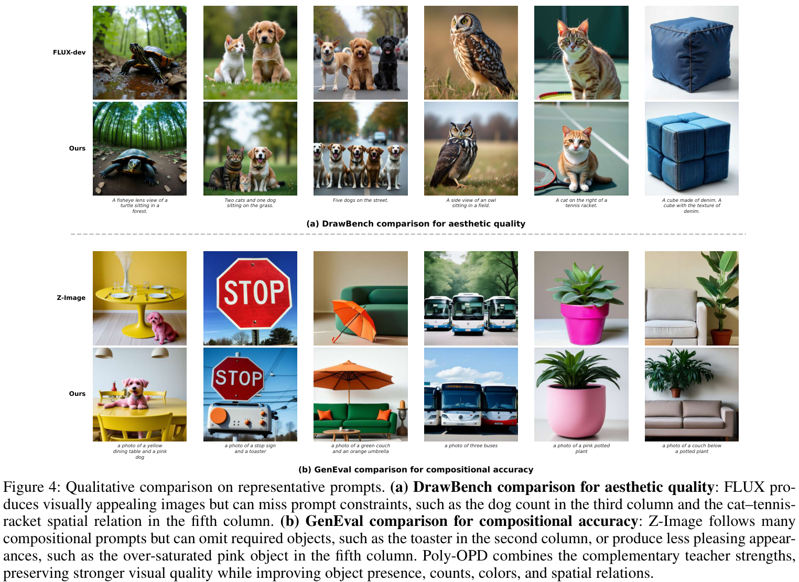

*Poly-OPD v1，Figure 4，[PDF 第 6 页](https://arxiv.org/pdf/2608.04349v1#page=6)，原 PDF 截图。*

上半部对照 FLUX 与偏好模式，下半部对照 Z-Image 与构图模式。例如上半部第三列要求“五只狗”，下半部第二列要求“停车标志和烤面包机”，作者用它们展示数量、物体存在与外观的变化。这些是选择展示的样例，不替代完整表，也不能证明任意 prompt 都不再漏物体。

### 3.4 Tables 3–4：共享/专属适配器、gap 采样与 warm start

三种删减分别是：`w/o CSA` 把两个专属 FFN 合为一个共享 adapter；`w/o gap-aware` 在构图类别内均匀采样；`w/o warm start` 跳过 Stage 1，直接从 base 做 OPD。其余保持不变，是论文给出的消融定义。

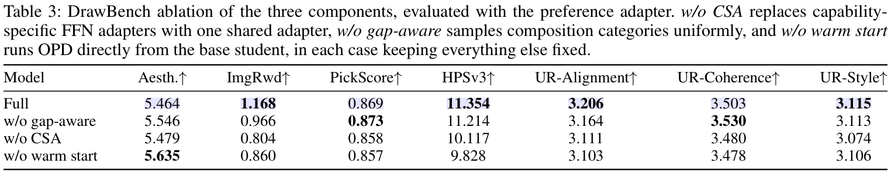

*Poly-OPD v1，Table 3，[PDF 第 6 页](https://arxiv.org/pdf/2608.04349v1#page=6)，完整原表。*

| 设置 | Aesthetic | ImageReward | PickScore | HPSv3 | UR-Alignment | UR-Coherence | UR-Style |
|---|---:|---:|---:|---:|---:|---:|---:|
| Full | 5.464 | 1.168 | 0.869 | 11.354 | 3.206 | 3.503 | 3.115 |
| w/o gap-aware | 5.546 | 0.966 | 0.873 | 11.214 | 3.164 | 3.530 | 3.113 |
| w/o CSA | 5.479 | 0.804 | 0.858 | 10.117 | 3.111 | 3.480 | 3.074 |
| w/o warm start | 5.635 | 0.860 | 0.857 | 9.828 | 3.103 | 3.478 | 3.106 |

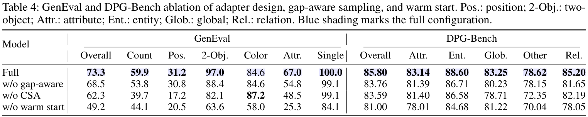

*Poly-OPD v1，Table 4，[PDF 第 6 页](https://arxiv.org/pdf/2608.04349v1#page=6)，完整原表；保留所有 DPG 子项，下面转录 GenEval 与 DPG 综合分。*

| 设置 | GenEval | Counting | Position | Two-object | Color | Attr. | Single | DPG Overall |
|---|---:|---:|---:|---:|---:|---:|---:|---:|
| Full | 73.3 | 59.9 | 31.2 | 97.0 | 84.6 | 67.0 | 100.0 | 85.80 |
| w/o gap-aware | 68.5 | 53.8 | 30.8 | 88.4 | 84.6 | 54.8 | 99.1 | 83.76 |
| w/o CSA | 62.3 | 39.7 | 17.2 | 82.1 | 87.2 | 48.5 | 99.1 | 83.59 |
| w/o warm start | 49.2 | 44.1 | 20.5 | 63.6 | 58.0 | 25.3 | 84.1 | 81.00 |

**该怎样读：**

- **FFN 全共享损伤明显。** GenEval 73.3 → 62.3，HPSv3 11.354 → 10.117，ImageReward 1.168 → 0.804。这支持分离冲突 FFN 的设计，但 Color 反而 84.6 → 87.2，说明不是所有指标都同向变化。
- **gap-aware 主要帮构图弱项。** 改为均匀采样后，GenEval 下降 4.8 点；Two-object 97.0 → 88.4、Attr. 67.0 → 54.8、Counting 59.9 → 53.8。偏好并非每项都获益：均匀版本的 Aesthetic、PickScore、UR-Coherence 还略高。它只改变构图数据比例，但两种模式共享 Attention，因此其他模式也可能受影响；这是结构上的解释，不是额外的因果消融。
- **跳过 warm start 损失最大。** GenEval 降 24.1 点，DPG 降 4.80，HPSv3 降 1.526。当前设置确实需要合适起点。不过原文“every metric 都下降”过强：Aesthetic **5.635 高于 Full 的 5.464**，表中并非全部下降。

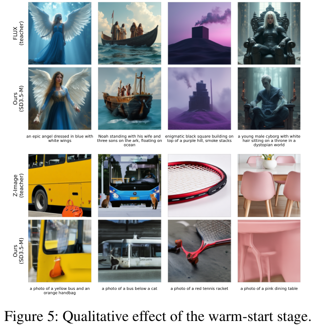

*Poly-OPD v1，Figure 5，[PDF 第 7 页](https://arxiv.org/pdf/2608.04349v1#page=7)，原 PDF 截图；“只做 warm start”的用途由 §4.3 正文说明，原图行标签仅写 Ours。*

作者用这些样例描述只做 warm start 的结果偏平滑、丢细节。它支持“warm start 是初始化而非终点”的定性解释；**没有 warm-start-only 的完整量化表**，不能拿它补造一组分数，也不要把它与“完全跳过 warm start”混为同一消融。

### 3.5 Table 5：默认需要较强教师介入，不只是末期微调

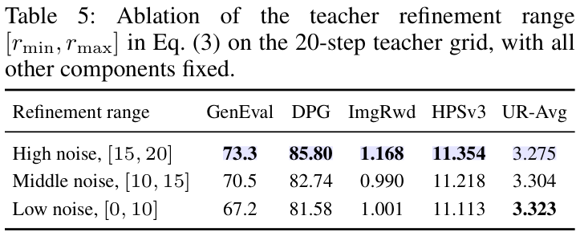

*Poly-OPD v1，Table 5，[PDF 第 7 页](https://arxiv.org/pdf/2608.04349v1#page=7)，完整原表。*

| 老师 20 步网格上的 $r$ 范围 | GenEval | DPG | ImageReward | HPSv3 | UR-Avg |
|---|---:|---:|---:|---:|---:|
| 高噪声起点，[15,20]，默认 | 73.3 | 85.80 | 1.168 | 11.354 | 3.275 |
| 中等噪声起点，[10,15] | 70.5 | 82.74 | 0.990 | 11.218 | 3.304 |
| 低噪声起点，[0,10] | 67.2 | 81.58 | 1.001 | 11.113 | 3.323 |

更深的教师重生成使 GenEval 从 67.2 提升至 73.3；作者解释为较高噪声允许重新组织数量、布局和关系。HPSv3 变化较小，UR-Avg 反而低噪声版本更高；因此默认是在这组指标中的取舍，**不是所有指标最优，也不是越靠近学生原图越有效**。

原表包含 $r=0$，但式 (4) 的严格区间匹配在教师 $\sigma=0$ 时没有对应区间。当前版本没有交代这一端点如何实现；本笔记的训练伪代码只覆盖披露清楚的默认 $r\in[15,20]$，不凭空补出低噪声消融的边界逻辑。

### 3.6 Table 6：为什么用 DINOv2，而不是直接匹配 latent？

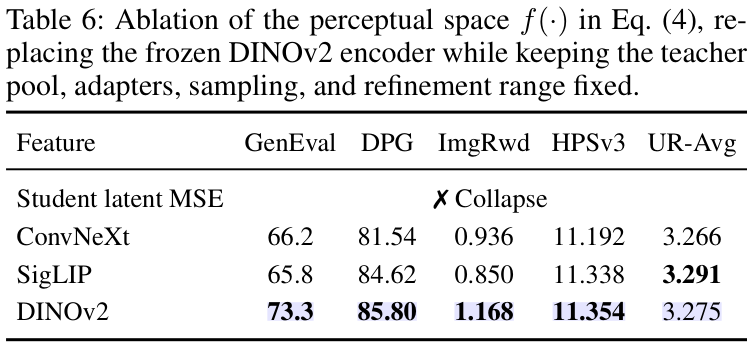

*Poly-OPD v1，Table 6，[PDF 第 7 页](https://arxiv.org/pdf/2608.04349v1#page=7)，完整原表。*

| 比较空间 | GenEval | DPG | ImageReward | HPSv3 | UR-Avg |
|---|---:|---:|---:|---:|---:|
| Student latent MSE | 崩溃 | — | — | — | — |
| ConvNeXt | 66.2 | 81.54 | 0.936 | 11.192 | 3.266 |
| SigLIP | 65.8 | 84.62 | 0.850 | 11.338 | 3.291 |
| DINOv2，默认 | 73.3 | 85.80 | 1.168 | 11.354 | 3.275 |

DINOv2 的 GenEval 比 ConvNeXt/SigLIP 分别高 **7.1/7.5** 点，DPG、ImageReward、HPSv3 也更好；UR-Avg 则不如 SigLIP。结果支持这里采用 DINOv2 的结构性监督，但不能推广为它在所有生成任务都优于其他特征模型。

`Student latent MSE` 是表中报告的失败对照，**不要误写成直接对不兼容的教师/学生 latent 做减法**。表名指学生 latent 坐标中的 MSE，具体目标构造未详细披露；崩溃是作者的实验报告，不是证明所有 latent loss 必然失败的定理。

### 3.7 来源、未披露项与结论边界

**能确认的结论：** 一个 2.5B 底座加可切换适配器，在相应模式下改善了偏好与构图指标；CSA、gap-aware 采样和 warm start 都有对应删减实验，默认深度与 DINOv2 也有消融。上文覆盖 v1 的 **Figures 1–5、Tables 1–6**，没有遗漏其主结果或消融表。

**不要把作者解释升级为定理。** §4.2 与结论把“分数超过老师”称为 on-policy 独有证据，并声称离线模仿受教师上限约束。这组分数比较不足以证明这种因果排他性：没有由此排除初始化、训练目标、评测指标或其他机制的作用，也不能推出离线蒸馏绝不可能在某项评分超过老师。笔记保留超越的具体数字，不接受该强结论。

集中列出当前版本的复现缺口：

| 项目 | 可核实范围 / 仍未知 |
|---|---|
| 正文 `RMIN/RMAX` 占位 | §4.1 与 Table 5 补齐为默认 **15/20**，不再保留为未知 |
| 模式先验 $\lambda$、正则权重 $\lambda_{\mathrm{WS}}$ | 当前 PDF 未给数值 |
| LoRA / 优化器配置 | rank、alpha、精确 target modules、学习率、batch 等未给完整配置；不搬用 Any-OPD 数字 |
| 感知特征与探针 | DINOv2 具体规模/预处理、probe 评分完整实现、EMA 初始化与 gap 分数尺度未完整披露 |
| 采样细节 | warm-start 教师采样步数、完整 CFG/schedule，以及 Table 5 的 $r=0$ 处理待核实 |
| 数据与结果解释 | DrawBench 999 条来源未说明；未报告这些表的重复运行方差，不能声称小差异显著 |
| 文中所引 Appendix / supplement | 下载的 v1 PDF 共 9 页，后两页为参考文献，未包含所述证明与采样附录；不能写成已验证一阶一致性证明 |
| 官方实现 | 没有定位到可核实的作者实现；上述伪代码不是源码确认或复现结果 |

**来源与图像许可：** 全部截图来自 [arXiv:2608.04349v1 原 PDF](https://arxiv.org/pdf/2608.04349v1)，仅渲染裁剪、未改图内数据；每张已标页码与图表号，未收录整篇 PDF。作者为 Siming Fu、Haojun Xu、Ruizhe He、Zheming Fu、Hualiang Wang、Jie Huang、Xiaoxiao Ma、Mingchen Zhong、Weihu Huang、Xiaoxuan He、Linjiang Huang、Si Liu。摘要页标示 [CC BY 4.0](https://creativecommons.org/licenses/by/4.0/)；原图表权利与署名归原作者。辅助核对入口为 [官方摘要页](https://arxiv.org/abs/2608.04349v1) 与 [官方 HTML](https://arxiv.org/html/2608.04349v1)，公式与表格以 PDF 为准。

**最后记住：一条样本找一位老师；异构模型通过图片交流；学生后半程多步反传；共享 Attention 学共同部分，专属 FFN 保留可切换能力。**
