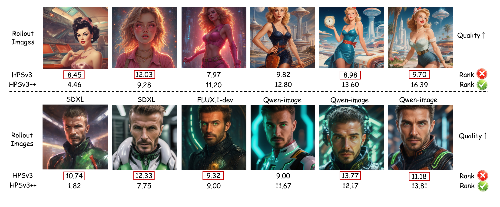
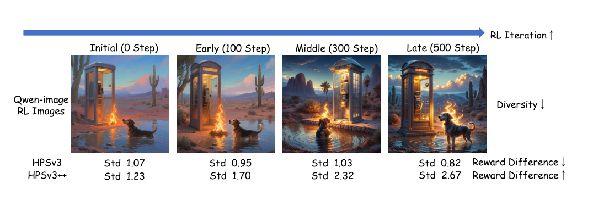
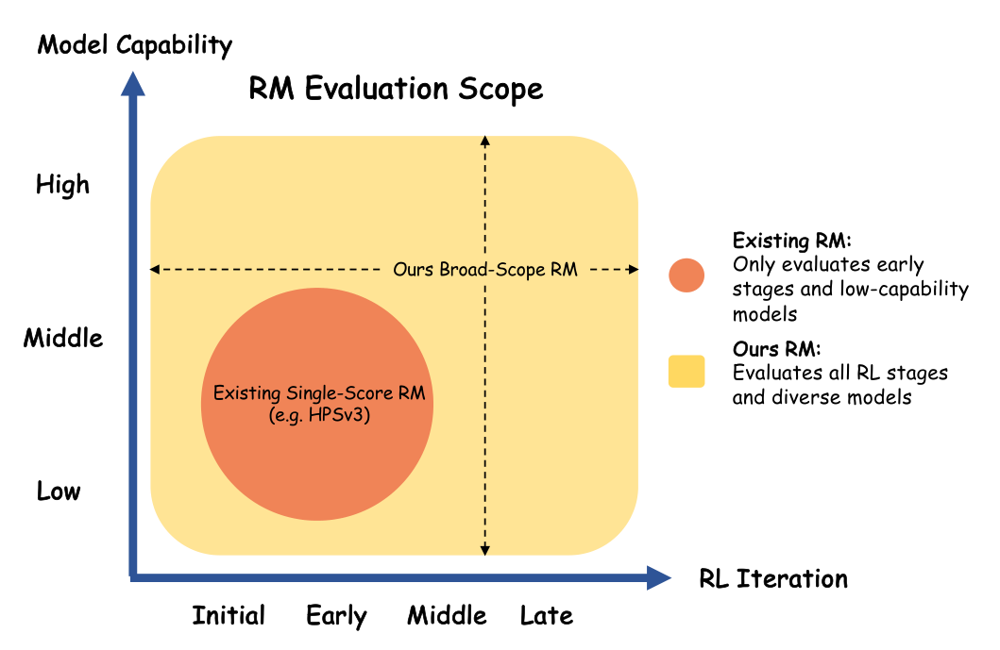

# HPSv3++：让奖励模型跨「模型能力 × RL 迭代」校准（Part 1）

> **arXiv**：[HPSv3++: Scaling Reward Models Across the Full Spectrum of Diffusion Model Capabilities（2606.14657v1）](https://arxiv.org/abs/2606.14657)（2026-06-12）
> **原文**：本地 `Papers/reward-models/HPSv3++.pdf`（16 页：正文 pp.1–9，附录 pp.10–16）
> **代码**：<https://github.com/PlantPotatoOnMoon/HPSv3-PlusPlus>
> **作者 / 机构**：Yijun Liu 等 8 人（清华 / JD Explore / 北大 / 浙大）
> **精读进度**：Part 1 ✅ ｜ Part 2–7 ⬜

**Part 1 对应正文 pp.1–3：Abstract、§1、Fig. 1–3。** 这里只回答四个问题：旧 reward model 具体坏在哪、作者要解决什么、总体思路是什么、最重要的实验结论是什么。数据生产、OGD 公式、Stage 2 各损失、完整实验表都留到后面的 Part。

---

## 1. 旧 RM 的两个失灵场景

先明确 RM 在 RLHF 里的角色：它给「prompt + 生成图」打一个分，这个分就是 RL 的奖励信号。HPSv3 这类 RM 的训练数据主要来自 SDXL 那一代模型，打分函数是无条件的——同一个函数，对任何模型、任何训练阶段的图都用同一把尺子。论文指出这会在两个维度上同时失准，并把它们合成一个二维空间：**模型能力 × RL 迭代**（Fig. 3）。

### 1.1 跨模型能力：分数不单调

*图 1（论文 Fig. 1）：每行是同一 prompt 下按质量从低到高排列的 6 张图，红框标出 HPSv3 的逆序打分。*

看第一行（复古人物）：HPSv3 给最左边一张 8.45，给第三张更好的图 7.97；给第五、六张 8.98 / 9.70，反而低于第二张 12.03。第二行（科幻男性）同样，最左边最差的一张拿到 10.74，比第三张 9.32 还高。也就是说，**分数没有随视觉质量单调上升**，差图可能压过好图。

HPSv3++ 在两组里都给出了单调序列：第一行 4.46 → 9.28 → 11.20 → 12.80 → 13.60 → 16.39，第二行 1.82 → 7.75 → 9.00 → 11.67 → 12.17 → 13.81。这里要注意，分数本身是 RM 的输出，不是人类评分；图想说明的是**排序是否与质量一致**，而不是绝对分数高低。

### 1.2 跨 RL 迭代：分数越训越挤

*图 2（论文 Fig. 2）：Qwen-Image 在 RL 第 0 / 100 / 300 / 500 步的 rollout 图，以及两个 RM 的组内分数标准差。*

RL 训练有个副作用：模型越训，同一 prompt 下的输出越像（图中标注 Diversity ↓）。留给 RM 的分辨空间本来就在变小。HPSv3 的组内标准差从 1.07 降到 0.82（中间第 100 步有一个 0.95 → 1.03 的小回升，整体趋势向下），论文认为这说明它逐渐分不开组内的质量差异。HPSv3++ 则是 1.23 → 1.70 → 2.32 → 2.67，单调上升。

作者把「组内分数标准差」当作**分布熟悉度和判别力的温度计**：在见过的分布上 std 更高，在没见过的分布上 std 更低；Stage 1 把新分布纳进来后，新分布上的 std 会明显上升（Table 1：Qwen-Image 从 2.79 到 5.63，SD 1.5 只从 3.53 到 3.65）。这个经验假设是后面 Stage 2 设计损失的直接依据，Part 3 会专门核对它站不站得住。

### 1.3 覆盖范围：只覆盖左下角

*图 3（论文 Fig. 3）：横轴是 RL 迭代（Initial → Late），纵轴是模型能力（Low → High）。*

橙色圆是现有单分数 RM 的有效范围：低能力模型、早期 RL 阶段；黄色区域是 HPSv3++ 想覆盖的全域。这张图不是实验测量，而是论文对问题范围的示意——它把「为什么一个固定 RM 不够」压缩成了一张二维图。

---

## 2. 总体思路：把「条件」塞进打分

作者没有从零训一个新模型，而是在 HPSv3 的基础上把它从**无条件打分**改成**条件打分**：

$$
r_\Theta(x,y \mid c,t) = f_\phi\big(E_\theta(x,y),\,c,\,t\big)
$$

和原来的 $r_\Theta(x,y)=f_\phi(E_\theta(x,y))$ 相比，多了两个输入：$c$ 是生成模型的能力条件，$t$ 是归一化后的 RL 迭代步数。$c$ 不是人工标的模型名，而是由 Capability Encoder 从图像特征里**反推**出来的；$t$ 是显式输入。两个条件一起注入打分头，让同一个 RM 在不同能力、不同迭代阶段输出不同的打分尺度。

支撑这个想法的是三件事：

| 组件 | 一句话作用 | 详见 |
| :--- | :--- | :--- |
| **HPDv3++** | 212K 对、双维度（文本遵循 / 美学）的前沿模型偏好数据，补上旧数据没有的分布 | Part 2 |
| **Stage 1：OGD** | 在新数据上继续学，同时用正交梯度投影避免遗忘 HPSv3 的旧偏好 | Part 3 |
| **Stage 2：半监督条件化** | 用有标注偏好对 + 无标注 rollout 图，学「能力 / 迭代 → 打分尺度」的映射 | Part 4 |

数据侧的关键数字先记在这里：185K prompt、每个 prompt 用 Qwen-Image 生成 6 张图（共 1.1M 候选）、人工做 6 选 2 的最好 / 最差比较、VLM 裁判 + HPSv3 裁判双重投票清洗，最终留下 212K 对（文本遵循 95K + 美学 117K）。Stage 1 的 OGD 则是在每个训练步同时取一个 HPDv3++ 批次（新梯度）和一个 HPDv3 批次（参考梯度），两个梯度方向冲突时，把新梯度里与参考梯度重叠的分量投影掉。

---

## 3. 主要实验结果

**偏好预测**（Table 2，数值为 pairwise accuracy %）：

| Benchmark | HPSv3 | HPSv3++ | Δ |
| :--- | ---: | ---: | ---: |
| HPDv3 | 76.9 | **86.7** | +9.8 |
| GenAI-Bench | 70.8 | **76.3** | +5.5 |
| MJ-Bench Align. | 69.0 | **69.8** | +0.8 |
| MJ-Bench Qual. | 97.6 | **98.7** | +1.1 |
| HPDv3++ Aesthetic | 74.8 | **79.1** | +4.3 |
| HPDv3++ Text-Following | 73.3 | **88.1** | +14.8 |
| ImageReward | **66.8** | 66.0 | −0.8 |
| PickScore | **72.2** | 70.5 | −1.7 |

涨得最多的是 HPDv3（+9.8）和自建的 HPDv3++ 文本遵循（+14.8）；但 ImageReward 和 PickScore 两列反而略低。论文正文的说法是「在这些更早的 benchmark 上保持竞争力」，没有单独解释这两处下降——这个取舍是否值得，Part 5 会结合评测分布再谈。

**作为 RL 奖励**：用 Flow-GRPO 在 SDXL、FLUX.1-dev、Qwen-Image 三条不同能力的骨干上微调，作者报告 HPSv3++ 的 GenEval 轨迹整体更好、更稳定（Fig. 7），完整数值在附录 Table 5。人评方面，100 个 prompt、12 位标注者，只替换 RM、其余 RL 配置相同，HPSv3++ 训出的图胜率 **77.5%**（Table 3）。

---

## 4. 一句话总结

这篇的核心不是把「打分」做得更准，而是先让裁判知道**自己在判谁、对方练到了哪一步**，再决定用哪把尺子。Part 2 从 HPDv3++ 的数据生产线开始：212K 对到底是怎么从 185K prompt 和 1.1M 张图里筛出来的。
