# APT：先诊断弱点，再自动安排下一轮训练

## 1. 通俗理解：给画图模型配一位会调整练习的老师

**APT 解决的不是“奖励拿到后怎样更新参数”，而是“这个模型现在最应该练什么”。**

不同模型的弱点不同，同一个模型在训练前后的弱点也不同。固定题库却一直让它练同一批内容。APT 把人工看失败案例、总结问题、重新准备训练提示词的过程，改成一个自动循环：

> **先考试 → 看具体错在哪 → 针对弱点出新题 → 做强化学习训练 → 重新考试。**

论文：*APT: Feedback-Driven Agentic Post-Training for Text-to-Image Generation*，Sirui Zhang 等，USTC / Microsoft Research Asia 等。[arXiv:2610.18097v1 原文](https://arxiv.org/pdf/2610.18097v1)，2026-10-13。

### 1.1 原始 teaser：三个 Agent，分别负责什么？

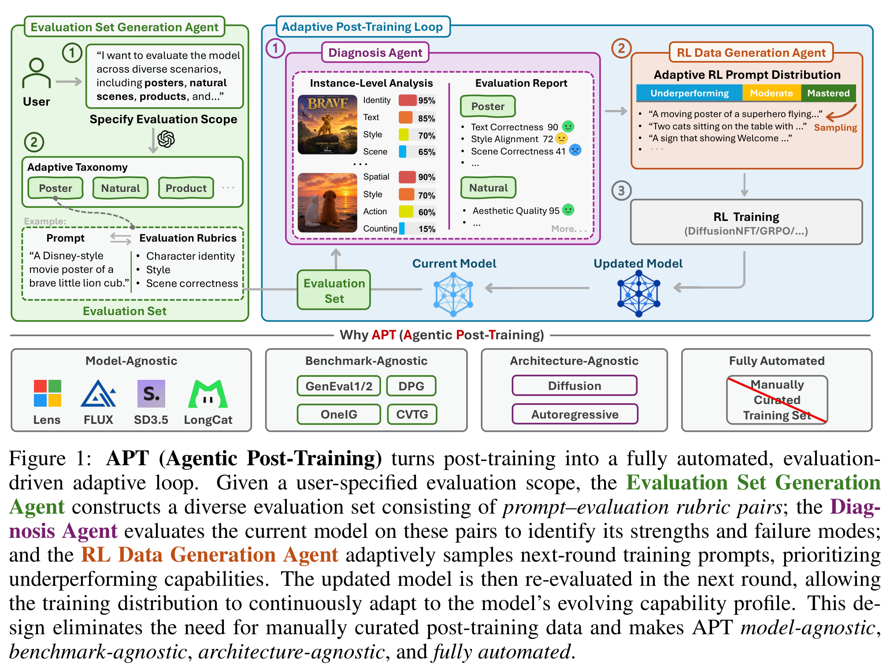

*原论文 Figure 1，第 1 页，直接从 PDF 截取，保留原图与图注。*

按图从左往右看：

1. **绿色框：出考卷。** 根据用户关心的场景，生成提示词和逐项检查标准；没有指定场景时，用通用评估框架覆盖多种能力。
2. **紫色框：批改考卷。** 让当前模型画图，逐项检查哪里成功、哪里失败，形成报告。
3. **橙色框：出下一轮练习。** 读取报告，多生成针对弱点的训练题，也保留一部分中等、较容易的题。
4. **灰色框：真正训练。** 用现有 RL 方法更新图像模型，然后回到紫色框重新诊断。

**绿色框在开始时运行一次，题库随后固定；反复变化的是模型、诊断结果和下一轮训练题，不是每轮重造诊断题库。**

### 1.2 一个具体例子

原论文 Figure 2 的提示词片段是：

> 两只奶油色小狗，并排坐在拉丝钢检查台上。

不是只给图片一个模糊的“好不好看”分数，而是分别检查：

- 小狗是不是奶油色？
- 是不是恰好两只？
- 是否并排坐在指定的检查台上？

如果很多不同场景都出现“数量错了”，出题 Agent 应该发现的是**计数能力弱**，而不是简单得出“还要多练小狗”。随后生成其他主体、其他场景下的计数练习。

**Agent 生成的是“训练提示词＋评分标准”，不是标准答案图片。图片由被训练的生成模型自己画，再依据标准获得奖励。**

### 1.3 放在 RSI 专区，应怎样理解它？

APT 的递归关系是：**训练改变能力 → 新能力产生新诊断 → 新诊断改变训练数据 → 再改变模型。**

但它不是“一个模型完全独立地教会自己一切”。论文使用外部 GPT 模型出题、制定标准和判图；真正持续更新的是图像生成模型。Agent 和评估器并没有随着每轮图像训练一起被微调。

它也不是推理时反复改 prompt、挑图或修图：**收益写进模型参数，部署时不要求仍运行这套 Agent 闭环。**

| 工作 | 主要回答的问题 |
| --- | --- |
| APT | 下一轮该训练哪些提示词，才能匹配当前模型的弱点？ |
| DiffusionART | 一批生成结果已经得到奖励，怎样把奖励转成有效、稳定的参数更新？ |

两者处于不同层级。APT 原论文的扩散模型实验使用 DiffusionNFT，没有在本文中验证与 DiffusionART 的组合。[DiffusionART 笔记](../rl-aigc/diffusionart.md)

## 2. 方法模块与核心代码

### 源码核验说明

已找到作者官方仓库：[siruizhang30/APT](https://github.com/siruizhang30/APT)。核验版本 [`9b04698fbc4697a717bf4ea639cc8721a777ee76`](https://github.com/siruizhang30/APT/tree/9b04698fbc4697a717bf4ea639cc8721a777ee76) 只有 `.gitignore`、`LICENSE`、`README.md` 和展示图片，**没有可核实的训练实现源码**。

因此下文每个模块都采用**依据正文与附录 E 整理的教学伪代码，不是作者源码，也不是可直接运行的复现脚本**。`llm_json`、`judge_binary`、`trainer.update` 等表示相应功能接口，不声称它们是仓库中的真实函数。

### 2.1 模块一：生成覆盖面足够广的固定诊断题库

**输入**：用户指定的评估范围；未指定时使用通用场景分类。

**处理**：场景分类 → 细分类与具体实体 → 加入描述维度 → 生成提示词 → 配套检查标准。

论文的通用范围包含 Human、Object、Animal、Plant、Scene、Food、Event、Fictional World、Text、UI and Graphic Design，共 10 个大类。最终得到 **219 个子类、2,609 个 prompt–rubrics 对**。

为具体实体随机组合 1–4 个描述维度，例如数量、位置、颜色、属性、关系、风格、文字。提示词由 GPT-4.1 生成；附录 E.1 要求每次输出 5 条，每条 30–60 个英文词；每组保留指定主体，变化场景、光照、构图与氛围。

**教学伪代码：对应 §2.1、附录 E.1。**

```python
def build_evaluation_set(scope):
    taxonomy = expand_scenarios(scope or GENERAL_SCENARIOS)
    evaluation_set = []
    for entity in taxonomy.entities:
        keypoints = sample_dimensions(count=randint(1, 4))
        prompts = llm_json(
            model="GPT-4.1", instruction=EVAL_PROMPT_INSTRUCTION,
            entity=entity, keypoints=keypoints, output_count=5,
        )
        for prompt in prompts.values():  # JSON 对象的键为 prompt-1 至 prompt-5
            evaluation_set.append({
                "prompt": prompt,
                "rubrics": make_rubrics(prompt),
            })
    return evaluation_set
```

这里展示的是生成链路，不补写论文没有提供的配额、去重或过滤细节，也不声称上述简化循环会精确产生 2,609 条。

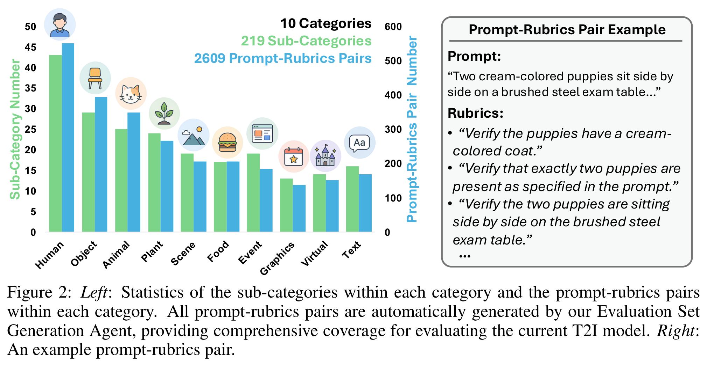

*Figure 2，第 4 页。广覆盖题库帮助区分“模型在哪类任务上弱”，而非只对一个排行榜出题。*

### 2.2 模块二：把提示词拆成“可单独检查的要求”

**rubric 就是一条具体检查标准。** 不是每道题都套同一份模板：没有文字要求，就不硬加 OCR 检查；没有数量要求，也不硬加计数检查。

附录 E.2 给 GPT-4.1-mini 的参考类别包括：

| 标准类别 | 检查什么 |
| --- | --- |
| OCR Alignment | 应出现的文字是否正确；若要求无文字，也应检查 |
| Object Count Consistency | 主体数量是否满足要求 |
| Attribute Accuracy | 颜色、材质、纹理等属性是否正确 |
| Action Accuracy | 动作、动态状态及交互是否正确 |
| Object Placement and Spatial Reasoning | 位置和空间关系是否正确 |

论文要求为每条提示词输出最多 10 条相关标准，采用 JSON 对象。类别清单与“最多 10 条”是原文规定，不应自行推定每条 prompt 总是有 10 项、每类固定拆几项。

**教学伪代码：对应 §2.1 Step 3、附录 E.2。**

```python
def make_rubrics(prompt):
    return llm_json(
        model="GPT-4.1-mini",
        instruction=RUBRIC_GENERATION_INSTRUCTION,
        user=prompt,
    )

# 返回结构示意；以下内容仅用于讲解字段。
example = {
    "Object Count Consistency": "Verify that exactly two puppies are present.",
    "Attribute Accuracy": "Verify that both puppies have cream-colored coats.",
}
```

**同一条 prompt 的标准先生成并固定，再用来评价它的不同生成结果。** 不允许看完每张图后，为该图临时改一份更容易满足的标准。

### 2.3 模块三：给当前模型做诊断，保留逐项结果

每轮从固定题库随机抽 **120 个 prompt–rubrics 对**，让当前图像模型分别生成图片，再由 GPT-4.1-mini 按每条标准打 **0 或 1**。

诊断报告至少保留：原始 prompt、对应 rubric、该项是否满足。它不只是“一张平均分排行榜”。细分失败能帮助下一模块判断究竟是数量、属性、空间关系还是文字问题。

**教学伪代码：对应 §2.2。**

```python
def diagnose(model, evaluation_set):
    report = []
    for item in random_sample(evaluation_set, 120):
        image = model.generate(item["prompt"])
        scores = score_rubrics(image, item["prompt"], item["rubrics"])
        report.append({
            "prompt": item["prompt"],
            "rubrics": item["rubrics"],
            "scores": scores,
            "mean_reward": mean(scores.values()),
        })
    return report
```

`mean_reward` 是为了直观展示附录 E.4 所要求的平均奖励信息；核心依据仍然包括逐项失败。三个 Agent 是功能角色，不意味着作者分别训练了三个新的专用模型。

### 2.4 模块四：根据报告，生成下一轮的 480 道练习

**这一模块的工作不是再判一次图，而是把跨样本的失败模式转成新的训练分布。** 默认使用 GPT-5.4。

附录 E.4 特别要求：不要主要按语义主题相似性归类，而要看反复出现的视觉任务困难，例如计数、材质、年龄、表情、左右位置、遮挡、手持关系、文字渲染与画面风格。

练习分配原则：

- 明显多数针对薄弱或反复失败的能力。
- 较少部分覆盖表现不稳定的中等能力。
- 少量覆盖已掌握能力，以保持广度。
- 不只盯着单一最弱类别，不直接复制旧提示词。

**论文没有给出固定的“弱／中／强 = 某三个百分比”。不能把别篇 RSI 的采样比例移植过来当成 APT 默认。**

**教学伪代码：对应 §2.3、附录 E.4。**

```python
def make_training_set(report):
    new_prompts = llm_jsonl(
        model="GPT-5.4",
        instruction=RL_DATA_GENERATION_INSTRUCTION,
        testing_report=report,
        count=480,
    )
    return [
        {"prompt": row["prompt"], "rubrics": make_rubrics(row["prompt"])}
        for row in new_prompts
    ]
```

输出要求是恰好 480 行 JSONL，每行含 `id` 与 `prompt`。**训练题的 rubric 仍由 GPT-4.1-mini 按同一流程补齐，不是 GPT-5.4 直接生产一套新的奖励模型。**

### 2.5 模块五：把逐项检查结果合成奖励，交给现有 RL

诊断和训练都使用同一个固定评估器 **GPT-4.1-mini**。对生成图片的每条 rubric 返回 0 或 1，然后对这些分数取平均，作为该图片的标量奖励。

例如有 4 项要求、满足了 3 项，奖励就是 0.75。不同图片仍使用该 prompt 原先固定的同一组标准。

**教学伪代码：对应 §2 Round-Wise Learning Objective、附录 E.3。**

```python
def score_rubrics(image, prompt, rubrics):
    return {
        name: judge_binary(
            model="GPT-4.1-mini", image=image,
            prompt=prompt, criterion=criterion,
            instruction=REWARD_SCORING_INSTRUCTION,
        )
        for name, criterion in rubrics.items()
    }


def image_reward(image, item):
    scores = score_rubrics(image, item["prompt"], item["rubrics"])
    return mean(scores.values())
```

原文的判图指令要求“满足返回 1、明显失败返回 0，不解释”。这是 **VLM 对图像的判断，不是代码执行或数学验证器提供的确定性真值**。

图像与奖励随后交给已配置的 RL 训练器：扩散模型主实验使用 DiffusionNFT，Janus-Pro 使用 GRPO。

```python
# 教学伪代码：具体损失、采样与优化由对应 RL 训练器实现。
def train_one_round(model, training_set, trainer):
    for _ in range(20):
        batch = trainer.sample_prompt_batch(training_set)
        rollouts = trainer.generate(model, batch)
        rewards = [image_reward(r.image, r.item) for r in rollouts]
        trainer.update(model, rollouts, rewards)
    return model
```

**20 是每轮优化步数，不是扩散生成步数，也不是每题生成 20 张。** 每个 prompt 的 rollout 候选数等完整训练器细节，在本文中没有充分给出，伪代码不虚构这些参数。

### 2.6 模块六：闭环调度，训练后再诊断

**教学伪代码：对应 §2 Overview、§2.4、§3.1。**

```python
evaluation_set = build_evaluation_set(user_scope)  # 只在开头构造
model = load_base_model()

for round_id in range(total_steps // 20):
    report = diagnose(model, evaluation_set)
    training_set = make_training_set(report)
    model = train_one_round(model, training_set, trainer)

# 部署时直接使用更新后的生成模型，不要求继续调用三 Agent。
```

主实验中 FLUX.1-dev 训练 200 步，对应 10 轮；其他扩散模型训练 400 步，对应 20 轮。这是按论文的每轮 20 步直接换算，并非额外实验结果。

最后把三个容易混淆的数据对象分开：

| 数据 | 从哪里来 | 什么时候变化 | 用途 |
| --- | --- | --- | --- |
| 诊断题库 E | 评估集生成 Agent | 开头生成后固定；每轮抽一个子集 | 探查当前能力 |
| 当前轮训练集 D | 数据生成 Agent 根据新诊断生成 | 每轮重新生成 480 条及其 rubrics | 做 RL 更新 |
| 最终公开 benchmark | GenEval 等既有评测集 | 作为最终测试 | 比较模型表现；主实验不拿它们构造训练 prompt |

“更新模型”与“更新训练题”是闭环的两部分；**轮内训练题和奖励过程固定，轮间再调整题目分布**。

## 3. 实验设置与主要结果

所有数值来自论文，不是本笔记复跑结果。主表保留原数值；附录 Tables 7–15 在最后附原始截图，方便检查全部细分指标。

### 3.1 对照是否公平、用了什么设置？

| 项目 | 论文设置 |
| --- | --- |
| 扩散基础模型 | Lens、SD3.5-Medium、FLUX.1-dev、LongCat-Image |
| 自回归扩展 | Janus-Pro，使用 GRPO |
| 扩散 RL 算法 | DiffusionNFT |
| 扩散模型微调 | LoRA rank 64、alpha 128；学习率 `3e-4` |
| 每轮诊断 / 新题 / 更新 | 120 个诊断样本 / 480 条新训练 prompt / 20 步优化 |
| 训练生成步数 | Lens、SD3.5-M、LongCat 为 10；FLUX 为 6 |
| 训练分辨率 | Lens、SD3.5-M 为 768×768；FLUX、LongCat 为 512×512 |
| 总优化步数 | FLUX 为 200，其余扩散模型为 400 |
| 人工题库基线 | Lens 工作中由专家整理的 RL 数据；与 APT 使用相同总训练 prompt 数、同一 rubric 生成及奖励流程 |
| 最终推理 | 均为 768×768；Lens 20 步/CFG 5.0，SD3.5-M 20/4.5，FLUX 16/3.5，LongCat 20/4.5 |

APT 与人工题库对照主要比较**训练数据如何安排**，不是一个用强奖励模型、另一个用弱奖励模型。不过相同 prompt 数与优化步数，不等于已经证明包括 Agent 调用在内的总时间、GPU 小时或 API 成本相同。

### 3.2 五个 benchmark 分别测什么？

| 基准 | 主要考察 | 本文主表指标 |
| --- | --- | --- |
| GenEval | 对象、数量、颜色、位置、属性绑定 | Overall |
| OneIG-EN | 对齐、文字、推理、风格、多样性 | Average |
| GenEval2 | 更复杂的对象、属性、关系与数量组合 | Soft-TIFA 的几何平均版本 Soft-TIFA GM |
| DPG | 长提示中的多对象、属性和复杂关系 | Overall |
| CVTG-2K | 多文字区域、指定文字及位置样式 | Word Accuracy |

五项综合平均先把 GenEval、OneIG-EN、CVTG-2K 的分数乘 100，再与其余两项平均。**Average 不是统一意义上的准确率，也不是人工偏好胜率。**

### 3.3 原论文 Table 1：四个扩散模型的完整主结果

| 模型 | 训练方式 | GenEval | OneIG-EN | GenEval2 | DPG | CVTG-2K | Average |
| --- | --- | ---: | ---: | ---: | ---: | ---: | ---: |
| Lens | Base | 0.702 | 0.521 | 29.06 | 85.93 | 0.480 | 57.06 |
| Lens | 人工 RL 题库 | 0.815 | 0.518 | 46.35 | 87.60 | 0.758 | 68.61 |
| Lens | APT | 0.859 | 0.523 | 50.73 | 87.88 | 0.795 | **71.26** |
| SD3.5-M | Base | 0.684 | 0.408 | 17.63 | 83.67 | 0.312 | 48.34 |
| SD3.5-M | 人工 RL 题库 | 0.722 | 0.399 | 27.64 | 86.54 | 0.534 | 55.94 |
| SD3.5-M | APT | 0.763 | 0.404 | 29.50 | 86.50 | 0.569 | **57.92** |
| FLUX.1-dev | Base | 0.660 | 0.388 | 22.23 | 82.54 | 0.260 | 47.11 |
| FLUX.1-dev | 人工 RL 题库 | 0.721 | 0.435 | 29.47 | 85.53 | 0.310 | 52.32 |
| FLUX.1-dev | APT | 0.751 | 0.459 | 31.01 | 85.75 | 0.513 | **57.81** |
| LongCat | Base | 0.727 | 0.500 | 28.60 | 85.71 | 0.426 | 55.92 |
| LongCat | 人工 RL 题库 | 0.780 | 0.503 | 31.14 | 87.80 | 0.730 | 64.05 |
| LongCat | APT | 0.832 | 0.510 | 34.43 | 87.89 | 0.821 | **67.72** |

**结论是四个模型的综合平均都超过人工题库，不是每个指标都赢。** 例如 SD3.5-M 的 DPG 为 86.50，略低于人工题库的 86.54；其 OneIG-EN 平均也仍低于基础模型。

APT 相对人工题库的综合分差分别为 **+2.65、+1.98、+5.49、+3.67 分**。这些差值由表中分数相减得到，不是相对百分比。

### 3.4 不能略过的代价：多样性下降

附录 C 明确讨论了 RL 后生成多样性降低。下表摘自原论文 Table 8：

| 模型 | Base 多样性 | 人工 RL 题库 | APT |
| --- | ---: | ---: | ---: |
| Lens | 0.257 | 0.184 | 0.174 |
| SD3.5-M | 0.254 | 0.173 | 0.164 |
| FLUX.1-dev | 0.244 | 0.208 | 0.203 |
| LongCat | 0.309 | 0.220 | 0.215 |

**四个模型的 APT 多样性分数都低于基础模型，也低于人工题库基线。** 数量、文字等能力的提升可能伴随输出分布变窄；不能把“留了一些容易题”解释成已经解决多样性退化。

### 3.5 原论文 Table 5：也能用于自回归图像生成

Janus-Pro 使用 GRPO。为阅读方便，将原来的宽表按指标拆开，保留全部数值。

**整体指标：**

| 训练方式 | GenEval Overall | OneIG-EN Average | GenEval2 |
| --- | ---: | ---: | ---: |
| Base | 0.781 | 0.314 | 15.25 |
| 人工 RL 题库 | 0.806 | 0.316 | 20.42 |
| APT | **0.815** | **0.318** | **21.61** |

**GenEval 细分：**

| 训练方式 | Single | Two | Count | Color | Position | Attribute |
| --- | ---: | ---: | ---: | ---: | ---: | ---: |
| Base | 0.994 | 0.869 | 0.538 | 0.891 | 0.758 | 0.635 |
| 人工 RL 题库 | 0.984 | 0.891 | 0.609 | 0.902 | 0.790 | 0.660 |
| APT | 0.991 | 0.909 | 0.606 | 0.910 | 0.808 | 0.668 |

**OneIG-EN 细分：**

| 训练方式 | Alignment | Text | Reasoning | Style | Diversity |
| --- | ---: | ---: | ---: | ---: | ---: |
| Base | 0.799 | 0.068 | 0.165 | 0.293 | 0.243 |
| 人工 RL 题库 | 0.804 | 0.074 | 0.175 | 0.297 | 0.229 |
| APT | 0.809 | 0.074 | 0.175 | 0.297 | 0.233 |

这里支持的是**自适应数据闭环可以换用其他生成架构与 RL 方法**，不是声称同一个损失函数直接通用于两类模型。细项仍有持平或下降，例如 APT 的 Count 略低于人工题库。

### 3.6 原始生成案例

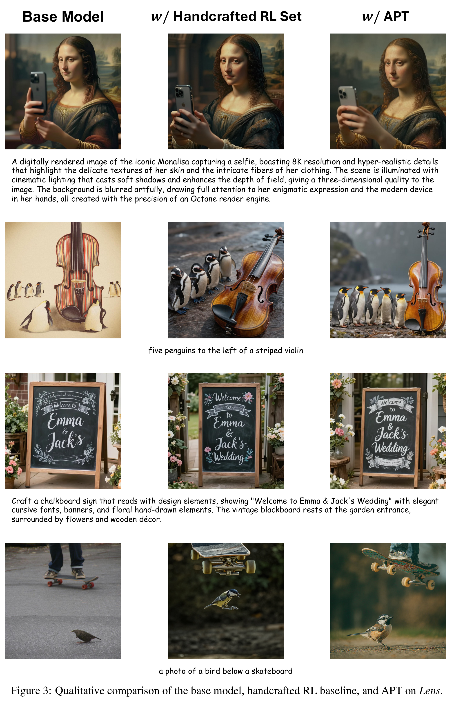

*Figure 3，第 19 页。三列依次是 Base、人工 RL 题库、APT，展示数量、文字、关系等案例。这是定性示例，不代替完整评估。*

## 4. 消融实验：各个模块究竟贡献了什么？

### 4.1 原论文 Table 2：别人的训练题库，适合自己的模型吗？

所有目标模型在这组实验里都训练 **200 步**，不是主表中部分模型的 400 步。行是接受训练的目标模型，列是训练数据所针对的来源模型。

对角线表示持续为当前目标模型自适应生成数据；非对角线复用另一个模型的 APT 训练中累积的数据。这项比较同时涉及**模型匹配和自适应数据流程**，不能单独解释成语义题材差异的纯因果实验。

**Table 2(a)：GenEval。**

| 目标模型＼数据来源 | Lens | SD3.5 | FLUX | LongCat |
| --- | ---: | ---: | ---: | ---: |
| Lens | 0.851 | 0.833 | 0.846 | 0.798 |
| SD3.5 | 0.736 | 0.743 | 0.742 | 0.722 |
| FLUX | 0.679 | 0.726 | 0.751 | 0.729 |
| LongCat | 0.823 | 0.786 | 0.827 | 0.828 |

**Table 2(b)：OneIG-EN。**

| 目标模型＼数据来源 | Lens | SD3.5 | FLUX | LongCat |
| --- | ---: | ---: | ---: | ---: |
| Lens | 0.523 | 0.522 | 0.517 | 0.520 |
| SD3.5 | 0.404 | 0.404 | 0.405 | 0.395 |
| FLUX | 0.436 | 0.443 | 0.459 | 0.440 |
| LongCat | 0.509 | 0.496 | 0.508 | 0.506 |

**Table 2(c)：GenEval2。**

| 目标模型＼数据来源 | Lens | SD3.5 | FLUX | LongCat |
| --- | ---: | ---: | ---: | ---: |
| Lens | 46.80 | 44.59 | 46.35 | 44.98 |
| SD3.5 | 23.61 | 27.58 | 23.74 | 22.65 |
| FLUX | 30.06 | 28.69 | 31.01 | 30.02 |
| LongCat | 34.91 | 37.37 | 34.90 | 37.80 |

**Table 2(d)：以上三个基准的归一化平均。**

| 目标模型＼数据来源 | Lens | SD3.5 | FLUX | LongCat |
| --- | ---: | ---: | ---: | ---: |
| Lens | **61.40** | 60.03 | 60.88 | 58.93 |
| SD3.5 | 45.87 | **47.43** | 46.15 | 44.78 |
| FLUX | 47.19 | 48.53 | **50.67** | 48.97 |
| LongCat | 56.04 | 55.19 | 56.13 | **57.07** |

**四行的综合最优均在对角线，说明按当前模型来安排训练更有效；但单个基准并非总是对角线最好。** 这张平均表只含三个基准，不能与主表的五基准 Average 直接比。

### 4.2 原论文 Table 3：诊断题库为什么不能只选一个 benchmark？

替换的是**生成诊断报告所用的题库**，其余流程与训练配置保持不变。

| 模型 | 诊断题库 | GenEval | OneIG-EN | GenEval2 | DPG | CVTG-2K | Average |
| --- | --- | ---: | ---: | ---: | ---: | ---: | ---: |
| Lens | Base，无后训练 | 0.702 | 0.521 | 29.06 | 85.93 | 0.480 | 57.06 |
| Lens | OneIG-EN | 0.847 | 0.528 | 47.08 | 87.39 | 0.823 | 70.85 |
| Lens | GenEval | 0.887 | 0.505 | 41.43 | 84.23 | 0.674 | 66.45 |
| Lens | APT 题库 | 0.859 | 0.523 | 50.73 | 87.88 | 0.795 | **71.26** |
| SD3.5-M | Base，无后训练 | 0.684 | 0.408 | 17.63 | 83.67 | 0.312 | 48.34 |
| SD3.5-M | OneIG-EN | 0.800 | 0.431 | 26.38 | 86.69 | 0.497 | 57.17 |
| SD3.5-M | GenEval | 0.692 | 0.390 | 17.35 | 79.02 | 0.458 | 50.07 |
| SD3.5-M | APT 题库 | 0.763 | 0.404 | 29.50 | 86.50 | 0.569 | **57.92** |

例子很直观：Lens 用 GenEval 做诊断，GenEval 分数最高，但综合平均明显更低。**只拿一种考卷找弱点，可能让训练过度偏向那种考卷。**

APT 题库在两模型上综合最优，但相对 OneIG-EN 题库的优势只有 0.41、0.75 分，不应描述成全面碾压。该消融有意把 benchmark 用于诊断，与主实验的 benchmark-independent 设置要分开看。

### 4.3 原论文 Table 4：必须反复诊断吗？必须混合难度吗？

这一组使用 Lens。

| 设置 | GenEval | OneIG-EN | GenEval2 | DPG | CVTG-2K | Average |
| --- | ---: | ---: | ---: | ---: | ---: | ---: |
| 完整 APT | 0.859 | 0.523 | 50.73 | 87.88 | 0.795 | **71.26** |
| 不再刷新诊断反馈 | 0.844 | 0.523 | 48.27 | 87.61 | 0.791 | 70.34 |
| Reduced Diagnostic Criteria | 0.800 | 0.520 | 49.58 | 87.53 | 0.763 | 69.08 |
| Hard-Only Sampling | 0.853 | 0.530 | 47.91 | 87.58 | 0.794 | 70.64 |

三个消融的准确含义：

1. **不刷新反馈**：仍不断生成新训练题，总题数和 RL 步数不变；只是训练后不再重新诊断当前模型。不是“不给新题”或“完全不训练”。完整 APT 的平均优势为 **0.92 分**。
2. **Reduced Diagnostic Criteria**：附录 E.5 缩减了出题 Agent 提示词中的诊断指导，只强调对象类型和风格／媒介，删去 E.4 对属性、关系、文字等模式的显式列举。不能据此认定它只是机械地删掉若干已评分的 rubric。完整 APT 的平均优势为 **2.18 分**。
3. **Hard-Only**：全部新题针对薄弱／反复失败的能力，不再保留中等和已掌握能力。完整 APT 平均高 **0.62 分**，但 Hard-Only 的 OneIG-EN 为 0.530，反而更高。

**结论：完整诊断指导、难度混合和动态反馈都有收益；其中持续重新诊断是增量贡献，不应把 APT 相对基础模型的全部提升都算作“递归带来的提升”。**

### 4.4 原论文 Table 6：一定要 GPT-5.4 才能出有效训练题吗？

只替换 **RL Data Generation Agent** 的 LLM，Lens 生成模型与其余管线不变。表中模型名称按论文原样列出，不表示本笔记调用或复测过这些模型。

| 数据生成 Agent 的模型 | GenEval | OneIG-EN | GenEval2 | DPG | CVTG-2K | Average |
| --- | ---: | ---: | ---: | ---: | ---: | ---: |
| Base，无后训练 | 0.702 | 0.521 | 29.06 | 85.93 | 0.480 | 57.06 |
| GPT-5.4 | 0.859 | 0.523 | 50.73 | 87.88 | 0.795 | 71.26 |
| GPT-5.6-Sol | 0.832 | 0.519 | 51.43 | 88.12 | 0.791 | 70.75 |
| GPT-4.1 | 0.851 | 0.520 | 48.94 | 87.93 | 0.796 | 70.71 |
| GPT-5.4-mini | 0.825 | 0.518 | 50.79 | 87.69 | 0.810 | 70.76 |
| Qwen3.5-9B | 0.861 | 0.520 | 47.03 | 88.36 | 0.793 | 70.56 |
| Qwen3.5-122B-A10B | 0.893 | 0.525 | 51.42 | 87.65 | 0.805 | **72.27** |
| Gemini-3.8-Flash | 0.829 | 0.525 | 48.67 | 87.70 | 0.781 | 69.97 |
| Grok-4.6 | 0.819 | 0.501 | 51.44 | 87.50 | 0.732 | 68.83 |

这些结果支持出题模块不只依赖某一个特定 LLM。**它不检验判图器是否可靠，因为这里并没有替换奖励评估器 GPT-4.1-mini。**

## 5. 附录实验表：保留全部细分指标

以下均为原 PDF 的直接截图，保留原始行列、精度和表号。点击“查看原尺寸”可检查较密集的数值。主文 Tables 1–6 已在前面完整整理，这里补齐 Tables 7–15。

### 5.1 主结果的细分表：Tables 7–10

<details>
<summary>Table 7：GenEval 的对象、计数、颜色、位置、属性细分</summary>

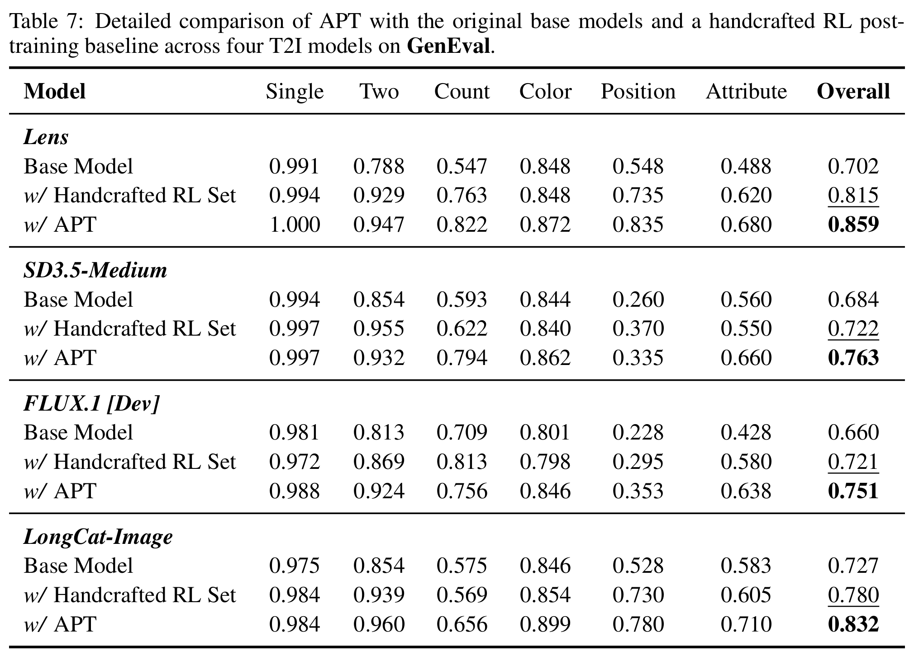

第 15 页。[查看原尺寸](./assets/apt/table07-geneval.png)。例如 FLUX 的 APT 总分更高，但 Count 0.756 低于人工题库的 0.813，说明总分改善不等于每项能力同步改善。

</details>

<details>
<summary>Table 8：OneIG-EN 的对齐、文字、推理、风格与多样性</summary>

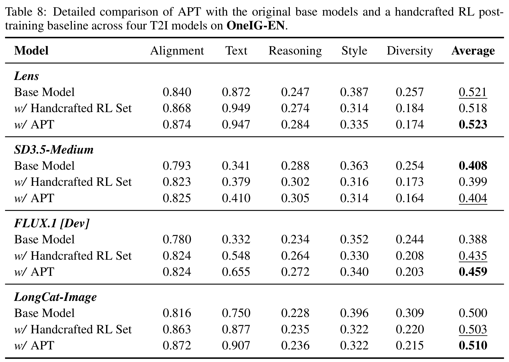

第 16 页。[查看原尺寸](./assets/apt/table08-oneig.png)。应同时看能力改善和 Diversity 下降。

</details>

<details>
<summary>Table 9：DPG 的 Global、Entity、Attribute、Relation、Other</summary>

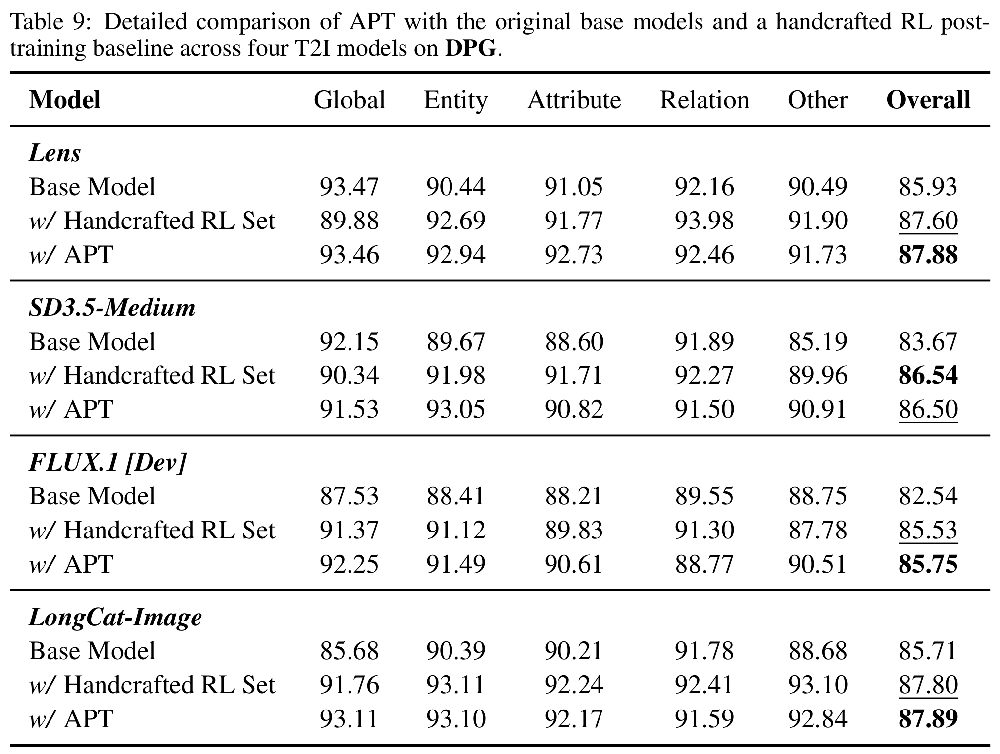

第 16 页。[查看原尺寸](./assets/apt/table09-dpg.png)。

</details>

<details>
<summary>Table 10：CVTG-2K 的文字准确率及其他指标</summary>

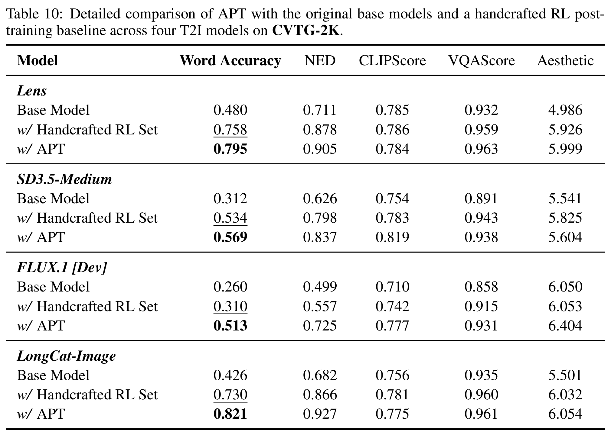

第 17 页。[查看原尺寸](./assets/apt/table10-cvtg.png)。包括 Word Accuracy、NED、CLIPScore、VQAScore 和 Aesthetic；不要只用文字准确率代表全部图像质量。

</details>

### 5.2 数据跨模型迁移：Table 11

<details>
<summary>Table 11：四个目标模型使用不同来源题库的完整细分结果</summary>

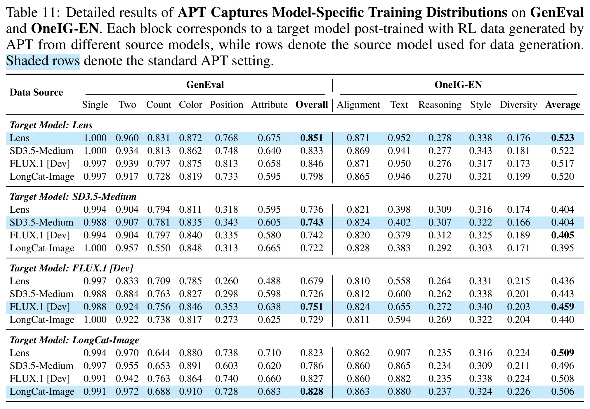

第 17 页。[查看原尺寸](./assets/apt/table11-transfer-details.png)。对应主文 Table 2，所有模型为 200 步设置。

</details>

### 5.3 诊断题库消融：Tables 12–13

<details>
<summary>Table 12：诊断题库消融的 GenEval、OneIG-EN 细分</summary>

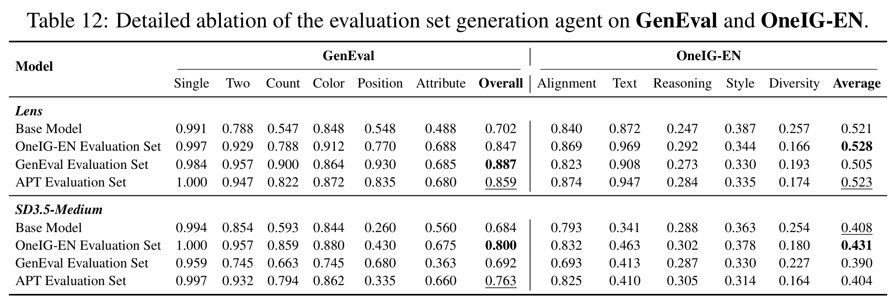

第 18 页。[查看原尺寸](./assets/apt/table12-diagnosis-geneval-oneig.png)。

</details>

<details>
<summary>Table 13：诊断题库消融的 DPG、CVTG-2K 细分</summary>

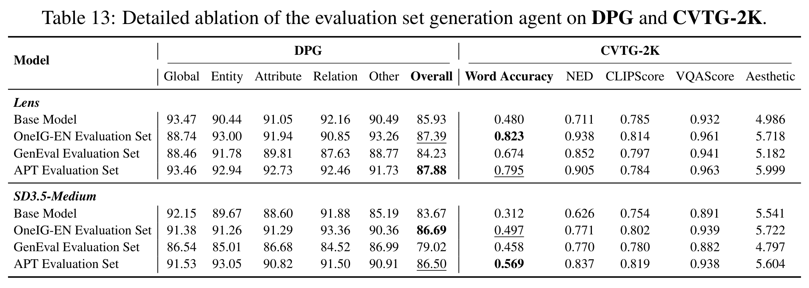

第 18 页。[查看原尺寸](./assets/apt/table13-diagnosis-dpg-cvtg.png)。

</details>

### 5.4 反馈闭环与出题策略消融：Tables 14–15

<details>
<summary>Table 14：闭环与出题策略消融的 GenEval、OneIG-EN 细分</summary>

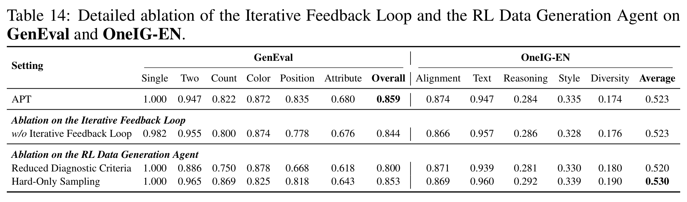

第 18 页。[查看原尺寸](./assets/apt/table14-loop-geneval-oneig.png)。

</details>

<details>
<summary>Table 15：闭环与出题策略消融的 DPG、CVTG-2K 细分</summary>

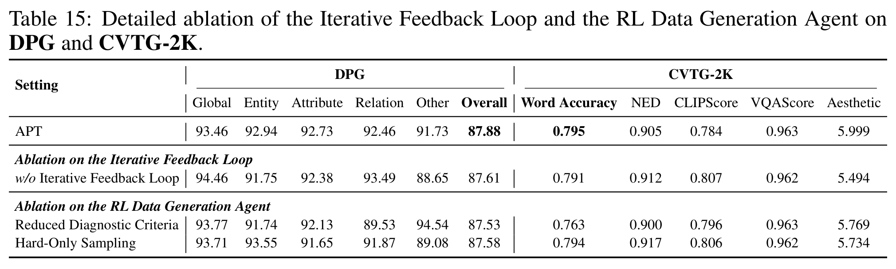

第 18 页。[查看原尺寸](./assets/apt/table15-loop-dpg-cvtg.png)。

</details>

## 6. 读完后应该留下的判断

- **最清楚的贡献**：把“人看失败案例，再安排 RL 数据”变成由模型当前表现驱动的自动流程；不要求每个基础模型重新手工设计题库。
- **最强的实验结论**：四个扩散模型的五基准综合平均均优于人工题库；Janus-Pro 的实验支持跨架构使用这套数据闭环。
- **不应夸大的部分**：单个指标不总是提高；RL 后多样性下降；动态反馈的额外增益比总后训练收益小。
- **仍依赖外部监督**：诊断与训练都依赖固定 VLM 判图。本文没有提供像程序执行那样的独立确定性校验，也没有通过该 LLM-backbone 消融验证奖励器偏差。
- **复现边界**：官方核验版本尚无训练代码，本文提供的模块代码均为伪代码；论文给出了模型和主要训练预算，但不能据此补造未披露的 rollout 参数或声称已复现结果。

**一句话：APT 不是让模型盲目多练，而是让下一轮训练题跟着当前模型的弱点走。**

### 原始来源

- [论文 PDF：2610.18097v1](https://arxiv.org/pdf/2610.18097v1)：方法 §2，实验 §3，补充消融与细分表附录 B–C，Agent 指令附录 E。
- [作者官方仓库](https://github.com/siruizhang30/APT)，[本次核验的固定文件树](https://github.com/siruizhang30/APT/tree/9b04698fbc4697a717bf4ea639cc8721a777ee76)。仓库存在不等于训练实现已发布。
- [作者项目页](https://siruizhang30.github.io/APT-page/)。

图表归原论文作者所有；本笔记的截图仅做裁剪与分辨率转换，未重绘或改动实验数值。所有教学伪代码已与作者源码区分。
